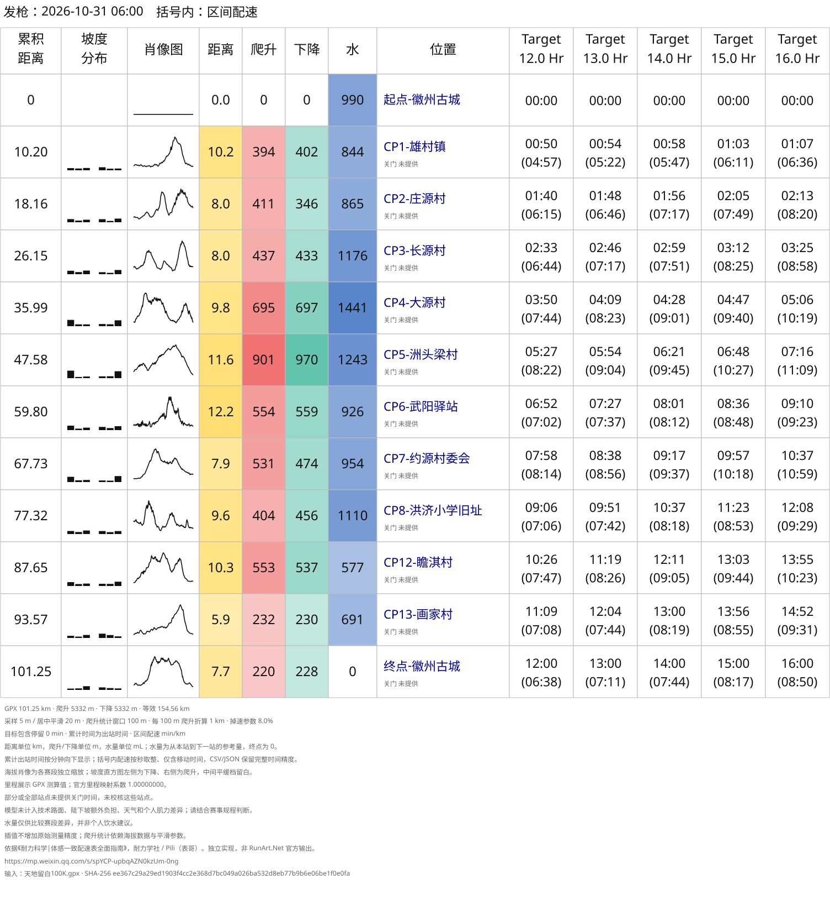

# 耐力学社 Even-Effort Pace Chart Skills

[简体中文](README.md) | [English](README.en.md)

An independent community implementation inspired by 耐力学社's even-effort pacing approach. Turn a GPX or KML race route into a checkpoint-based trail running pace chart and compare multiple finish targets. Invoke `even-effort-pace-chart` through an AI assistant or use the command-line tool directly.

> **Source and copyright notice:** The approach draws on [《耐力科学|体感一致配速表全面指南》](https://mp.weixin.qq.com/s/spYCP-upbqAZN0kzUm-0ng) by 耐力学社 / Pili（表哥）. This project independently implements equivalent-distance and fatigue curves; it is not an official RunArt.Net tool or output. Rights to the article and illustrations remain with their respective rights holders. The [repository archive](docs/reference/) preserves the source and copyright notice; use of third-party material is subject to that notice.

- Prefer checkpoints embedded in the route; supply a manual list only when usable stations are missing.
- Expand one finish target into five schedules, 30 minutes apart by default, or specify an interval or exact target list.
- Show segment distance, ascent, descent, slope distribution, elevation profiles, and reference water for the next leg.
- Include station rests and supplied cutoffs; omit cutoff details from station cells when none are supplied.
- Export SVG with segment pace in parentheses by default; optionally select equivalent pace, arrival clock times, and other export formats.

## Requirements

- **Runtime:** Python 3.10 or newer, using only the standard library. No extra Python packages or online services are required.
- **Quick installation:** The installer below requires Node.js, npm, and Git. Manual copying is also supported.
- **Route:** A local GPX or KML file with coordinates and elevations at every route point.

## Install and use the Skills package

### Quick installation

Run this from the project where you want to use the Skills package:

```bash
npx skills add yihouzenmeban/trail-running-pace --skill even-effort-pace-chart
```

Follow the prompts to select your AI assistant. Installation is scoped to the current project; add `-g` for a user-level installation available across projects:

```bash
npx skills add yihouzenmeban/trail-running-pace --skill even-effort-pace-chart -g
```

For manual installation, copy the entire `skills/even-effort-pace-chart/` directory into your AI assistant's skills directory. The repository examples and reference article are not runtime dependencies.

### First use

Replace `race.gpx` with your own GPX or KML route path and provide your finish target. In an assistant that supports `$name` invocation, use:

```text
$even-effort-pace-chart
Create an even-effort pace chart from race.gpx,
with a 14-hour finish target, 30-minute target intervals, and a 06:00 start. Save it to output/my-race/.
```

You can also name `even-effort-pace-chart` in a natural-language request. The assistant inspects the route and checkpoints before generating a chart. This request defaults to SVG with segment pace in parentheses; providing a start time does not select arrival clock times. Chart labels currently default to Chinese.

## Preview and examples



| Example | Route | Configuration | Pace chart |
| --- | --- | --- | --- |
| Tiandi Liubai 100K | [GPX](examples/tiandi-liubai-100k/天地留白100K.gpx) | [12–16 hour schedules](examples/tiandi-liubai-100k/config.json) | [SVG](examples/tiandi-liubai-100k/pace-chart.svg) |
| Dajingmen DGW100K | [KML](examples/大境门/2026京东大境门古长城越野赛by%20UTMB®DGW100K.kml) | [24-hour central target](examples/大境门/config.json) | [SVG](examples/大境门/pace-chart.svg) |

Both example directories retain the original route, configuration, and all four exports. Their configurations explicitly select every format; these are not the default exports, and the example targets are not individual fitness assessments.

## CLI quick start

Run these commands from the root of a cloned repository. Inspect the sample route and checkpoints, then generate five schedules for 12, 13, 14, 15, and 16 hours using the example configuration:

```bash
python3 skills/even-effort-pace-chart/scripts/pace_chart.py inspect \
  'examples/tiandi-liubai-100k/天地留白100K.gpx'

python3 skills/even-effort-pace-chart/scripts/pace_chart.py generate \
  'examples/tiandi-liubai-100k/天地留白100K.gpx' \
  --config examples/tiandi-liubai-100k/config.json \
  --output-dir output/tiandi-liubai-100k
```

Results go into the Git-ignored `output/` directory. Add `--overwrite` when you intend to replace existing outputs.

See the table above for the KML example. For files with an omitted altitude mode or `clampToGround`, first verify that the coordinate heights are suitable, then explicitly enable `use_kml_altitudes`. Full rules and inspection commands are in the [KML input reference](skills/even-effort-pace-chart/references/configuration.en.md#kml-input).

## Configuration and exports

When using an AI assistant, describe your requirements directly. For the CLI, save the following as `race.json`:

```json
{
  "name": "我的比赛",
  "target": "14:00"
}
```

```bash
python3 skills/even-effort-pace-chart/scripts/pace_chart.py generate \
  race.gpx --config race.json --output-dir output/my-race
```

This minimal configuration produces 13:00, 13:30, 14:00, 14:30, and 15:00 schedules, with a default 06:00 start and SVG export.

| Common parameter | Default | Meaning |
| --- | --- | --- |
| `target` / `targets` | Supply one | Central target or exact list; use `H:MM` or `H:MM:SS`, including durations beyond 24 hours |
| `target_step_minutes` | `30` | Interval in minutes between the five schedules expanded from one target |
| `start_time` | `"06:00"` | Local race start as `HH:MM` or a full date/time |
| `secondary_display` | `"pace"` | Parenthesized segment pace, equivalent pace, or arrival clock time |
| `output_formats` | `["svg"]` | Export format selection; formats can be combined |

The three parenthesized modes are `"pace"`, `"equivalent_pace"`, and `"arrival_time"`. Start time and parenthesized display are independent. Optional parameters follow “current explicit request > selected configuration > script defaults,” without inheriting example choices. See the [configuration reference](skills/even-effort-pace-chart/references/configuration.en.md) for all fields, checkpoints, rests, and cutoffs.

### Export formats

| Format | Filename | Purpose |
| --- | --- | --- |
| SVG (default) | `pace-chart.svg` | Self-contained vector chart for previewing, scaling, and sharing |
| HTML | `pace-chart.html` | Offline browser viewing and landscape printing |
| CSV | `pace-chart.csv` | Process checkpoint and target timing data in spreadsheet software |
| JSON | `pace-chart.json` | Full calculation precision, parameters, provenance, and warnings |

To export all four formats, explicitly add:

```json
{
  "output_formats": ["svg", "html", "csv", "json"]
}
```

## Development and tests

```bash
python3 -m unittest discover -s skills/even-effort-pace-chart/tests -v
```

Tests cover synthetic GPX/KML and both real courses. Real-route tests are skipped when the Skills package is copied without `examples/`. See the [behavior evaluation guide](skills/even-effort-pace-chart/evals/guide.en.md) for natural-language cases, the checker, and manual review steps.

## Model and limitations

Default ascent uses a 10 m peak/valley reversal threshold, separately from the display curve's 5 m sampling and 20 m smoothing. Isolated elevation corrections are reported; horizontal simplification requires an explicit setting. Both inspection and generation summaries include input quality and before/after metrics. The previous 100 m window approach remains selectable; see the [migration configuration](skills/even-effort-pace-chart/references/configuration.en.md#previous-window-method-and-explicit-filtering).

See the [model reference](skills/even-effort-pace-chart/references/model.en.md) for equations, filtering rules, and assumptions. Results depend on source elevations, methods, and thresholds; they may differ from event or other platform statistics. Water values compare relative segment demand and cannot establish individual hydration needs or finish capability.
