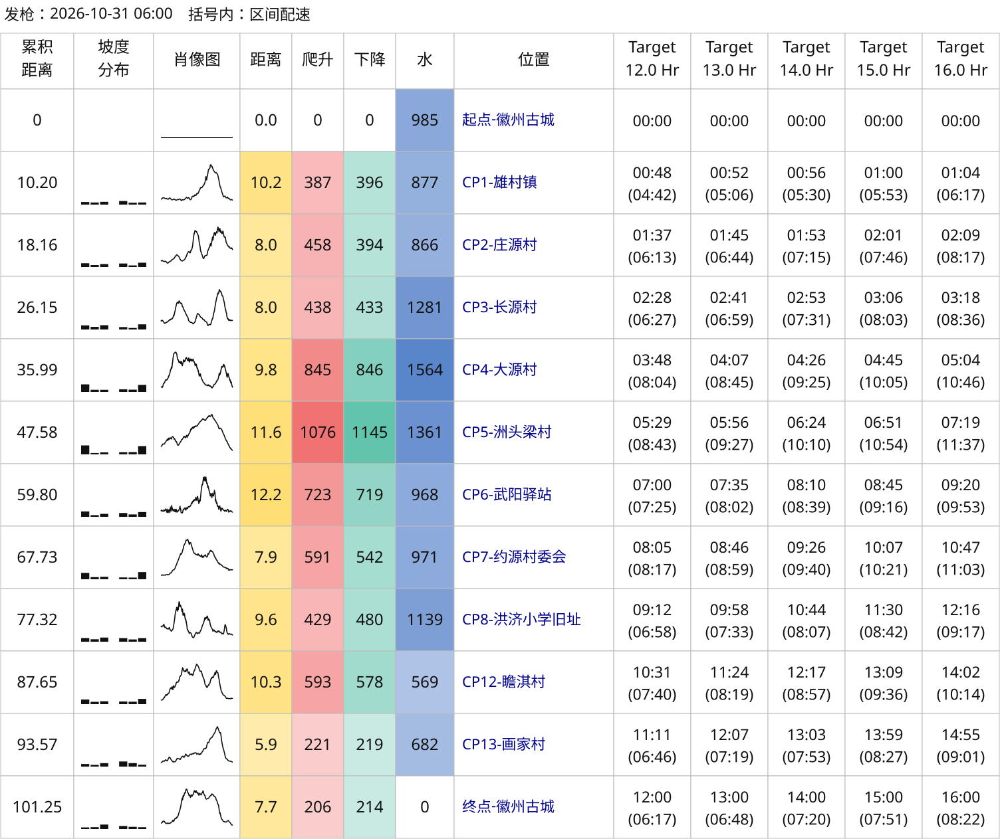
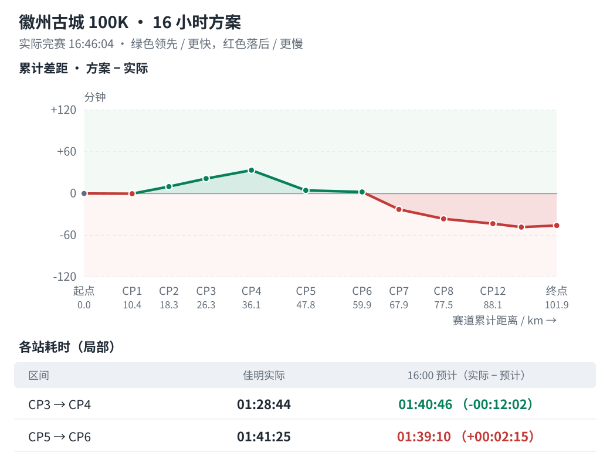

# 耐力学社 Even-Effort Pace Chart Skills

[简体中文](README.md) | [English](README.en.md)

An independent community implementation inspired by 耐力学社's even-effort pacing approach. Before a race, turn GPX, KML, or FIT routes into checkpoint-based plans for multiple finish targets. After a race, compare a FIT activity with those plans to review cumulative differences, segment times, and terrain metrics. Invoke `even-effort-pace-chart` through an AI assistant or use the command line.

The approach draws on [《耐力科学｜体感一致配速表全面指南》](https://mp.weixin.qq.com/s/spYCP-upbqAZN0kzUm-0ng) by 耐力学社 / Pili（表哥）. This project independently implements equivalent-distance and fatigue curves; it is not an official RunArt.Net tool or output. See [sources and copyright](#sources-and-copyright).

## Preview



| Example and notes | Pace charts | Activity comparisons |
| --- | --- | --- |
| [Huizhou Ancient City 100K](examples/huizhou-gucheng-100k/README.en.md): GPX planning and post-race FIT review | [GPX plans](examples/huizhou-gucheng-100k/pace-chart.svg) / [FIT-route plans](examples/huizhou-gucheng-100k/pace-chart-fit.svg) | [On the pre-race GPX](examples/huizhou-gucheng-100k/garmin-comparison.svg) / [On the recorded FIT](examples/huizhou-gucheng-100k/garmin-comparison2.svg) |
| [Dajingmen DGW100K](examples/大境门/DGW100K/README.en.md): reproducible from the public KML | [10–24 hours](examples/大境门/DGW100K/pace-chart.svg) | — |
| [Dajingmen MGW50K](examples/大境门/DGW50K/README.en.md): plans use the public elevation-filled copy; includes official-GPX and recorded-FIT post-race comparisons | [5–12.5 hours](examples/大境门/DGW50K/pace-chart.svg) / [Single 6:15 plan](examples/大境门/DGW50K/pace-chart-6h15m.svg) / [FIT-route plans](examples/大境门/DGW50K/pace-chart-fit.svg) | [Official GPX](examples/大境门/DGW50K/garmin-comparison.svg) / [Recorded FIT](examples/大境门/DGW50K/garmin-comparison2.svg) / [RunArt / repository / Garmin](examples/大境门/DGW50K/runart-comparison.svg) |

Example notes include input provenance, configurations, files needed for reproduction, commands, and metric definitions.

## Installation and first use

Requires **Python 3.10+**. GPX/KML pace charts use only the standard library; FIT inputs and activity comparisons need an [optional dependency](skills/even-effort-pace-chart/references/comparison.en.md#prepare-inputs). Quick installation also requires Node.js, npm, and Git.

Run this from the project where you want to use the Skills package:

```bash
npx skills add yihouzenmeban/trail-running-pace --skill even-effort-pace-chart
```

Follow the prompts to select your AI assistant; add `-g` for a user-level installation. Alternatively, copy the entire `skills/even-effort-pace-chart/` directory into your assistant's skills directory. Runtime use does not depend on repository examples or the archived article.

Provide your route path and finish target. In assistants that support `$name` invocation, use:

```text
$even-effort-pace-chart
Generate an even-effort pace chart from race.gpx with a 14-hour finish target,
writing to output/my-race/.
```

You can also name `even-effort-pace-chart` in a natural-language request. Defaults are five plans, 30 minutes apart, a 06:00 start, SVG-only output, and segment pace in parentheses. Specifying a start time does not change the parenthesized display. Embedded CPs are preferred; supply manual CPs when usable stations are missing. FIT routes require manual CPs. Chart labels are Chinese.

### CLI quick start

Run these commands from the root of a cloned repository. Save this as `race.json`:

```json
{
  "name": "My race",
  "target": "14:00"
}
```

Inspect the public example route, then generate the chart:

```bash
python3 skills/even-effort-pace-chart/scripts/pace_chart.py inspect \
  'examples/huizhou-gucheng-100k/徽州古城100K.gpx'

python3 skills/even-effort-pace-chart/scripts/pace_chart.py generate \
  'examples/huizhou-gucheng-100k/徽州古城100K.gpx' \
  --config race.json --output-dir output/my-race
```

This produces five plans for 13:00, 13:30, 14:00, 14:30, and 15:00 in `output/my-race/pace-chart.svg`. Git ignores `output/`; use `--overwrite` to replace existing results. When using your own route, resolve any route or checkpoint ambiguities reported by inspection first.

## Post-race activity comparisons



This excerpt uses the recorded FIT route and the 16-hour plan. The [full comparison](examples/huizhou-gucheng-100k/garmin-comparison2.svg) includes 15h, 16h, and 17h plans plus segment ascent and descent. The [Dajingmen MGW50K notes](examples/大境门/DGW50K/README.en.md#post-race-activity-comparison) also include both official-GPX and recorded-FIT comparisons, showing how the route input changes the plans.

Give your assistant the race route, pace configuration, and recorded FIT activity:

```text
Use even-effort-pace-chart to compare activity.fit with race.gpx and race.json.
Use exact targets of 15, 16, and 17 hours, include elapsed times between adjacent
checkpoints, and write to output/comparison/.
```

For the CLI, install the FIT dependency, then generate offline:

```bash
python3 -m pip install -r skills/even-effort-pace-chart/scripts/requirements-comparison.txt

python3 skills/even-effort-pace-chart/scripts/compare_activity.py generate race.gpx \
  --config race.json --fit activity.fit \
  --targets 15:00 16:00 17:00 --output-dir output/comparison
```

The default output is `garmin-comparison.svg`. FIT and single-activity FIT ZIP are supported without online credentials. Resolve ambiguous checkpoint matches before generating. See the [activity comparison reference](skills/even-effort-pace-chart/references/comparison.en.md) for reading charts, platform totals, rebuilding routes from FIT, and optional Garmin downloads.

## Documentation

| Topic | Reference |
| --- | --- |
| All parameters, exact targets, manual CPs, rests, cutoffs, and exports | [Configuration and CLI](skills/even-effort-pace-chart/references/configuration.en.md) |
| KML heights, FIT device distance, and checkpoint requirements | [KML input](skills/even-effort-pace-chart/references/configuration.en.md#kml-input) / [FIT route input](skills/even-effort-pace-chart/references/configuration.en.md#fit-route-input) |
| Activity comparisons, delta signs, passage matching, and Garmin retrieval | [Activity comparison](skills/even-effort-pace-chart/references/comparison.en.md) |
| Equivalent distance, fatigue curves, distance, and elevation processing | [Model and limitations](skills/even-effort-pace-chart/references/model.en.md) |
| Why no averaging + 10 m is the default, and how to switch | [Ascent methods and historical experiments](skills/even-effort-pace-chart/references/ascent-options.en.md) |
| AI assistant workflow | [SKILL.md](skills/even-effort-pace-chart/SKILL.md) |

Ascent statistics and display smoothing are independent. Results depend on source elevations and processing parameters and may differ from event or other platform statistics. Water values compare relative segment demand.

## Development and tests

```bash
python3 -m unittest discover -s skills/even-effort-pace-chart/tests -v
```

Tests cover route processing, pacing, and activity comparisons. Real-course tests are skipped when the Skills package is copied without `examples/`. See the [behavior evaluation guide](skills/even-effort-pace-chart/evals/guide.en.md) for natural-language cases and manual review, or the [development article](docs/articles/从配速表到百公里复盘.md) for the project story in Chinese.

## Sources and copyright

The [article and illustration archive](docs/reference/) preserves the original source and copyright notice. Rights remain with their respective holders; use of those materials is subject to the original notice. Race-route and activity-comparison provenance is listed in each example's notes.
