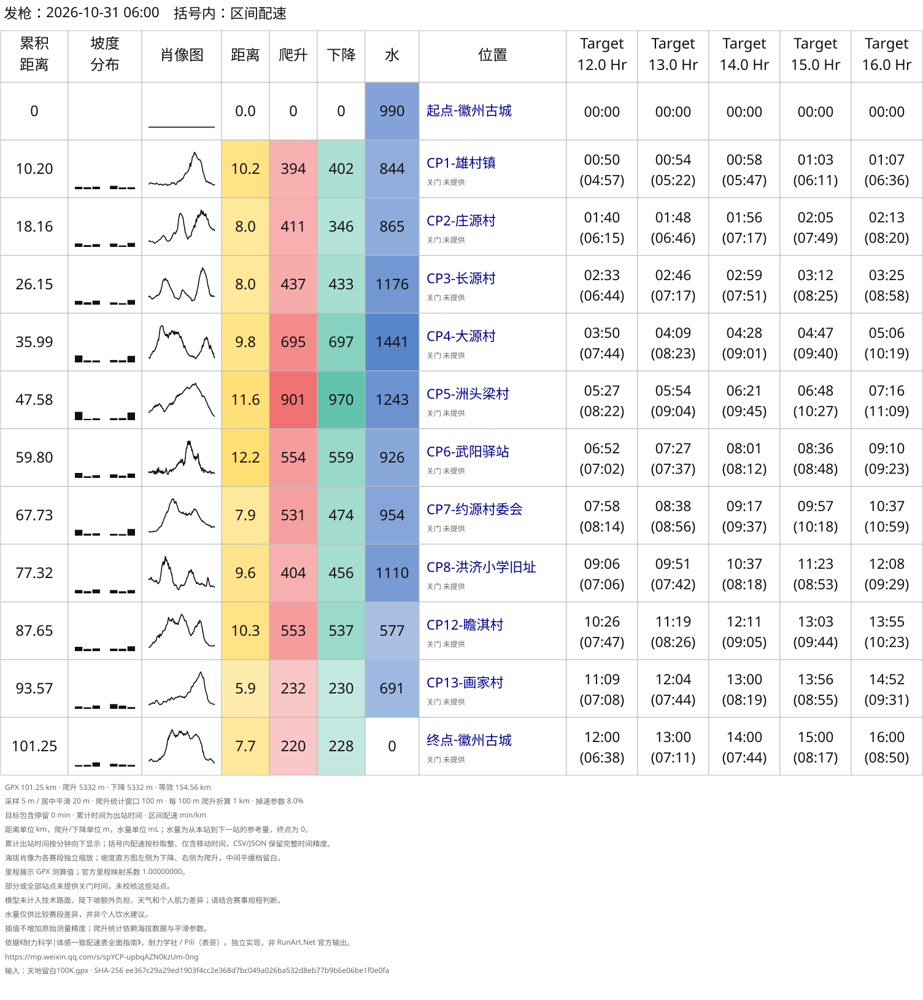

# 耐力学社体感一致配速表 Skills

[简体中文](README.md) | [English](README.en.md)

基于耐力学社体感一致配速思路的社区独立实现。赛前，将 GPX、KML 或 FIT 路线转换成按检查点（CP）分段的多目标配速表；赛后，将 FIT 活动与方案对照，查看累计差距、相邻站耗时和地形差异。可通过 AI 助手调用 `even-effort-pace-chart`，也可直接使用命令行。

思路参考耐力学社 / Pili（表哥）的[《耐力科学｜体感一致配速表全面指南》](https://mp.weixin.qq.com/s/spYCP-upbqAZN0kzUm-0ng)。本项目独立实现等效距离与疲劳曲线，并非 RunArt.Net 官方工具或输出；来源及授权现状见[下方说明](#来源与授权)。

## 效果预览



| 示例与说明 | 配速表 | 活动对比 |
| --- | --- | --- |
| [天地留白 100K](examples/tiandi-liubai-100k/README.md)：公开 GPX 可复现，个人 FIT 结果仅供展示 | [GPX 方案](examples/tiandi-liubai-100k/pace-chart.svg) / [FIT 路线方案](examples/tiandi-liubai-100k/pace-chart-fit.svg) | [按赛前 GPX](examples/tiandi-liubai-100k/garmin-comparison.svg) / [按实际 FIT](examples/tiandi-liubai-100k/garmin-comparison2.svg) |
| [大境门 DGW100K](examples/大境门/DGW100K/README.md)：公开 KML 可复现 | [10–24 小时](examples/大境门/DGW100K/pace-chart.svg) | — |
| [大境门 MGW50K](examples/大境门/DGW50K/README.md)：使用公开的海拔补全副本生成配速表，三方对比为历史参考图 | [5–12.5 小时](examples/大境门/DGW50K/pace-chart.svg) / [6:15 单列](examples/大境门/DGW50K/pace-chart-6h15m.svg) | [耐力学社 / 仓库 / 佳明](examples/大境门/DGW50K/runart-comparison.svg) |

各示例说明包含输入来源、配置、复现命令和结果口径。示例目标不是个人能力评估。

## 安装与首次使用

需要 **Python 3.10+**。GPX/KML 配速表仅使用标准库；FIT 输入和活动对比需要[可选依赖](skills/even-effort-pace-chart/references/comparison.md#准备输入)。快捷安装还需要 Node.js、npm 和 Git。

在需要使用 Skills 的项目目录执行：

```bash
npx skills add yihouzenmeban/trail-running-pace --skill even-effort-pace-chart
```

按提示选择 AI 助手；添加 `-g` 可安装到用户级技能目录。也可将 `skills/even-effort-pace-chart/` 整个目录复制到助手的技能目录，运行时不依赖仓库示例或参考文章。

向助手提供轨迹路径和目标时间。在支持 `$名称` 调用的助手中，可以使用：

```text
$even-effort-pace-chart
用 race.gpx 生成体感一致配速表，目标完赛时间 14 小时，输出到 output/my-race/。
```

也可在自然语言请求中指定使用 `even-effort-pace-chart`。默认展开五组方案，相邻间隔 30 分钟；06:00 出发，仅输出 SVG，括号内显示区间配速。指定出发时间不会切换括号内容。优先读取轨迹内 CP，缺少可用站点时再补充人工 CP；FIT 路线使用人工 CP。图表标签为中文。

### 命令行快速开始

以下命令在克隆后的仓库根目录执行。将下面内容保存为 `race.json`：

```json
{
  "name": "我的比赛",
  "target": "14:00"
}
```

先检查公开示例轨迹，再生成配速表：

```bash
python3 skills/even-effort-pace-chart/scripts/pace_chart.py inspect \
  'examples/tiandi-liubai-100k/天地留白100K.gpx'

python3 skills/even-effort-pace-chart/scripts/pace_chart.py generate \
  'examples/tiandi-liubai-100k/天地留白100K.gpx' \
  --config race.json --output-dir output/my-race
```

生成 13:00、13:30、14:00、14:30、15:00 五组方案，结果为 `output/my-race/pace-chart.svg`。`output/` 已被 Git 忽略；替换已有结果时使用 `--overwrite`。换用自己的轨迹后，请先处理检查结果中的路线与 CP 歧义。

## 赛后活动对比

向助手提供比赛轨迹、配速配置和活动 FIT，例如：

```text
用 even-effort-pace-chart 将 activity.fit 与 race.gpx、race.json 对比，
参照目标为 15、16、17 小时，包含每两个站之间的耗时，输出到 output/comparison/。
```

命令行用户先安装 FIT 依赖，再离线生成：

```bash
python3 -m pip install -r skills/even-effort-pace-chart/scripts/requirements-comparison.txt

python3 skills/even-effort-pace-chart/scripts/compare_activity.py generate race.gpx \
  --config race.json --fit activity.fit \
  --targets 15:00 16:00 17:00 --output-dir output/comparison
```

默认输出 `garmin-comparison.svg`，支持 FIT 或单活动 FIT ZIP，无需在线凭据。CP 匹配有歧义时需先核对。读图、平台汇总、按实际 FIT 重算路线及可选佳明下载，见[活动对比文档](skills/even-effort-pace-chart/references/comparison.md)。

## 文档导航

| 需要了解什么 | 文档 |
| --- | --- |
| 完整参数、目标列表、人工 CP、停留、关门和导出格式 | [配置与命令行](skills/even-effort-pace-chart/references/configuration.md) |
| KML 高度、FIT 设备距离与 CP 要求 | [KML 输入](skills/even-effort-pace-chart/references/configuration.md#kml-输入) / [FIT 路线输入](skills/even-effort-pace-chart/references/configuration.md#fit-作为路线输入) |
| 活动对比、差值方向、CP 匹配和佳明读取 | [活动对比](skills/even-effort-pace-chart/references/comparison.md) |
| 等效距离、疲劳曲线、距离与海拔处理 | [模型与限制](skills/even-effort-pace-chart/references/model.md) |
| 为什么默认不平滑＋10 米阈值，如何切换 | [爬升方案与历史实验](skills/even-effort-pace-chart/references/ascent-options.md) |
| AI 助手的执行流程 | [SKILL.md](skills/even-effort-pace-chart/SKILL.md) |

参数遵循“当前明确要求 > 指定使用的配置 > 脚本默认值”，不从示例继承。爬升统计和图示平滑各自独立；结果依赖输入海拔与处理参数，不能保证复现赛事或其他平台统计。参考水量仅用于比较赛段需求。

## 开发与测试

```bash
python3 -m unittest discover -s skills/even-effort-pace-chart/tests -v
```

测试覆盖路线处理、配速和活动对比。独立复制 Skills、未携带 `examples/` 时，真实赛道测试会跳过。自然语言用例及人工复核步骤见[行为评测指南](skills/even-effort-pace-chart/evals/guide.md)；开发经历见[投稿文章](docs/articles/从配速表到百公里复盘.md)。

## 来源与授权

本项目代码与项目自有文档尚未指定项目许可证，仓库当前没有 `LICENSE` 文件。

[参考文章及配图归档](docs/reference/)保留原文来源与版权声明，权利归原权利人所有，使用条件以原文声明为准。第三方资料的声明与项目自身的授权状态分别列示，不互相替代。比赛轨迹与活动对比的来源见各示例说明；个人原始 FIT 不随仓库公开。
