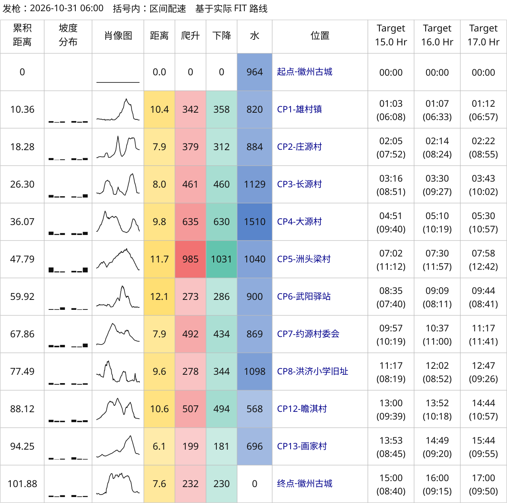

# 从做一张跑表，到跑完徽州古城百公里

准备徽州古城百公里的时候，我想给自己做一张配速表。跑完以后，又拿它和佳明的活动记录对照了一遍。

前后折腾下来，工具倒是做出来了，还发现了一个挺大的偏差：CP5 到 CP6 这段，按赛前 GPX 算，我比 16 小时方案快了十九分钟；换成自己跑过的轨迹重算，却比预计慢了两分多钟。

这段路实际用了多久，两次都一样。只是换了轨迹，分给这段的参考时间就差了二十多分钟。

## 先做一张自己能用的跑表

我参考的是耐力学社 / Pili（表哥）的《耐力科学｜体感一致配速表全面指南》。它把距离、爬升和长距离中的掉速放在一起，给出不同完赛目标下，各站应该用多少时间。

我想照着这个思路做一个工具：给一份比赛轨迹和目标时间，就能生成跑表。于是先把文章存成 PDF，整理成 Markdown，留作参考，再让 Codex 帮我实现。

第一版和我想要的样子差得挺远。后来我拿着参考图一项项改：左边是赛道数据、坡度分布和海拔小图，右边放几组完赛目标。CP 尽量从轨迹里读，原来的名字和编号保留。

我自己的习惯是早上六点出发，括号里看本段配速。这么简单的要求也改过几次。有一次，我只是在生成请求里加了“早上六点出发”，AI 给出的配置就把括号内容换成了到达时间。后来我专门把这些默认值写清楚，也加了检查，免得每次生成都要重新纠正。

文件最后选了 SVG，放大后字和线都清楚。有的比赛提供 KML，也加上了支持。目标时间既可以指定一个，让程序往前、往后各展开两档，也可以自己列一组。

*基于 GPX 生成的徽州古城百公里配速表。*

这份代码是我参考公开思路做的独立实现，没有复现 RunArt.Net 的完整算法，生成的表也不是耐力学社的官方跑表。

## 爬升怎么差了六百多米

表格有了，爬升却一直让我不放心。

徽州古城同一份 GPX，旧版算法算出来大约 5332 米，换成“不平滑＋10 米阈值”，就成了 5965 米。我用高驰导入时，看到的是 5300 米左右。

我先后试了好几种平滑窗口。所谓 40 米平滑，就是看当前位置前后各 20 米的海拔，按距离取平均。窗口大一些，细碎起伏会少，但短坡也可能被压掉。

不平滑则保留原始海拔点，再加一道 10 米的峰谷反转阈值。比如正在爬升，后面连续下降累计达到 10 米，才确认转成下降。这个 10 米看的是累计变化。

到底选哪个，我一度也拿不准。只看徽州古城，平滑后确实更接近高驰；但别的轨迹会怎么样？

于是我把最近二十次越野跑活动拿出来，旧版、不平滑，以及 40 米、20 米、10 米平滑，分别算了一遍，再和佳明显示的爬升比较。

| 处理方案 | 与佳明爬升的平均绝对差异 |
| --- | ---: |
| 旧版 100 米窗口 | 110.5 米 |
| 不平滑＋10 米阈值 | 71.4 米 |
| 40 米平滑＋10 米阈值 | 105.9 米 |
| 20 米平滑＋10 米阈值 | 88.6 米 |
| 10 米平滑＋10 米阈值 | 79.1 米 |

结果是不平滑＋10 米阈值最接近这批活动的佳明显示值。我最后选了它作为默认方案，其他窗口留下来，想比较时可以切换。佳明的数字也不等于真实地形，所以这只能算我选参数的一份参考。

徽州古城的 5965 米先留着，等有更多数据再看。

这期间还碰到过缺海拔的问题。大境门 50K 的 GPX 有 59 个点没海拔，我保留了原文件，另外做了一份补全副本，用已知端点之间的距离插值。那几段只能先这样接起来，原本有什么小坡，已经没法从缺失的数据里还原了。

## 配速模型也改过，后来又改回去了

地形数据处理完，才轮到各段该分多少时间。

目前采用的基准是每爬升 100 米，增加 1 个等效公里。比如 8 公里、爬升 500 米，折算下来就是 13 个等效公里，再用疲劳曲线分配时间。

做的过程中，我也试过调整疲劳曲线，加上路面修正，再拿大境门的路线和参考跑表比较。看完新旧结果，我还是觉得旧版更符合自己的预期，就把那轮调整撤回了。新加的修正有没有用，需要更多实际数据，现在还说不准。

这套计算没有单独算出技术路面和陡下坡的额外负担，也不知道我当天的状态。对我来说，先用它了解赛段、安排时间就够了。

图表反而改了不少轮。拿大境门 50K 做对照时，我把耐力学社截图里的数据、自己的方案、佳明实际活动放到一起，重复的内容删掉，差值尽量挨着原数值放。

后来做分站耗时，CP 一多，横着排就很难看，我又把站点改成一行一站。实际和预计并排，每个预计时间后面直接跟差额：实际慢了标红，快了或持平标绿。

我还让 AI 去参考 ECharts 的布局和配色。前几次颜色和曲线都不太好认，反复调整后，才有了现在的样子。累计差距和本段差距都保留，因为我想同时知道“到这里还领先多少”和“刚才这一段跑得怎么样”。

## 跑完以后，重点看了两段路

2026 年 10 月 31 日，徽州古城百公里跑完。佳明记录是 101.877 公里，爬升 5019 米、下降 5023 米，经过时间 16 小时 46 分 04 秒，包含停留。

我选了 15、16、17 小时三组方案，拿实际记录逐站比较。相对 16 小时方案，全程慢了 46 分 04 秒，具体慢在哪些段，要把相邻两个 CP 的时间相减才看得出来。

用到的是佳明原始 FIT 文件，里面有位置、时间、距离和海拔。把记录对齐到各个 CP，就能估算经过时间。站点附近有停留、多次经过的地方，需要另外核对，这些时间和官方打卡也可能有出入。

看地形对比时，CP4、CP6 又把我的注意力拉回了爬升：原 GPX 算出来的升降，和实际活动差得太多了。

我把这两段单独拿出来，用实际 FIT 的海拔，也按同一套“不平滑＋10 米阈值”算法算了一遍。

| 区间 | 原 GPX 重算 | 实际 FIT 海拔重算 | 佳明活动统计估算 |
| --- | ---: | ---: | ---: |
| CP3→CP4 | 844.8 / 846.3 | 635.2 / 630.4 | 641.3 / 638.4 |
| CP5→CP6 | 722.6 / 718.7 | 273.0 / 286.0 | 311.1 / 325.1 |

*每格依次为本段爬升 / 下降，单位为米。佳明中间 CP 的数值由逐圈累计数据按距离插值，再相邻作差得到。*

CP5 到 CP6 尤其明显。原 GPX 算出约 723 米爬升，换成实际 FIT 海拔，只有约 273 米。

按位置对照后，能看到原 GPX 某些地方的海拔反复上下跳，FIT 对应位置的波动小得多。这些起伏横跨多个点，超过 10 米阈值，就会被计入爬升。只针对孤立尖峰的过滤，也去不掉这类波动。

当时一直觉得可疑的 5965 米，到这里才有了些线索。

## CP5 到 CP6，重新算一次

既然有了实际跑过的记录，我就用 FIT 重新生成了一份 15、16、17 小时方案，原来的 GPX 版本也保留。

距离直接用设备记录的 101.877 公里。如果把同一批 GPS 坐标重新连线累加，会算出约 103.626 公里，多出约 1.75 公里。这次复盘我就沿用设备距离，各个 CP 也对应到这条距离轴上。

海拔用 FIT 里的记录重新计算，全程得到约 4783 米爬升、4760 米下降。和佳明显示的 5019 / 5023 米还有差距，这部分原样留在图里，没有按比例调整。

重新分配时间后，再看 CP5 到 CP6：

| 16 小时参照方案 | 本段预计耗时 | 我的实际表现 |
| --- | ---: | --- |
| 原 GPX 路线 | 2:00:45 | 快了 19:20 |
| 实际 FIT 路线 | 1:39:10 | 慢了 2:15 |

我实际用的是 **1 小时 41 分 25 秒**，两次比较没有变化。

按原 GPX 算，这段爬升多，分到的时间也多。换成实际记录重算后，预计用时少了二十多分钟，原来那段看起来跑得很快的路，就变成了比预计稍慢。

*赛后按实际 FIT 路线重算的 15、16、17 小时方案。*

*赛后对照图：上方是累计差距和区间快慢，中间逐站列耗时，下方比较分段爬升下降，可放大查看。*

当然，某段用时长，还要结合当时的路况、补给、停留和身体情况去看。这张图能列出差了多少，原因还是得自己回想。

## 代码和图都放出来了

从最初做一张表，到现在能拿实际活动来复盘，代码主要是让 Codex 帮我写和改的。我花了不少时间看生成结果，觉得不对就继续问，有些改动试完又撤回。

现在已经整理成 AI 助手可以调用的 skills，支持 GPX、KML，也支持用 FIT 当路线。给出轨迹、CP 和目标时间，可以生成配速表；跑完后再提供活动记录，就能做分站对照。常用设置、示例和中英文说明都放在仓库里了。

徽州古城的两版图我都留着。一版按赛前 GPX 算，一版按实际 FIT 算，放在一起看，能清楚看到参考方案变了多少。个人原始 FIT 没有上传。

有兴趣的跑友可以拿自己的轨迹试试。如果发现某个赛段的数据不对，也欢迎把问题提到仓库里。

---

**项目与资料**

- 开源项目：[trail-running-pace](https://github.com/yihouzenmeban/trail-running-pace)。
- 思路来源：[耐力学社 / Pili（表哥）《耐力科学｜体感一致配速表全面指南》](https://mp.weixin.qq.com/s/spYCP-upbqAZN0kzUm-0ng)。
- 仓库内的[爬升方案对比](../../skills/even-effort-pace-chart/references/ascent-options.md)、[模型说明](../../skills/even-effort-pace-chart/references/model.md)和[活动对比说明](../../skills/even-effort-pace-chart/references/comparison.md)。
