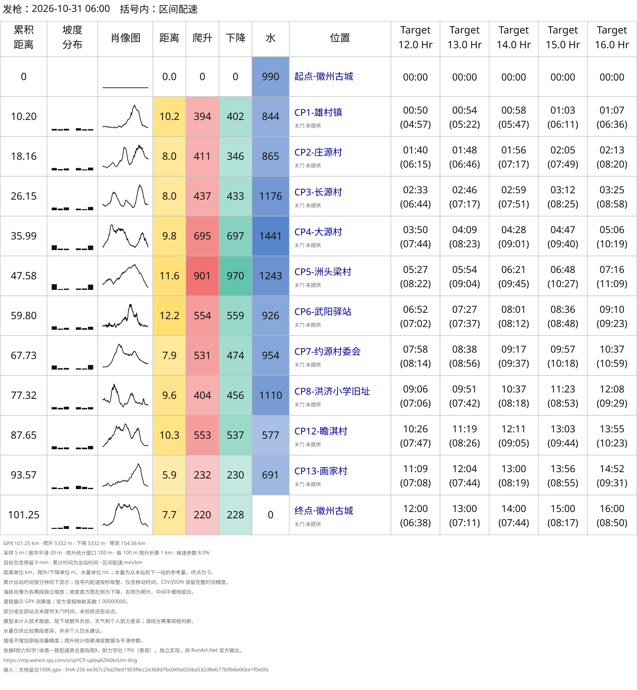
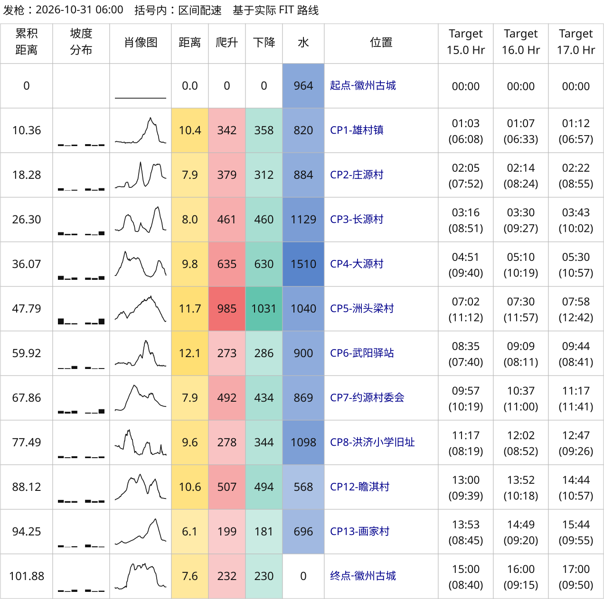
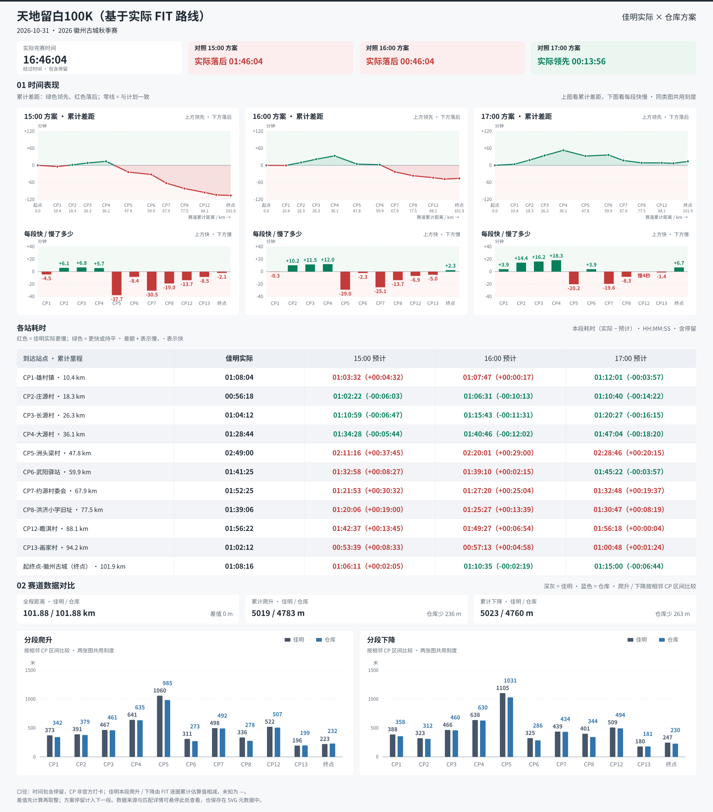

# 我和 AI 做了一张越野配速表，直到真正跑完百公里

同一段路，第一张表告诉我：比预计快了 19 分 20 秒。

换了一份轨迹，重新计算，结果却变成：比预计慢了 2 分 15 秒。

我的实际用时没有变，配速模型也没有变。变化来自输入：我把赛前使用的 GPX，换成了自己跑完后记录的 FIT，再计算各段难度和时间分配。

这件事发生在天地留白百公里之后。它让我重新审视了这段时间和 AI 一起做的越野跑配速工具，也让我意识到：一张看起来精确到秒的表，值得追问的地方，往往藏在最基础的数据里。

## 我最初只想给自己做一张跑表

起点是耐力学社 / Pili（表哥）的《耐力科学｜体感一致配速表全面指南》。

文章把距离、爬升和长距离中的掉速放到一起考虑，给出不同完赛目标下的分站时间。我很喜欢这种方式：面对一条陌生赛道，可以先知道每段大概有多长、爬多少、地形是什么样，再看自己应该用多少时间通过。

我想试着把它做成一个自己能反复使用的小工具。

最开始，我先把原文保存为 PDF，再整理成 Markdown，留在仓库里作为对照资料。接着，才把自己的需求一步步变成代码。

最初的需求很简单：给一份 GPX，读取里面的 CP 点，输入目标完赛时间，生成一张类似风格的配速表。

我用 Codex 开始实现。后来，需求随着实际使用不断增加：有的比赛给 KML，要能读；有时需要精确指定一组目标，有时只想给一个中心目标，让程序自动展开；括号里有人想看配速，有人想看等强配速，也有人想看到达钟点。

我给自己的默认选择是：早上六点出发，只生成 SVG，括号内显示本段配速。SVG 放大后仍然清楚，方便保存、分享和检查。

这里需要先交代来源：这个项目是参考耐力学社公开思路的社区独立实现。等效距离、疲劳曲线和轨迹处理由项目自行实现，结果不是 RunArt.Net 的官方输出，也不意味着复现了它的完整算法。



*图 1：最初基于 GPX 生成的天地留白百公里配速表，包含多组完赛目标。表中的水量是赛段需求的比较指标，不是个人饮水处方。*

## 先把距离和爬升算明白

生成表格之后，最先让我停下来的，是累计爬升。

天地留白这条 GPX，在不同处理方案下，算出来的结果能差几百米。同一份文件，旧版算法大约是 5332 米，不做窗口平滑、使用 10 米峰谷反转阈值时，大约是 5965 米。而我此前用高驰导入这条轨迹，看到的是 5300 米左右。

很容易产生一个念头：那就把参数调到接近 5300 米。

但这样做，解释不了为什么要选这个参数，也解释不了换一条赛道后还能不能用。

我于是把问题拆开：距离怎么累计，重复点怎么处理，缺失海拔怎么办，哪些尖峰可以修正，哪些连续起伏应该保留。大境门 50K 的原始 GPX 就有 59 个点缺海拔，我保留原文件，用已知端点之间的距离做线性插值，另存一份补全副本，并记录了缺失范围。插值只能把曲线接起来，补不回那段路真正的地形。

海拔平滑也是一样。所谓“40 米平滑”，可以粗略理解成：看当前位置前后各 20 米范围内的海拔，按距离做平均。它有助于减弱细碎波动，也可能把真实的短坡压低。

“不平滑＋10 米阈值”则是另一种取舍：保留原始海拔顶点，追踪爬升和下降；反向变化累计达到 10 米，才确认一次峰谷转向。

这里的 10 米，指累计的反向变化，并不是要求相邻两个点之间必须升降 10 米。

为了避免只围着天地留白这一个文件调参数，我拿最近二十次越野跑活动，把几种方案都算了一遍，与佳明显示值比较。

| 处理方案 | 累计爬升的平均绝对差异 |
| --- | ---: |
| 旧版 100 米窗口 | 110.5 米 |
| 不平滑＋10 米阈值 | 71.4 米 |
| 40 米平滑＋10 米阈值 | 105.9 米 |
| 20 米平滑＋10 米阈值 | 88.6 米 |
| 10 米平滑＋10 米阈值 | 79.1 米 |

*这组比较使用同一批活动的原始 FIT 坐标与海拔；“差异”是相对佳明显示值的差异，不是相对实测地形的误差。*

在这批个人样本里，不平滑＋10 米阈值整体最接近佳明，同时避免额外的窗口平均削弱短坡。我最终把它选为默认方案，把其他窗口保留为可选项。

天地留白算出 5965 米的疑问还在，但我暂时没有为了让它接近手表的一个数字，修改所有路线的默认算法。

这次取舍也让我把“画图”和“统计”分开了：展示用的海拔小图可以独立平滑，让人看清走势；累计爬升不必跟着展示曲线一起变。

## 模型越复杂，越需要证据

地形数据之后，是配速分配。

目前项目采用的等效距离基准，可以简单写成：

```text
等效公里数 = 路线公里数 + 爬升米数 ÷ 100
```

例如，8 公里、爬升 500 米的一段，按这个基准折算为 13 个等效公里。然后，再用疲劳曲线分配不同目标下的时间。

这个模型便于理解和复算，也有明确的缺项：下降没有直接抵扣等效距离，技术路面和陡下坡的额外负担没有被完整表达；天气、补给、拥堵和个人状态也不能从轨迹里自动读出来。

开发过程中，我尝试过修改疲劳曲线、增加路面修正，再用大境门的轨迹和配速表做比较。最后，我撤回了那轮调整，恢复此前的方案。

原因很朴素：对当时的用途，我更愿意保留一个自己能理解、能检查的基准。增加参数之后，还需要相应的数据去判断它们是否改善了结果。

所以，“体感一致”在这个项目里，是组织配速计划的思路。它不能保证每一段的真实体感相同，更不能单凭一份轨迹判断某个完赛目标是否适合我。

## 我也花了很多时间，让表格真正好读

算法之外，图表被我来回改了很多次。

一开始，我只是要求它接近参考跑表的样子：有分段距离、爬升下降、坡度分布、海拔肖像和多个目标。后来加入实际活动对比，问题又变成了：信息这么多，应该先看什么？

我拿大境门 50K 做对照，把耐力学社截图中的数据、仓库生成的方案和自己的佳明活动放到一起，逐步删掉重复信息。天地留白赛后没有对应的耐力学社数据，就只保留自己的方案与实际活动。

时间曲线和配色也反复调整过。我让 AI 参考 ECharts 的图表设计，借用它清楚的坐标、零线和图例组织方式，最终仍由 Python 直接输出独立 SVG。

几轮修改之后，我逐渐明确了自己最需要的读数方式：

- CP 多，就按行向下排列，方便逐站查看。
- 实际用时和预计用时放在一起，并直接显示差额。
- 实际比预计慢，用红色；更快或持平，用绿色。
- 累计差距看整场走势，本段差距看上一站到这一站。
- 分段爬升和下降用并列柱图，直观看出差异集中在哪里。

我尤其在意“累计”和“本段”的区分。到某一站时仍然领先，不代表刚刚那一段跑得快；前面攒下的时间，可能正在后面一点点消耗。

最后，模型、参数、默认值和示例也一起整理进了仓库，补上中英文文档，打包成可以通过 AI 助手调用的 skills。这样，下次换一条轨迹，就能沿用同一套检查和生成流程。

## 跑完百公里，才有机会检验那份计划

2026 年 10 月 31 日，我跑完了天地留白百公里。

佳明记录的全程距离是 101.877 公里，累计爬升 5019 米、下降 5023 米，经过时间为 16 小时 46 分 04 秒，包含途中停留。

我把 15、16、17 小时作为三组参照，开始做赛后分析。

单看终点，相对 16 小时方案，我慢了 46 分 04 秒；相对 17 小时方案，我提前了 13 分 56 秒。但终点只能概括全程，不能告诉我时间具体花在哪里。

于是，我把实际 FIT 中的经过时间与原路线的 CP 对齐，再计算相邻两个站之间的耗时。站点附近可能有停留或多次经过，存在歧义的地方需要核对，不能静默选一个最近的位置。这些经过时刻用于复盘，不等同于赛事官方打卡。

在这个过程中，之前搁置的疑问又出现了：为什么 CP4、CP6 的爬升下降，与实际活动差那么多？

我开始重点检查 CP3→CP4 和 CP5→CP6。

| 区间 | 原 GPX 重算 | 实际 FIT 海拔重算 | 佳明活动统计估算 |
| --- | ---: | ---: | ---: |
| CP3→CP4 | 844.8 / 846.3 | 635.2 / 630.4 | 641.3 / 638.4 |
| CP5→CP6 | 722.6 / 718.7 | 273.0 / 286.0 | 311.1 / 325.1 |

*表中每格依次为本段爬升 / 下降，单位为米。前两列沿用同一套“不平滑＋10 米阈值”算法；佳明中间 CP 的指标由逐圈累计数据按距离插值，再相邻作差得到。*

差异相当集中。尤其是 CP5→CP6，同样的算法，原 GPX 算出约 723 米爬升，我的 FIT 海拔算出约 273 米。

进一步按位置对照，原 GPX 的部分海拔存在连续的上下波动，实际 FIT 在对应位置的波动小得多。这些变化横跨多个点，幅度又足以超过 10 米阈值，因此会被算进累计爬升；仅过滤孤立大尖峰，处理不了这种情况。

这给了我一个更具体的解释：在这些区间，输入海拔的差异，足以显著改变计算结果。

FIT 和手表统计仍然不是实测地形真值，但这次对照提供了新的证据，让我能把数据源的问题与算法的选择分开讨论。

## 换成实际路线后，一段“跑快了”的路变成了“略慢”

接下来，我决定用自己的 FIT 作为这次赛后复盘的路线，再生成 15、16、17 小时方案。

这里还有一个细节：要保留 FIT 里设备记录的距离。如果把同一批 GPS 坐标重新连线累计，会得到约 103.626 公里，比设备记录的 101.877 公里多出约 1.75 公里。

这次我选择沿用 FIT 记录距离，使用逐点海拔重新计算爬升下降，保留此前核对过的 CP 经过时刻。配速模型和目标时间保持一致。

重算后的全程爬升约 4783 米、下降约 4760 米，与佳明显示的 5019 / 5023 米仍有差异。我保留了这份差异，没有把结果按比例拉到平台总量。

更值得注意的是，地形改变之后，各段分到的时间也改变了。

拿 CP5→CP6 和 16 小时方案比较：

- 我的实际本段耗时为 **1 小时 41 分 25 秒**。
- 原 GPX 方案预计 **2 小时 00 分 45 秒**，看起来我快了 **19 分 20 秒**。
- FIT 路线方案预计 **1 小时 39 分 10 秒**，结果变成我慢了 **2 分 15 秒**。

这就是文章开头那次翻转。

原 GPX 给这段分配了更多时间。换成实际记录的路线后，这一段的地形权重降低，全程时间重新分配，评价也随之变化。

如果只看原图，我很容易把“快了十九分钟”理解成这一段执行得好。现在再看，我会先问：这段参考时间，是依据什么地形数据算出来的？



*图 2：赛后用实际 FIT 路线重算的 15、16、17 小时参考方案。它用于复盘，不是比赛前已经掌握的信息。*



*图 3：基于 FIT 路线方案的赛后对照。上方看累计差距与区间快慢，中间逐站看实际、预计耗时及差额，下方比较分段爬升下降。图中文字可放大查看。*

这些图仍然解释不了所有事情。某一段慢了，可能涉及路况、补给、停留或者身体状态；只靠轨迹和耗时，无法确认原因。但它至少帮我把问题定位到了具体区间，也提醒我先检查参照方案本身。

## 我把这段过程留在了开源项目里

回头看，最初想做的只是“一份轨迹生成一张表”。后来做得最多的工作，是比较输入、核对统计、调整展示，再把每次选择的依据留下来。

AI 帮我完成了大量实现和反复修改。我仍然需要检查默认值是否符合自己的需求，追问异常数据，决定哪些调整保留、哪些撤回。

现在这个工具可以读取 GPX、KML，也可以用实际 FIT 路线重新生成方案；既能做赛前跑表，也能拿实际活动做分站和分段复盘。原 GPX 版本与 FIT 版本的对比图都保留下来了，方便回头检查这次判断是怎样变化的。

我希望它能成为一个跑者愿意打开、看得明白，也能提出疑问的工具。

下一场比赛前，我还会做配速表；跑完之后，也还会把它重新打开。尤其当某一段显示“跑得很好”或“明显失速”时，我会多看一眼：这里比较的，到底是哪一份路线、哪一种统计口径，以及哪一组假设。

---

**项目与资料**

- 开源项目：[trail-running-pace](https://github.com/yihouzenmeban/trail-running-pace)。
- 思路来源：[耐力学社 / Pili（表哥）《耐力科学｜体感一致配速表全面指南》](https://mp.weixin.qq.com/s/spYCP-upbqAZN0kzUm-0ng)。
- 仓库内的[爬升方案对比](../../skills/even-effort-pace-chart/references/ascent-options.md)、[模型说明](../../skills/even-effort-pace-chart/references/model.md)和[活动对比说明](../../skills/even-effort-pace-chart/references/comparison.md)。

本文记录个人工具开发与比赛数据复盘。公开图表使用估算的 CP 经过时间，包含停留；原始个人 FIT 和访问凭据不随仓库公开。文章及配图的权利归各自权利人，本项目不代表耐力学社或 RunArt.Net 官方。
