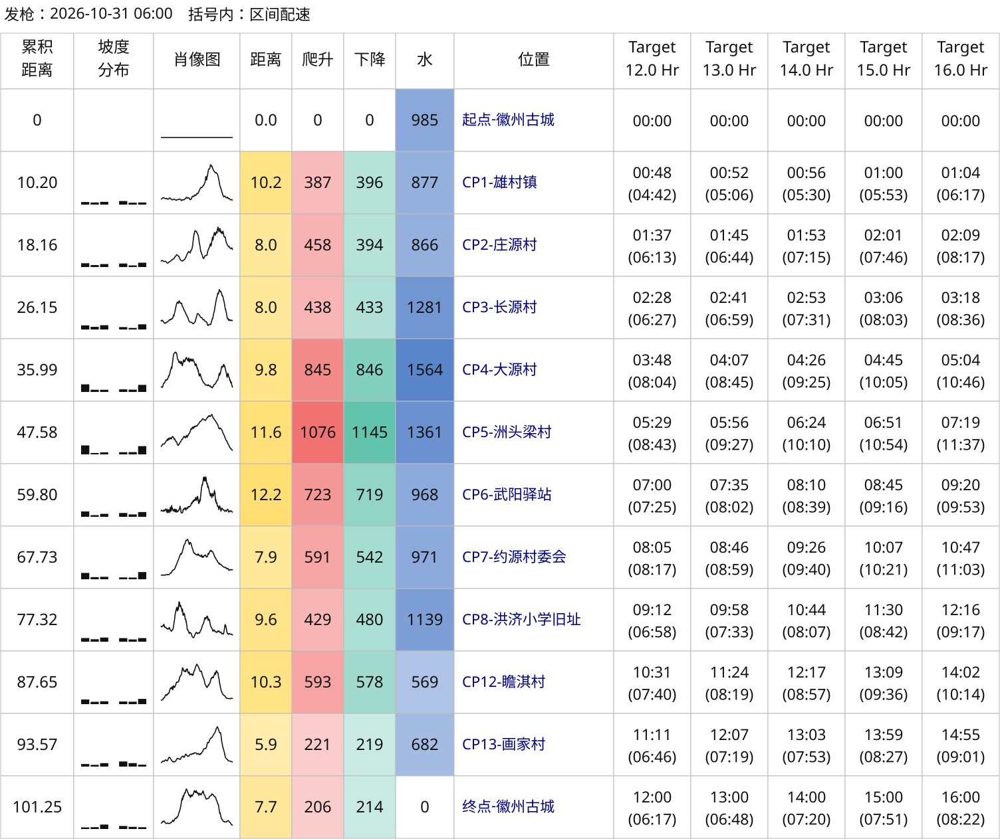
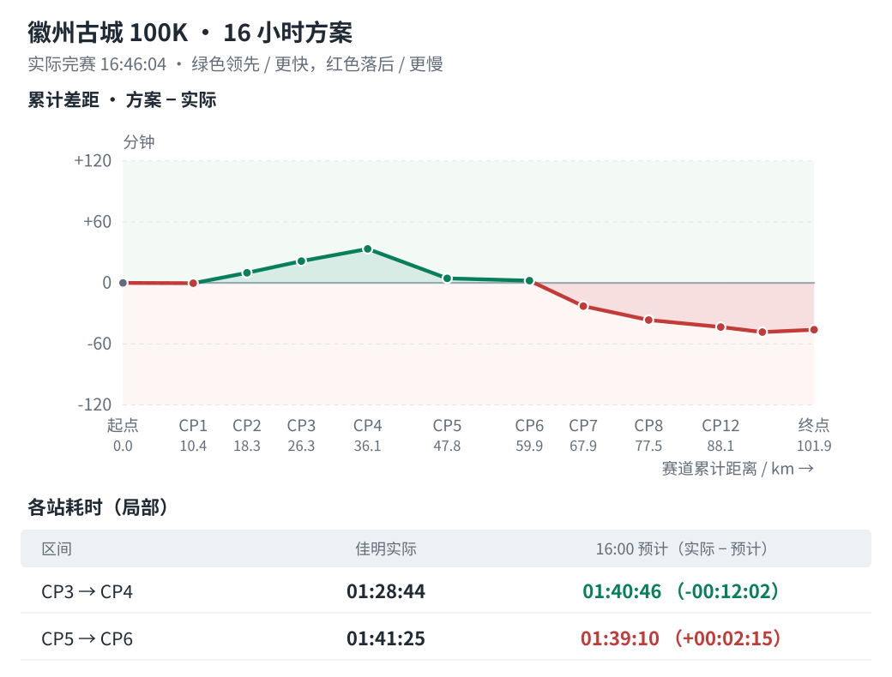

# 大蜀道见：带上你的 AI 助手，一起做跑表

耐力学社 · 2026 年 11 月 4 日 · 预览稿

准备一场越野赛，光知道“想跑几小时”还不够。哪段该慢一点，到各站大概用多久，提前安排一下，跑起来心里更有数。

这也是耐力学社一直分享“体感一致配速”思路的原因：结合各段距离、爬升和长距离中的掉速，把完赛目标分到各个赛段，帮助跑者安排体力和时间。

**11 月 6 日至 7 日，我们会把这套思路带到大蜀道 100 越野赛 by UTMB 的 EXPO 现场**。这次还准备了一个新玩法：BYOA——带上你的 AI 助手，一起做跑表、看比赛记录。

在来现场之前，先看看一位社群跑友的尝试。

## 从我们分享的指南，到一张自己能用的跑表

备战徽州古城百公里时，跑友 yihouzenmeban（以后怎么办）参考耐力学社公开分享的[《耐力科学｜体感一致配速表全面指南》](https://mp.weixin.qq.com/s/spYCP-upbqAZN0kzUm-0ng)，借助 AI 编程助手，做出了一套跑表工具。

10 月 31 日，他以 16 小时 46 分完赛。跑完以后，又拿手表记录和参考方案比了一遍，把工具用到了赛后复盘中。

它能帮跑友做的事，主要有两件。

**赛前，把各站时间排出来**。提供比赛路线和目标完赛时间，就能生成跑表，查看各站的计划用时，也能同时列出几套方案作比较。

*左侧看各段距离、爬升和地形，右侧每列对应一个完赛目标。每格上方是累计用时，括号内是上一段的参考配速。*

**赛后，看看时间差在哪里**。导入手表记录，就能对照各段实际用了多久，比计划快了还是慢了，以及从哪里开始逐渐落后。

*上方看累计进度，下方看单段耗时。绿色表示领先或更快，红色表示落后或更慢。*

他还发现一个有意思的变化：同样参考 16 小时方案，CP5 到 CP6 这一段，用赛前路线算，看起来快了约 19 分钟；换成手表记录的路线重算，又慢了约 2 分钟。

实际用时一直是 **1 小时 41 分 25 秒**。两份路线算出的爬升不同，分给这段的参考时间也变了。

这次核对让他更具体地看到了路线数据对跑表的影响。至于某段为什么慢，还要结合当时的路况、补给和身体感受来判断。

这份工具是跑友参考公开思路完成的独立实现，并非耐力学社或 RunArt.Net 的官方跑表。它也不能判断一个完赛目标是否适合你，仍需要结合自己的训练和比赛经验使用。

## 你也可以先让自己的 AI 助手试试

做这个工具时，他负责提需求、看结果，AI 帮忙写代码。哪里不对就继续改，有些调整试完不好用，也会撤回。

现在，他把常用步骤整理成了 AI 助手能调用的工具包，也就是 Skill，代码和示例都公开了。

### 打开你常用的 AI 助手

比如 WorkBuddy、豆包办公、千问办公，把下面这句话复制给它：

> 我想尝试一下这个项目：https://github.com/yihouzenmeban/trail-running-pace

第一次可以先请助手用项目自带的示例生成一张表，看看效果，再换成自己的比赛路线。想看代码、示例图和完整复盘，也可以复制上面的项目地址，在浏览器中打开。

## 从一张跑表开始，还能继续做什么

这位跑友的实践，让我们看到了更多可能：把配速方法做成能反复使用的工具，让跑者更方便地准备比赛、整理记录、积累自己的经验。

未来，我们也希望继续探索比赛中的节奏与补给安排、结合实际状态调整计划，以及长期运动能力记录等方向。这些都需要在真实使用中逐步尝试和完善。

大蜀道现场，就是一次一起动手、一起交流的机会。

## 带上你的路线和问题，来展位聊聊

11 月 6 日至 7 日，耐力学社将携手隆景体育、RunArt.Net、RUNPRO 越野助手及山野无痕（Leave No Trace）伙伴，联合亮相大蜀道赛会 EXPO。

**展位位置：游客中心台阶下左手边。**

你可以带上比赛路线和常用的 AI 助手，现场一起尝试生成跑表、查看比赛记录，也可以了解相关工具，与伙伴们聊聊自己的比赛需求。没有准备材料，也欢迎来看看。

除了 BYOA 跑表工坊，现场还有“跑得慢才能跑得快”耐力科学知识问答，以及山野无痕环保互动，一起聊聊如何跑得更合理，也更好地照顾我们经过的山野。

慢以致快，格物致知。

大蜀道见，带上你的 AI 助手，也带上你想解决的问题。
