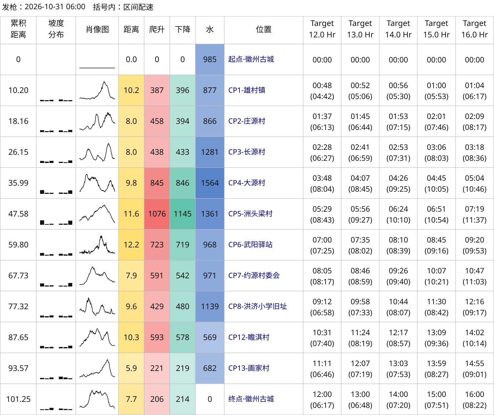
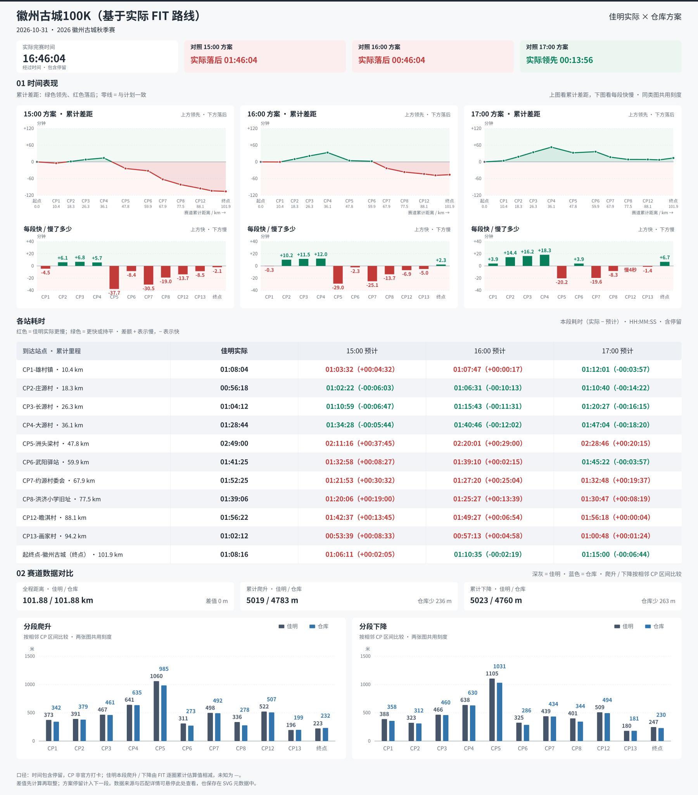
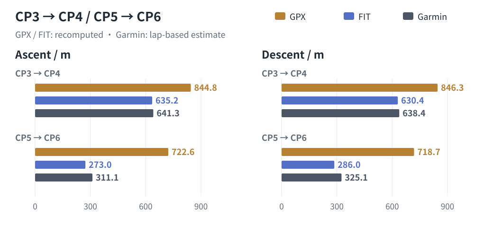

# 徽州古城 100K 示例

[简体中文](README.md) | [English](README.en.md) | [项目首页](../../README.md)

本示例展示赛前 GPX 配速表，以及基于实际 FIT 路线的赛后复盘。

## 文件与来源

| 文件 | 内容与复现条件 |
| --- | --- |
| [徽州古城100K.gpx](徽州古城100K.gpx) | 比赛 GPX 轨迹，作为赛前方案输入 |
| [config.json](config.json) | 12、13、14、15、16 小时；2026-10-31 06:00 出发；显式导出 SVG、HTML、CSV、JSON |
| [pace-chart.svg](pace-chart.svg) | 使用公开 GPX 和上述配置生成，括号内为区间配速 |
| [garmin-comparison.svg](garmin-comparison.svg) | 赛前 GPX 路线与佳明实际活动对比，参照目标改为 15、16、17 小时，不改写原配置 |
| [config-fit.json](config-fit.json) / [pace-chart-fit.svg](pace-chart-fit.svg) | 15、16、17 小时方案，使用实际 FIT 路线的设备距离与海拔；配置中的人工 CP 仅适用于该次记录 |
| [garmin-comparison2.svg](garmin-comparison2.svg) | 用实际 FIT 路线重算方案后，与同一次活动比较；保留已核对的 CP 经过时刻 |

实际活动为佳明 2026-10-31「2026 徽州古城秋季赛」。经过时间 16:46:04（包含停留），平台距离 101.877 km、爬升 / 下降 5019 / 5023 m。GPX 配速表可用本目录文件生成；两张赛后对比图所需的个人原始 FIT 与平台详情未公开，仅提供结果供查看。

## 复现公开 GPX 配速表



需要 Python 3.10+，在仓库根目录执行：

```bash
python3 skills/even-effort-pace-chart/scripts/pace_chart.py inspect \
  'examples/huizhou-gucheng-100k/徽州古城100K.gpx'

python3 skills/even-effort-pace-chart/scripts/pace_chart.py generate \
  'examples/huizhou-gucheng-100k/徽州古城100K.gpx' \
  --config examples/huizhou-gucheng-100k/config.json \
  --output-dir output/huizhou-gucheng-100k
```

这份示例配置生成 SVG、HTML、CSV、JSON 四种格式，写入被 Git 忽略的 `output/`。替换已有文件时加 `--overwrite`。

## 赛后活动对比

两张赛后对比图使用相同的实际 CP 经过时刻，但方案所依据的路线不同：



上图按实际 FIT 路线重算方案；[赛前 GPX 路线对比图](garmin-comparison.svg)保留赛前路线，便于对照路线输入带来的差异。

| 口径 | 赛前 GPX 路线 | 实际 FIT 路线 | 佳明实际统计 |
| --- | ---: | ---: | ---: |
| 全程距离（km） | 101.249 | 101.877 | 101.877 |
| 全程爬升 / 下降（m） | 5965 / 5965 | 4783 / 4760 | 5019 / 5023 |

GPX 距离由坐标计算；FIT 路线保留设备记录距离，不按 GPS 坐标重新累计。两种路线的爬升均由当前路线算法独立重算，佳明实际侧使用逐圈估算及平台汇总，不强行缩放一致。

重点核对的两个区间如下，每格为本段爬升 / 下降，单位米：

| 区间 | GPX 重算 | FIT 海拔重算 | 佳明逐圈数据估算 |
| --- | ---: | ---: | ---: |
| CP3→CP4 | 844.8 / 846.3 | 635.2 / 630.4 | 641.3 / 638.4 |
| CP5→CP6 | 722.6 / 718.7 | 273.0 / 286.0 | 311.1 / 325.1 |



原 GPX 某些位置存在多点连续海拔起伏，FIT 对应位置波动较小。这为差异提供了比较证据，不代表 FIT 是实测高程，也不足以确定每个点应如何纠正。方法与历史实验见[爬升方案](../../skills/even-effort-pace-chart/references/ascent-options.md)。

CP5→CP6 实际耗时为 1:41:25：16 小时方案按 GPX 分配 2:00:45，实际快 19:20；按 FIT 分配 1:39:10，实际慢 2:15。它们都是本段差异，不是累计领先／落后。

## 查看与使用自己的活动

两张对比图均由仓库活动对比脚本生成，采用标准的「时间表现／赛道数据对比」结构。浏览器独立打开 SVG 可悬停或聚焦查看累计时间；静态预览直接显示本段耗时与差额。差值方向及时间口径见[如何读图](../../skills/even-effort-pace-chart/references/comparison.md#如何读图)。

CP 经过时间由投影或已核对的覆盖值确定，非官方打卡。中间站爬升、下降为逐圈累计数据按距离插值后相邻作差；FIT 逐圈合计为 5018 / 5024 m，平台为 5019 / 5023 m，终点保留平台值。差值先用原值计算再取整，分段显示值之和可能略有误差。

要分析自己的活动，请按[活动对比流程](../../skills/even-effort-pace-chart/references/comparison.md)提供自己的 FIT、路线和配置。按实际 FIT 重算时，需要在该次活动的设备距离轴上重新定义 CP；不能直接套用本目录的 `config-fit.json`。原图的输入哈希、经过时刻覆盖及匹配记录保留在 SVG 元数据中。
