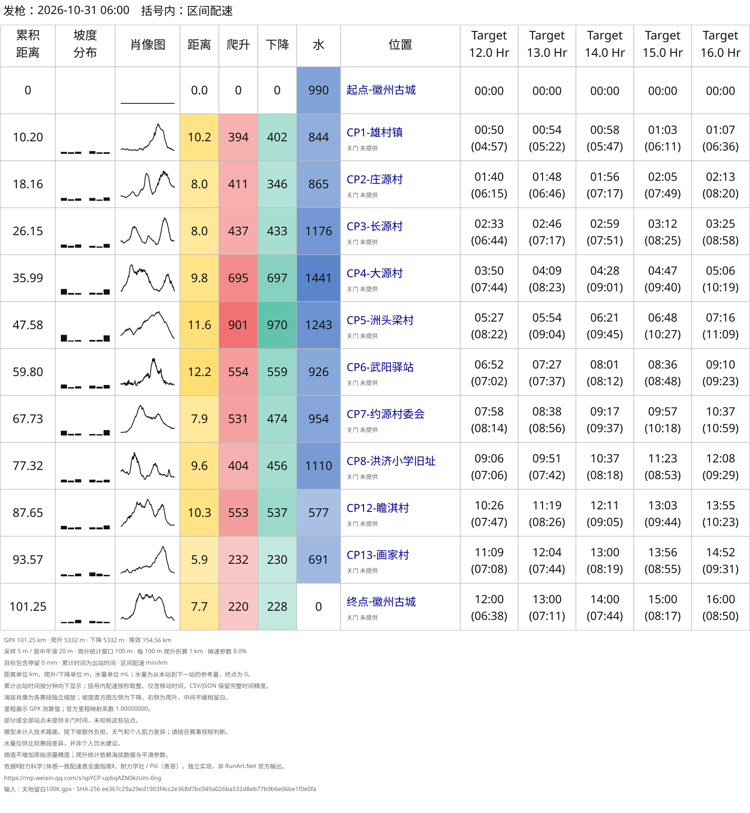
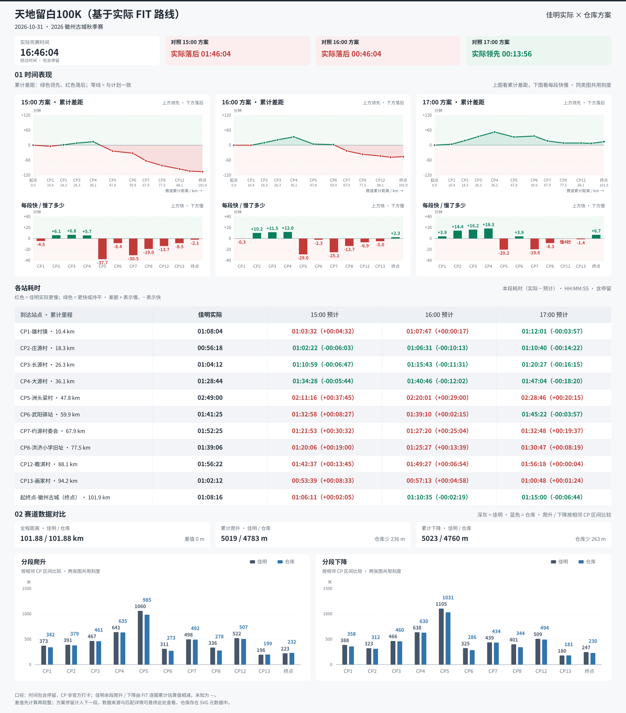
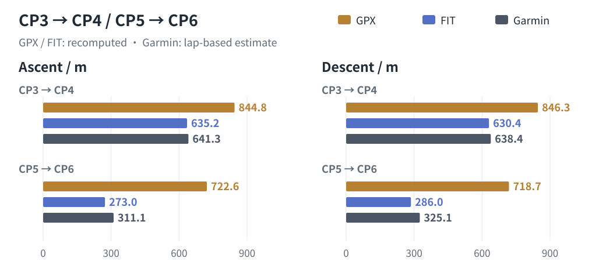

# Tiandi Liubai 100K example

[简体中文](README.md) | [English](README.en.md) | [Project home](../../README.en.md)

This example shows pre-race GPX pace charts and a post-race review based on the recorded FIT route.

## Files and provenance

| File | Contents and reproduction requirements |
| --- | --- |
| [天地留白100K.gpx](天地留白100K.gpx) | Race GPX track used for pre-race plans |
| [config.json](config.json) | 12h, 13h, 14h, 15h, and 16h; a 2026-10-31 06:00 start; SVG, HTML, CSV, and JSON explicitly selected |
| [pace-chart.svg](pace-chart.svg) | Generated from the public GPX and configuration, with segment pace in parentheses |
| [garmin-comparison.svg](garmin-comparison.svg) | The same GPX compared with the Garmin activity using exact 15h, 16h, and 17h targets without modifying the original configuration |
| [config-fit.json](config-fit.json) / [pace-chart-fit.svg](pace-chart-fit.svg) | 15h, 16h, and 17h plans using personal FIT device distance and elevations; manual CP distances apply only to this recording |
| [garmin-comparison2.svg](garmin-comparison2.svg) | Plans recomputed on the FIT route and compared with that same activity, preserving reviewed checkpoint passage times |

The Garmin activity is “2026 徽州古城秋季赛” from October 31, 2026. Elapsed time is 16:46:04 including stops; platform totals are 101.877 km and 5019 / 5023 m ascent/descent. The GPX chart can be generated from this directory's files. The personal FIT and platform details needed for the two activity comparisons are not published; those charts are available as previews.

## Reproduce the public GPX chart



Requires Python 3.10+. Run from the repository root:

```bash
python3 skills/even-effort-pace-chart/scripts/pace_chart.py inspect \
  'examples/tiandi-liubai-100k/天地留白100K.gpx'

python3 skills/even-effort-pace-chart/scripts/pace_chart.py generate \
  'examples/tiandi-liubai-100k/天地留白100K.gpx' \
  --config examples/tiandi-liubai-100k/config.json \
  --output-dir output/tiandi-liubai-100k
```

This example generates SVG, HTML, CSV, and JSON in Git-ignored `output/`. Add `--overwrite` to replace existing files.

## Post-race FIT comparison

The two activity charts use the same actual checkpoint passage times but build plans on different routes:



The chart above rebuilds plans on the recorded FIT route. The [pre-race GPX comparison](garmin-comparison.svg) retains the pre-race route, making it possible to compare the effect of route inputs.

| Metric | Pre-race GPX route | Recorded FIT route | Garmin activity statistics |
| --- | ---: | ---: | ---: |
| Total distance (km) | 101.249 | 101.877 | 101.877 |
| Total ascent / descent (m) | 5965 / 5965 | 4783 / 4760 | 5019 / 5023 |

GPX distance is computed from coordinates. The FIT route retains device distance rather than summing GPS coordinate distances again. Both route ascent totals are independently recomputed by the current route algorithm; the Garmin side uses lap estimates and platform totals without forcing agreement.

Two closely reviewed segments are shown below. Each cell is segment ascent / descent in metres:

| Segment | GPX recomputation | FIT elevation recomputation | Garmin lap-based estimate |
| --- | ---: | ---: | ---: |
| CP3→CP4 | 844.8 / 846.3 | 635.2 / 630.4 | 641.3 / 638.4 |
| CP5→CP6 | 722.6 / 718.7 | 273.0 / 286.0 | 311.1 / 325.1 |



Some GPX locations contain continuous elevation oscillations across multiple points, with smaller fluctuations at corresponding FIT locations. This provides comparative evidence, not surveyed FIT elevations or a rule for correcting individual points. See [ascent methods](../../skills/even-effort-pace-chart/references/ascent-options.en.md) for the method and historical experiments.

CP5→CP6 took 1:41:25. The 16h plan allocates 2:00:45 on the GPX, making the activity 19:20 faster, but 1:39:10 on the FIT route, making it 2:15 slower. These are segment differences, not cumulative advantage or deficit.

## Viewing and using your own activity

Both comparison charts were generated by the repository's activity-comparison script using the standard time-performance/course-data layout. Open the SVG directly in a browser to hover or focus for cumulative times; static previews show segment times and differences directly. See [reading the chart](../../skills/even-effort-pace-chart/references/comparison.en.md#reading-the-chart) for delta signs and timing semantics.

Checkpoint times come from projection or reviewed overrides, not official timing. Intermediate ascent/descent comes from adjacent differences of cumulative lap estimates interpolated by distance. FIT laps sum to 5018 / 5024 m, versus platform totals of 5019 / 5023 m; the finish retains platform totals. Differences are computed before rounding, so displayed segments can sum slightly differently.

To analyze your own activity, follow the [activity-comparison workflow](../../skills/even-effort-pace-chart/references/comparison.en.md) with your FIT, route, and configuration. Rebuilding plans on a FIT route requires CPs on that activity's device-distance axis; do not reuse this directory's `config-fit.json` unchanged. Input hashes, passage overrides, and matching records are retained in the original SVG metadata.
