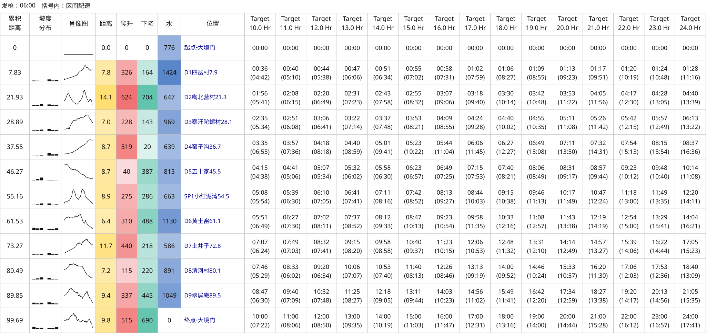

# Dajingmen DGW100K example

[简体中文](README.md) | [English](README.en.md) | [Project home](../../../README.en.md)

This example generates 10–24 hour pace charts from a race KML track. The route and configuration are both included in this directory.

The `15h/` plan centers on 15 hours and supports entering departure water amounts in HTML; see `15h/README.md`.

## Inputs and results

| File | Contents |
| --- | --- |
| [Race KML](2026京东大境门古长城越野赛by%20UTMB®DGW100K.kml) | Original route and checkpoint candidates |
| [config.json](config.json) | 15 plans from 10h to 24h, one hour apart; 06:00 start; explicitly selected CPs and KML coordinate heights |
| [pace-chart.svg](pace-chart.svg) | Segment pace in parentheses; the same configuration also exports HTML, CSV, and JSON |



`cp_selection` contains this file's checkpoint candidate IDs. Re-exporting the KML can change those IDs, so inspect candidates again afterward.

## Reproduction

Requires Python 3.10+. Run from the repository root:

```bash
python3 skills/even-effort-pace-chart/scripts/pace_chart.py inspect \
  'examples/大境门/DGW100K/2026京东大境门古长城越野赛by UTMB®DGW100K.kml' \
  --use-kml-altitudes

python3 skills/even-effort-pace-chart/scripts/pace_chart.py generate \
  'examples/大境门/DGW100K/2026京东大境门古长城越野赛by UTMB®DGW100K.kml' \
  --config 'examples/大境门/DGW100K/config.json' \
  --output-dir output/dgw100k
```

This example uses the supplied coordinate heights: inspection passes `--use-kml-altitudes`, and generation sets `use_kml_altitudes: true`. When using another KML file, verify that its coordinate heights are suitable. See [KML input](../../../skills/even-effort-pace-chart/references/configuration.en.md#kml-input) for details.

All four formats go into Git-ignored `output/dgw100k/`; add `--overwrite` to replace existing results. Historical comparisons of ascent algorithms are in [ascent methods](../../../skills/even-effort-pace-chart/references/ascent-options.en.md).
