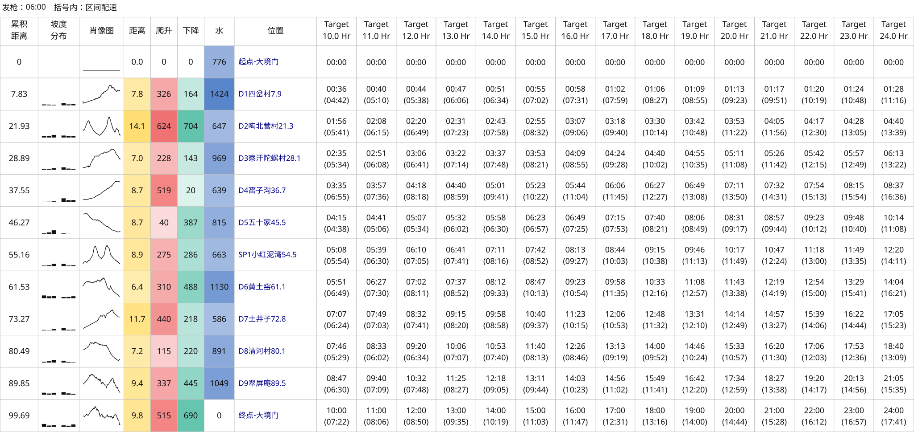

# 大境门 DGW100K 示例

[简体中文](README.md) | [English](README.en.md) | [项目首页](../../../README.md)

本示例使用比赛 KML 轨迹生成 10–24 小时配速表，轨迹与配置均包含在本目录中。

另有以 15 小时为中心的[配速方案](15h/README.md)。

## 输入与结果

| 文件 | 内容 |
| --- | --- |
| [比赛 KML](2026京东大境门古长城越野赛by%20UTMB®DGW100K.kml) | 原始路线与站点候选 |
| [config.json](config.json) | 10–24 小时、每隔 1 小时，共 15 组；06:00 出发；显式选用 CP 和 KML 坐标高度 |
| [pace-chart.svg](pace-chart.svg) | 括号内为区间配速；同配置另导出 HTML、CSV、JSON |



配置中的 `cp_selection` 对应本文件的站点候选 ID。重新导出 KML 后，候选 ID 可能变化，需要再次检查。

## 复现

需要 Python 3.10+，在仓库根目录执行：

```bash
python3 skills/even-effort-pace-chart/scripts/pace_chart.py inspect \
  'examples/大境门/DGW100K/2026京东大境门古长城越野赛by UTMB®DGW100K.kml' \
  --use-kml-altitudes

python3 skills/even-effort-pace-chart/scripts/pace_chart.py generate \
  'examples/大境门/DGW100K/2026京东大境门古长城越野赛by UTMB®DGW100K.kml' \
  --config 'examples/大境门/DGW100K/config.json' \
  --output-dir output/dgw100k
```

本示例采用文件内提供的高度，检查命令带 `--use-kml-altitudes`，生成配置带 `use_kml_altitudes: true`。换用其他 KML 时，需核实坐标高度是否可用，详见[KML 输入](../../../skills/even-effort-pace-chart/references/configuration.md#kml-输入)。

生成四种格式到被 Git 忽略的 `output/dgw100k/`，替换已有结果时加 `--overwrite`。不同爬升算法的历史比较见[爬升方案](../../../skills/even-effort-pace-chart/references/ascent-options.md)。
