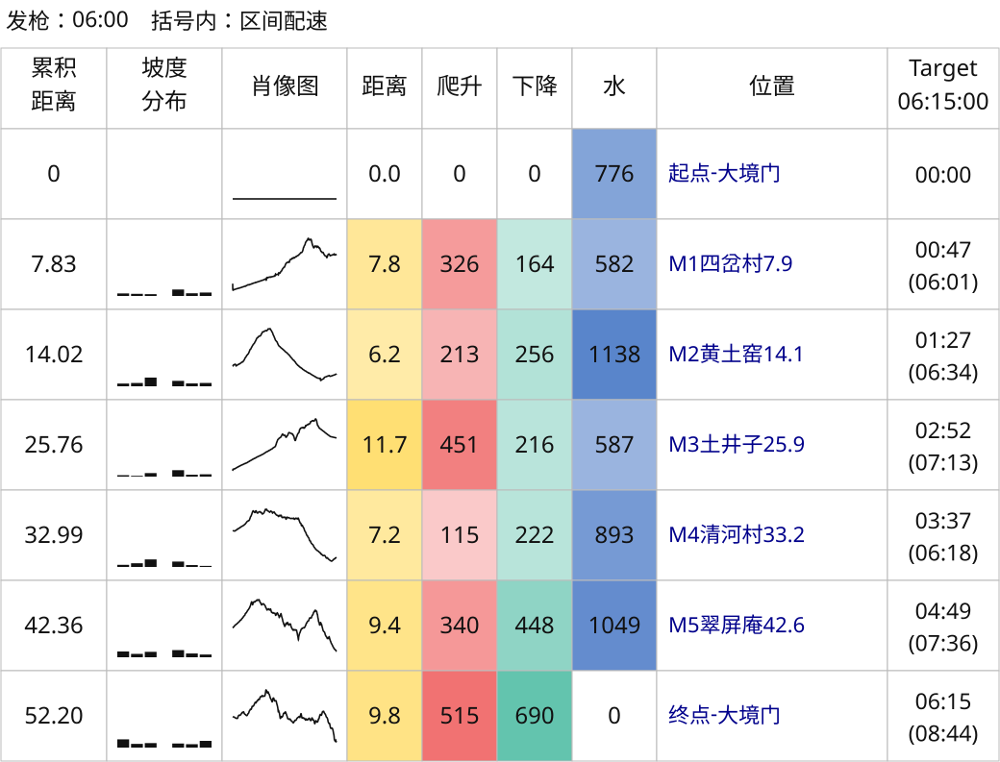
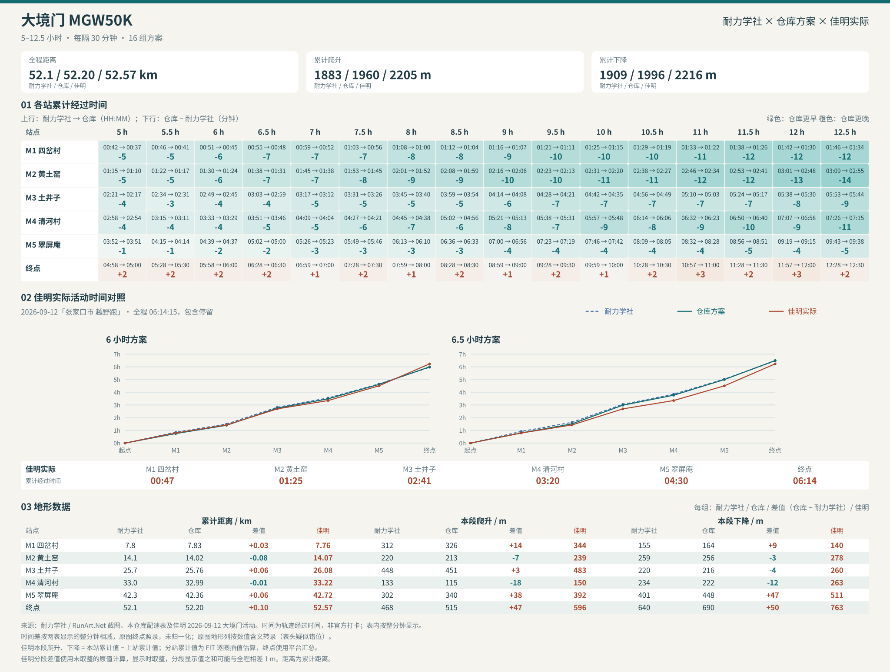

# Dajingmen MGW50K example

[简体中文](README.md) | [English](README.en.md) | [Project home](../../../README.en.md)

The directory retains the name `DGW50K`, while route and chart titles use the race category `MGW50K`. Public files reproduce the two GPX pace charts. The FIT-route plans and post-race comparisons use a personal activity whose raw FIT is not published; the merged three-source comparison is a manually assembled historical reference.

## Inputs and elevation repair

The [original GPX](2026京东大境门古长城越野赛by%20UTMB®MGW50K.gpx) lacks elevation at 59 points; use the filled copy below to generate charts. The two gaps span approximately 834.6 m and 34.1 m between known endpoints.

[MGW50K-elevation-filled.gpx](MGW50K-elevation-filled.gpx) is a copy with elevations linearly interpolated along horizontal distance between known endpoints. [elevation-repair.json](elevation-repair.json) records point indices, gaps, the repair method, and hashes of both files. The copy is ready to use; interpolation cannot recover missing hills.

## Pace charts and reproduction

| Configuration | Plans | Result |
| --- | --- | --- |
| [config.json](config.json) | 16 plans from 5h to 12.5h, 30 minutes apart | [pace-chart.svg](pace-chart.svg) |
| [config-6h15m.json](config-6h15m.json) | A single 6h15m plan | [pace-chart-6h15m.svg](pace-chart-6h15m.svg) |
| [config-fit.json](config-fit.json) | 6:00, 6:15, and 6:30 plans on the recorded FIT route; manual CPs apply only to this recording | [pace-chart-fit.svg](pace-chart-fit.svg) |

The two GPX configurations use the defaults: SVG, a 06:00 start, and segment pace in parentheses; both explicitly select CP IDs from this route. The FIT configuration uses the recorded device-distance axis and manual CPs.



Requires Python 3.10+. Run from the repository root:

```bash
python3 skills/even-effort-pace-chart/scripts/pace_chart.py inspect \
  'examples/大境门/DGW50K/MGW50K-elevation-filled.gpx'

python3 skills/even-effort-pace-chart/scripts/pace_chart.py generate \
  'examples/大境门/DGW50K/MGW50K-elevation-filled.gpx' \
  --config 'examples/大境门/DGW50K/config.json' \
  --output-dir output/dgw50k

python3 skills/even-effort-pace-chart/scripts/pace_chart.py generate \
  'examples/大境门/DGW50K/MGW50K-elevation-filled.gpx' \
  --config 'examples/大境门/DGW50K/config-6h15m.json' \
  --output-dir output/dgw50k-6h15m
```

Results go into Git-ignored `output/`; add `--overwrite` to replace existing files.

## Post-race activity comparison

Both comparison charts use the same Garmin activity from September 12, 2026; only the route input differs:

| Chart / config | Route input | Notes |
| --- | --- | --- |
| [garmin-comparison.svg](garmin-comparison.svg) | Official GPX (elevation-filled copy) | Compares 6:00, 6:15, and 6:30 plans; does not rewrite `config-6h15m.json` |
| [garmin-comparison2.svg](garmin-comparison2.svg) | Recorded FIT device distance and point elevations | Recalculates the same targets on the FIT route |
| [config-fit.json](config-fit.json) / [pace-chart-fit.svg](pace-chart-fit.svg) | Recorded FIT route | 6:00, 6:15, and 6:30 plans; manual CPs apply only to this recording |

| Metric | Official GPX route | Recorded FIT route | Garmin activity |
| --- | ---: | ---: | ---: |
| Distance | 52.20 km | 52.57 km | 52.57 km |
| Ascent | 1960 m | 2043 m | 2205 m |
| Descent | 1996 m | 2049 m | 2216 m |

The recorded finish was 6:14:15, 45 seconds ahead of the 6:15 plan; the first 42.6 km built an 18:46 lead, and the final 9.85 km gave back 18:00.

| Target | GPX plan lead at M5 | FIT plan lead at M5 | Finish gap (same for both) |
| --- | ---: | ---: | ---: |
| 6:00 | 7:12 | 6:20 | 14:15 behind |
| 6:15 | 18:46 | 17:51 | 0:45 ahead |
| 6:30 | 30:19 | 29:23 | 15:45 ahead |

The raw personal FIT is not published; checkpoint times are projected from the track, not official timing. To reproduce with your own FIT:

```bash
python3 -m pip install -r skills/even-effort-pace-chart/scripts/requirements-comparison.txt

# Official GPX route comparison
python3 skills/even-effort-pace-chart/scripts/compare_activity.py generate \
  'examples/大境门/DGW50K/MGW50K-elevation-filled.gpx' \
  --config 'examples/大境门/DGW50K/config-6h15m.json' \
  --fit activity.fit \
  --targets 06:00 06:15 06:30 --output-dir output/dgw50k-comparison

# FIT-route plans and comparison with the same activity
python3 skills/even-effort-pace-chart/scripts/pace_chart.py generate \
  activity.fit \
  --config 'examples/大境门/DGW50K/config-fit.json' \
  --output-dir output/dgw50k-fit

python3 skills/even-effort-pace-chart/scripts/compare_activity.py generate \
  activity.fit \
  --config 'examples/大境门/DGW50K/config-fit.json' \
  --fit activity.fit \
  --targets 06:00 06:15 06:30 --output-dir output/dgw50k-fit-comparison
```

Add `--summary activity-details.json` when platform details are available; finish totals then prefer the platform data. When recalculating on the recorded FIT, define CPs on that activity's device-distance axis; `config-fit.json` applies only to this recording. Elapsed times include stops. See the [activity comparison reference](../../../skills/even-effort-pace-chart/references/comparison.en.md) for delta signs and reading the charts.

## Historical three-source comparison

[runart-comparison.svg](runart-comparison.svg) combines data transcribed from a 耐力学社 / RunArt.Net pace-chart screenshot, repository plans, and the Garmin Dajingmen activity from September 12, 2026. It presents:

1. Cumulative checkpoint times across all 16 targets.
2. Cumulative distance and segment ascent/descent for all three sources, with RunArt-minus-Garmin and repository-minus-Garmin differences beside their values.
3. Repository 6:15 plans against actual Garmin checkpoint times; time differences mean actual minus plan, so negative means earlier.



Elapsed times include stops. Intermediate terrain values are estimated by distance interpolation within FIT laps, then differenced between adjacent cumulative values. Finish totals come from the platform; differences are computed before rounding. The raw personal FIT is not published.

The three-source chart is provided as an SVG. Both post-race comparison charts use the personal FIT, which is not published. To generate a plan-versus-activity comparison from your own FIT, see the [activity comparison reference](../../../skills/even-effort-pace-chart/references/comparison.en.md).
