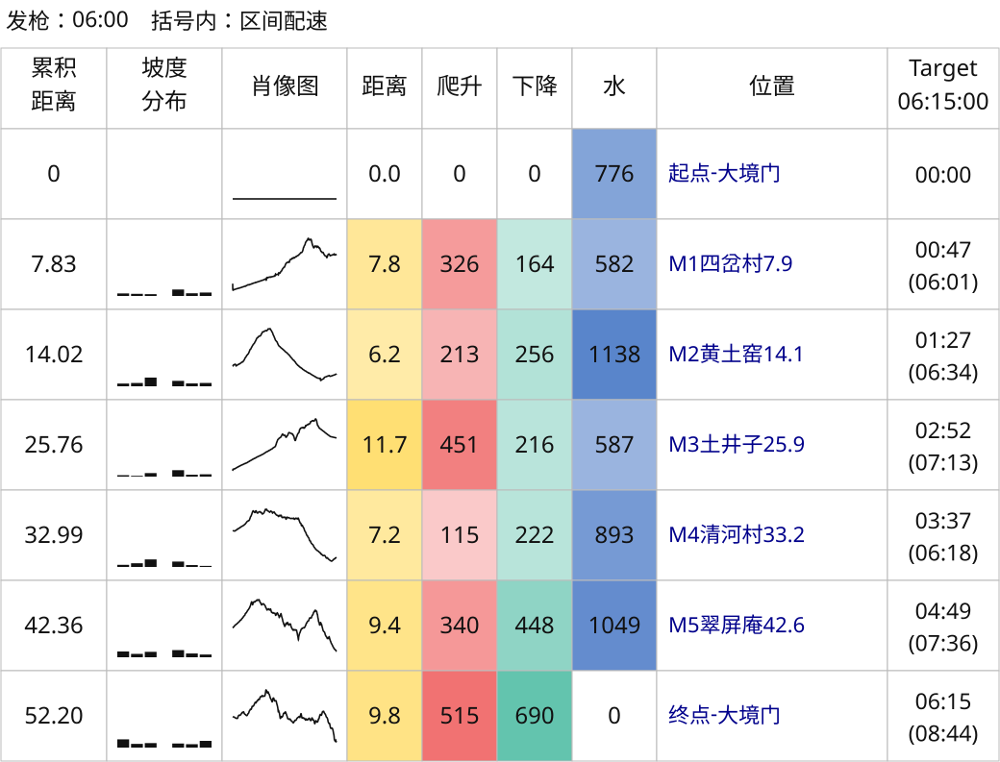

# 大境门 MGW50K 示例

[简体中文](README.md) | [English](README.en.md) | [项目首页](../../../README.md)

目录沿用 `DGW50K` 名称，轨迹与图表保留赛事组别 `MGW50K`。公开文件可复现两份 GPX 配速表；实际 FIT 路线方案与两张赛后对比图使用个人活动记录，原始 FIT 未公开。

## 输入与海拔修复

[原始 GPX](2026京东大境门古长城越野赛by%20UTMB®MGW50K.gpx) 有 59 点缺少海拔，生成配速表时使用下面的补全副本。缺失分为两段，已知端点之间分别约 834.6 m、34.1 m。

[MGW50K-elevation-filled.gpx](MGW50K-elevation-filled.gpx) 是沿水平距离在已知端点之间线性插值的副本。[elevation-repair.json](elevation-repair.json) 记录点索引、缺失范围、补全方法及两份文件的哈希。副本已完成海拔补全；插值不能还原缺失区间的小坡。

## 配速表与复现

| 配置 | 方案 | 结果 |
| --- | --- | --- |
| [config.json](config.json) | 5–12.5 小时，每隔 30 分钟，共 16 组 | [pace-chart.svg](pace-chart.svg) |
| [config-6h15m.json](config-6h15m.json) | 仅 6 小时 15 分钟 | [pace-chart-6h15m.svg](pace-chart-6h15m.svg) |
| [config-fit.json](config-fit.json) | 6:00、6:15、6:30，使用实际 FIT 设备距离与海拔；人工 CP 仅适用于该次记录 | [pace-chart-fit.svg](pace-chart-fit.svg) |

前两份 GPX 配置均使用默认的 SVG、06:00 出发和括号内区间配速，并明确选择本轨迹的 CP ID；FIT 配置使用实际记录的设备距离轴和人工 CP。



需要 Python 3.10+，在仓库根目录执行：

```bash
python3 skills/even-effort-pace-chart/scripts/pace_chart.py inspect \
  'examples/大境门/DGW50K/MGW50K-elevation-filled.gpx'

python3 skills/even-effort-pace-chart/scripts/pace_chart.py generate \
  'examples/大境门/DGW50K/MGW50K-elevation-filled.gpx' \
  --config 'examples/大境门/DGW50K/config.json' \
  --output-dir output/dgw50k

python3 skills/even-effort-pace-chart/scripts/pace_chart.py generate \
  'examples/大境门/DGW50K/MGW50K-elevation-filled.gpx' \
  --config 'examples/大境门/DGW50K/config-6h15m.json' \
  --output-dir output/dgw50k-6h15m
```

输出写入被 Git 忽略的 `output/`，替换已有结果时加 `--overwrite`。

## 赛后活动对比

两张赛后对比图使用同一次 2026-09-12 佳明活动，差别只在路线输入：

| 图表 / 配置 | 路线输入 | 说明 |
| --- | --- | --- |
| [garmin-comparison.svg](garmin-comparison.svg) | 赛前 GPX 路线（海拔补全副本） | 对照 6:00、6:15、6:30；不改写 `config-6h15m.json` |
| [garmin-comparison2.svg](garmin-comparison2.svg) | 实际 FIT 路线（设备距离与逐点海拔） | 同一批目标，按实际 FIT 路线重算方案 |
| [config-fit.json](config-fit.json) / [pace-chart-fit.svg](pace-chart-fit.svg) | 实际 FIT 路线 | 6:00、6:15、6:30 方案；人工 CP 仅适用于该次记录 |

| 口径 | 赛前 GPX 路线 | 实际 FIT 路线 | 佳明实际统计 |
| --- | ---: | ---: | ---: |
| 全程距离 | 52.20 km | 52.57 km | 52.57 km |
| 累计爬升 | 1960 m | 2043 m | 2205 m |
| 累计下降 | 1996 m | 2049 m | 2216 m |

实际完赛 6:14:15，比 6:15 方案快 45 秒；前 42.6 km 领先 18:46，最后 9.85 km 慢 18:00。

| 目标 | 赛前 GPX 方案 M5 领先 | 实际 FIT 方案 M5 领先 | 终点差（两张图相同） |
| --- | ---: | ---: | ---: |
| 6:00 | 7:12 | 6:20 | 落后 14:15 |
| 6:15 | 18:46 | 17:51 | 领先 0:45 |
| 6:30 | 30:19 | 29:23 | 领先 15:45 |

个人原始 FIT 未公开；CP 时刻为轨迹投影，不是官方打卡。用自己的 FIT 复现同类对比：

```bash
python3 -m pip install -r skills/even-effort-pace-chart/scripts/requirements-comparison.txt

# 赛前 GPX 路线对比
python3 skills/even-effort-pace-chart/scripts/compare_activity.py generate \
  'examples/大境门/DGW50K/MGW50K-elevation-filled.gpx' \
  --config 'examples/大境门/DGW50K/config-6h15m.json' \
  --fit activity.fit \
  --targets 06:00 06:15 06:30 --output-dir output/dgw50k-comparison

# 实际 FIT 路线方案与同一次活动对比
python3 skills/even-effort-pace-chart/scripts/pace_chart.py generate \
  activity.fit \
  --config 'examples/大境门/DGW50K/config-fit.json' \
  --output-dir output/dgw50k-fit

python3 skills/even-effort-pace-chart/scripts/compare_activity.py generate \
  activity.fit \
  --config 'examples/大境门/DGW50K/config-fit.json' \
  --fit activity.fit \
  --targets 06:00 06:15 06:30 --output-dir output/dgw50k-fit-comparison
```

有佳明活动详情时可加 `--summary activity-details.json`，终点汇总优先采用平台数据。按实际 FIT 重算时，需要在该次活动的设备距离轴上重新定义 CP；`config-fit.json` 仅适用于这次记录，不能直接套用到其他活动。图中经过时间包含停留；差值方向和读图方式见[活动对比文档](../../../skills/even-effort-pace-chart/references/comparison.md)。

两张赛后对比图使用个人 FIT 生成，原始 FIT 未公开。
