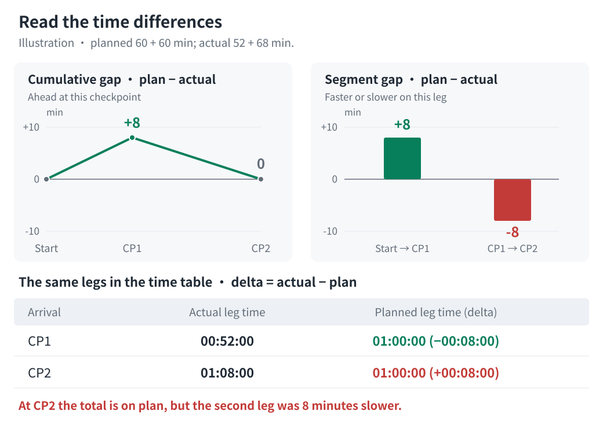

# Recorded activity versus pace plans

[简体中文](comparison.md) | [English](comparison.en.md)

Use `scripts/compare_activity.py`, which reuses the pace chart's route processing, checkpoints, and pacing model. Replace `<skill-dir>` in commands with the Skills installation directory, or `skills/even-effort-pace-chart` in the full repository.

## Prepare inputs

Provide a race route (GPX/KML/FIT), race configuration, and a single-activity original FIT or ZIP containing exactly one FIT. Garmin activity-details JSON is optional; without it, actual totals use the FIT session and are labeled accordingly. GPX/KML can use embedded or manual CPs; FIT routes require manual CPs.

Requires Python 3.10+ and the optional FIT dependency:

```bash
python3 -m pip install -r <skill-dir>/scripts/requirements-comparison.txt
```

Offline inspection and generation need no Garmin account, credentials, or network. Use [network commands](#garmin-network-commands) only when downloading activities.

## Offline inspection and generation

Inspect matches and resolve passage ambiguities before generating:

```bash
python3 <skill-dir>/scripts/compare_activity.py inspect race.gpx \
  --config race.json --fit activity-original.zip --targets 15:00 16:00 17:00

python3 <skill-dir>/scripts/compare_activity.py generate race.gpx \
  --config race.json --fit activity-original.zip \
  --targets 15:00 16:00 17:00 --output-dir output/comparison
```

`inspect` prints activity totals, matched checkpoints, segment data, and warnings without writing files. `--targets` is an exact list overriding configured `target`/`targets`, without expanding five plans or changing the source configuration. Omit it to use configured targets and existing defaults. Add `--summary activity-details.json` when platform details are available.

`generate` writes only `garmin-comparison.svg` by default. Add `--export-json` for unrounded `garmin-comparison.json`; it excludes raw GPS points but includes activity identity, passage times, and estimated metrics. Use another directory or user-authorized `--overwrite` to replace existing results.

The first route argument can instead be FIT or FIT ZIP, rebuilding plans on the recorded route and comparing that same activity via `--fit`. The route uses device distance and per-record elevations, with manual CPs on that distance axis. Preserve reviewed times with `--passage-overrides`, mapping CP IDs to the new configuration. Route ascent is independently recomputed; the actual side retains lap estimates and platform totals without forcing agreement. See [FIT route input](configuration.en.md#fit-route-input).

## Reading the chart

The header shows actual finish time and the final advantage or deficit against each target. The body contains:

- **Time performance:** cumulative difference curves and segment faster/slower bars for each target, followed by checkpoint rows with actual segment times, planned segment times, and differences. Cumulative differences answer “how far ahead/behind at this station”; segment differences answer “how much faster/slower on this leg.”
- **Course data comparison:** total distance, ascent, and descent, followed by ascent/descent bars for adjacent checkpoint intervals.



Read each difference according to its location:

| Location | Calculation | Positive | Negative |
| --- | --- | --- | --- |
| Time plots and JSON time deltas | Plan − actual | Actually ahead / faster on this leg | Actually behind / slower on this leg |
| Difference after a planned time in the table | Actual − plan | Actually slower on this leg | Actually faster on this leg |
| Terrain deltas | Repository − Garmin | Repository has more | Repository has less |

For example, a planned `01:00:00` leg completed in `01:08:00` has a `−8 minute` segment bar and a planned table cell reading `01:00:00 (+00:08:00)`. Both mean the activity was eight minutes slower and are red. Cumulative advantage/deficit does not determine segment performance.

Time plots use green for actually ahead/faster, red for behind/slower, and gray for a tie when the absolute difference is below half a second. Cumulative curves place checkpoints by route distance; segment bars use equal-width intervals. Like plots share scales across targets. In the table, planned times and differences are bold and red when actual segment time is longer, green otherwise, including ties. Actual times remain neutral. Table deltas are calculated before rounding to seconds; a rounded zero displays `00:00:00`, but colors still follow unrounded values.

Terrain charts use dark gray for Garmin and blue for the repository, without implying better or worse. Unknown values show `—` with no corresponding bar. Terrain differences are calculated before rounding to metres. Time readouts include seconds and support durations beyond 24 hours.

Open the SVG directly in a browser to hover or Tab-focus for cumulative times, full station names, both cumulative distances, and terrain differences. Static previews show segment times and deltas directly. Provenance, processing warnings, and matching records remain in tooltips and SVG metadata. Python generates the SVG directly; ECharts and other external chart libraries are not required.

## Passage matching and timing semantics

Embedded CPs use their original station coordinates. Manual CPs and explicit `distance_km` overrides use the corresponding processed-route coordinates. Projection locates passages by geometric distance, then interpolates recorded distance and elapsed time; geometric distance does not substitute for Garmin distance.

Repeated passages, offsets over 100 m, substantial checkpoint standstills, or nonmonotonic station order produce diagnostics instead of silently choosing the nearest occurrence. Automatic matching is not official timing; projections near station stops can differ by seconds.

After confirming times, save overrides as `passages.json`. Keys must be CP IDs from inspection/diagnostics, not guessed station names or indices. Values accept `H:MM[:SS]` or elapsed seconds with fractional precision:

```json
{
  "wpt:3": "03:08:35",
  "manual:2": 16638.987685
}
```

```bash
python3 <skill-dir>/scripts/compare_activity.py generate race.gpx \
  --config race.json --fit activity.fit --targets 15:00 16:00 17:00 \
  --passage-overrides passages.json --output-dir output/comparison
```

Overrides apply only to intermediate CPs, must fall within GPS time coverage, and must preserve station order. Endpoints use activity start/finish and must be within 100 m of route endpoints; otherwise choose a matching activity or route. Overrides, offsets, and input hashes are retained in metadata. Numeric seconds preserve reviewed passage precision.

Actual segment time is `current passage elapsed − previous passage elapsed`. Planned segment time is `current planned arrival − previous planned arrival`, including configured rest at the previous station. Both include stops between passages; neither isolates moving time or station dwell. Subtract before rounding. Unrounded segments sum to the total; displayed times may differ by a few seconds.

## Terrain and input limitations

Intermediate Garmin cumulative ascent/descent is linearly interpolated over FIT lap distances, then differenced between adjacent CPs. The climb's actual position within a lap is unknown. Missing lap distances disable intermediate terrain estimates. Missing ascent/descent makes subsequent corresponding totals unknown; never zero-fill or recompute Garmin elevation metrics.

Finish totals prefer fields available in platform details, with FIT session fallback; without details, use the session. Report lap/platform discrepancies without rescaling, and reject decreasing cumulative terrain. Records missing GPS/time/distance are skipped and reported; long gaps produce warnings. Damaged FIT, multiple sessions, and decreasing record distance/time are errors.

## Garmin network commands

Use `list`/`fetch` only when activity downloads are requested. Read credentials from `GARMIN_PERSONAL_API_KEY` or explicit `--env-file .env.local`, with the environment taking precedence. Env files accept literal values without shell execution or variable expansion. Never put credentials in code, configuration, or command-line arguments. Keep raw personal activities in Git-ignored `output/`.

```bash
python3 <skill-dir>/scripts/compare_activity.py list \
  --start-date 2026-10-01 --end-date 2026-11-02 --limit 20 --env-file .env.local

python3 <skill-dir>/scripts/compare_activity.py fetch <activity-id> --env-file .env.local
```

`list` supports pagination with `--start`/`--limit`. `fetch` saves `activity-details.json` and `activity-original.zip` under `output/activities/<activity-id>/` by default. Use `--output-dir` for another directory and `--overwrite` to replace a cache. Downloaded files have mode `600`; bearer tokens stay in memory.

The default region is `--region com`; explicitly use `--region cn` for China. There is no automatic regional fallback or retry. `--timeout` defaults to 45 seconds. Authentication/network errors report status without response bodies, keys, or tokens.
