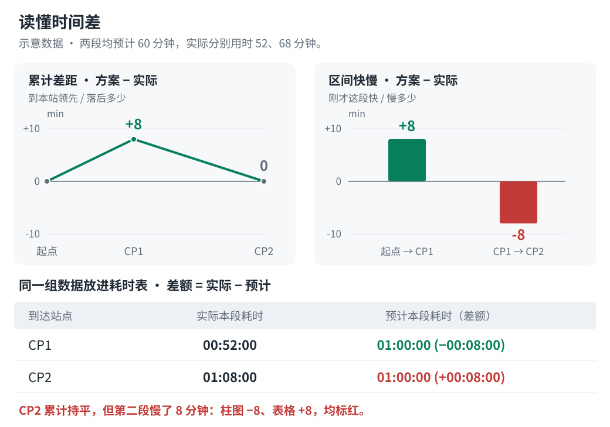

# 实际活动与配速方案对比

[简体中文](comparison.md) | [English](comparison.en.md)

使用 `scripts/compare_activity.py`，复用配速表的路线处理、CP 和配速模型。本页命令中的 `<skill-dir>` 应替换为 Skills 安装目录；在完整仓库中为 `skills/even-effort-pace-chart`。

## 准备输入

需要比赛路线（GPX/KML/FIT）、比赛配置，以及单活动原始 FIT 或仅包含一个 FIT 的 ZIP。可选提供佳明活动详情 JSON；未提供时，实际汇总采用 FIT session 并标记来源。GPX/KML 可使用嵌入 CP 或人工 CP，FIT 路线需人工 CP。

Python 3.10+，安装 FIT 可选依赖：

```bash
python3 -m pip install -r <skill-dir>/scripts/requirements-comparison.txt
```

离线检查和生成不需要佳明账号、密钥或网络。只有主动下载活动时才需要[在线读取](#佳明在线读取)。

## 离线检查和生成

先检查匹配结果，处理站点歧义后再生成：

```bash
python3 <skill-dir>/scripts/compare_activity.py inspect race.gpx \
  --config race.json --fit activity-original.zip --targets 15:00 16:00 17:00

python3 <skill-dir>/scripts/compare_activity.py generate race.gpx \
  --config race.json --fit activity-original.zip \
  --targets 15:00 16:00 17:00 --output-dir output/comparison
```

`inspect` 只输出活动汇总、匹配站点、分段数据和告警，不写文件。`--targets` 为精确目标列表，覆盖配置中的 `target`/`targets`，不展开五组，也不改写源配置；省略时采用配置目标及原有默认逻辑。有平台详情时加 `--summary activity-details.json`。

`generate` 默认仅写 `garmin-comparison.svg`；加 `--export-json` 可导出未取整的 `garmin-comparison.json`。JSON 不含原始 GPS 点，但包含活动身份、匹配时间及估算指标。替换已有结果时使用另一目录或经用户授权的 `--overwrite`。

也可把首个路线参数换成 FIT／FIT ZIP，按实际路线重算方案，再用 `--fit` 对比同一次活动。路线采用设备记录距离及逐点海拔，人工 CP 需位于该距离轴上；已有核对结果通过 `--passage-overrides` 保留时刻，CP ID 按新配置对应。路线爬升独立重算，实际侧保留逐圈估算及平台汇总，不强制相等。详见[FIT 路线输入](configuration.md#fit-作为路线输入)。

## 如何读图

顶部为实际完赛时间和各目标下的最终领先／落后。正文分为：

- **时间表现**：每个目标一组累计差距曲线和区间快慢柱图，下方按 CP 列出实际本段耗时、预计本段耗时及差额。累计差距回答“到这里领先／落后多少”，区间差距回答“刚才这段快／慢多少”。
- **赛道数据对比**：全程距离、爬升、下降汇总，以及相邻 CP 区间的爬升、下降对比柱图。



各处差值的方向不同，按所在位置解读：

| 位置 | 差值口径 | 正数 | 负数 |
| --- | --- | --- | --- |
| 时间图与 JSON 时间差 | 方案 − 实际 | 实际领先／本段快 | 实际落后／本段慢 |
| 耗时表中预计时间后的差额 | 实际 − 预计 | 实际本段慢 | 实际本段快 |
| 地形差值 | 仓库 − 佳明 | 仓库多 | 仓库少 |

例如，本段预计 `01:00:00`、实际 `01:08:00`：区间柱为 `−8 分钟`，耗时表预计格为 `01:00:00（+00:08:00）`。两处都表示实际慢了 8 分钟，均标红；不能用累计领先／落后来判断这一段的快慢。

时间图绿色表示实际领先／本段快，红色表示落后／本段慢，绝对差小于半秒时按持平显示为灰色。累计曲线按赛道距离排列站点，区间柱按等宽赛段排列，同类图在各目标间共用刻度。耗时表的预计时间与差额一同加粗：实际本段更慢为红色，否则为绿色（含持平）；实际列为中性色。表中差额先相减再按秒取整，取整为零显示 `00:00:00`，颜色仍按未取整值比较。

地形图深灰代表佳明、蓝色代表仓库，不表示优劣；未知为 `—`，不画对应柱。地形差值先相减再取整到米。读数时间保留到秒，支持超过 24 小时。

独立在浏览器打开 SVG，可悬停或用 Tab 聚焦查看累计经过时间、完整站名、双方累计距离和地形差值。静态预览直接显示本段耗时与差额；来源、处理告警和匹配记录保留在提示及 SVG 元数据中。SVG 由 Python 直接生成，不依赖 ECharts 或其他外部图表库。

## CP 匹配与耗时口径

嵌入 CP 使用原站点坐标；人工 CP 和明确配置了 `distance_km` 的 CP 使用处理后路线对应距离的坐标。活动投影按几何距离定位，再插值活动记录中的距离和经过时间，不将几何距离当成佳明距离。

多次经过同一站点、距活动轨迹超过 100 m、站点附近明显停留或站序不递增时，脚本返回诊断，不静默选最近一次。自动匹配非官方打卡，站内停留附近的投影可能相差几秒。

确认时刻后，将覆盖值保存为 `passages.json`。键必须是 `inspect`/诊断中的 CP ID，不能猜测站名或顺序；值为 `H:MM[:SS]` 或保留小数精度的经过秒数：

```json
{
  "wpt:3": "03:08:35",
  "manual:2": 16638.987685
}
```

```bash
python3 <skill-dir>/scripts/compare_activity.py generate race.gpx \
  --config race.json --fit activity.fit --targets 15:00 16:00 17:00 \
  --passage-overrides passages.json --output-dir output/comparison
```

覆盖仅限中间 CP，需在 GPS 时间覆盖范围内并保持站序；起终点采用活动开始/结束，必须距路线端点不超过 100 m，否则需选择匹配的活动或路线。覆盖、偏移及输入哈希写入元数据，数字秒数可保留核对结果的精度。

实际分段耗时为 `本站经过时间 − 上站经过时间`；预计分段耗时为 `本站计划到达 − 上站计划到达`，包含上一站配置的停留。两者都包含站点之间的停留，不能拆出纯移动时间或站内停留。先相减再取整，原值分段和等于全程，显示值之和可能相差几秒。

## 地形指标与输入限制

佳明中间 CP 的累计爬升/下降由 FIT 逐圈累计距离线性插值，再相邻作差得到本段值，无法确定爬升在一圈内的具体位置。缺逐圈距离时禁用中间地形估算；缺某项爬升/下降时，后续相应累计值未知，不补零或自行重算佳明海拔指标。

终点优先使用平台详情中存在的汇总字段，其余回退 FIT session；无详情则全部使用 session。逐圈与平台合计有差异时报告而不缩放，导致累计升降倒退时拒绝生成。缺 GPS/时间/距离的记录会跳过并报告，较长记录间隔会告警；损坏 FIT、多 session、记录距离/时间倒退会报错。

## 佳明在线读取

只在用户要求下载活动时使用 `list`/`fetch`。密钥从 `GARMIN_PERSONAL_API_KEY` 环境变量读取，或显式指定 `--env-file .env.local`，环境变量优先。env 文件只读取字面值，不执行命令或变量展开。不要把凭据放进代码、配置或命令行参数；原始个人活动保存在 Git 忽略的 `output/`。

```bash
python3 <skill-dir>/scripts/compare_activity.py list \
  --start-date 2026-10-01 --end-date 2026-11-02 --limit 20 --env-file .env.local

python3 <skill-dir>/scripts/compare_activity.py fetch <activity-id> --env-file .env.local
```

`list` 可用 `--start`/`--limit` 分页。`fetch` 默认将 `activity-details.json`、`activity-original.zip` 保存到 `output/activities/<activity-id>/`；可用 `--output-dir` 改目录，替换缓存需 `--overwrite`。下载文件权限为 `600`，bearer token 仅留在进程内。

区域默认为 `--region com`，中国区显式用 `--region cn`；不自动切区或重试。`--timeout` 默认 45 秒。认证/网络错误只报告状态，不输出响应正文、密钥或 token。
