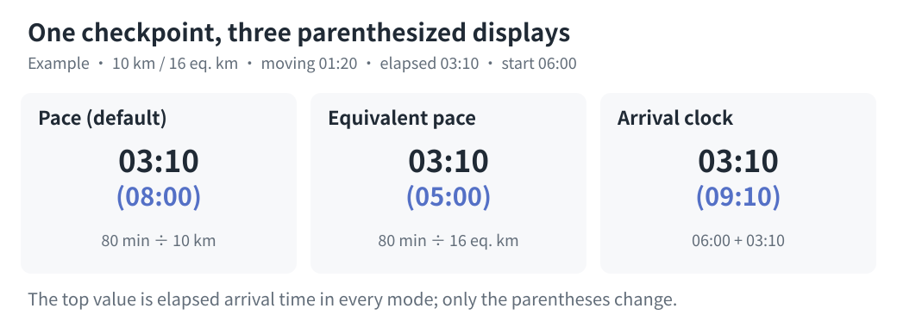

# Configuration and CLI

[简体中文](configuration.md) | [English](configuration.en.md)

Run with Python 3.10+. GPX/KML pace charts use only the standard library; FIT input needs an optional dependency. Default generation is offline; optional time-based water planning can fetch weather online or use user-confirmed manual conditions. Paths in these examples assume the repository root. For an installed Skills package, resolve `scripts/pace_chart.py` relative to the package directory.

## Defaults and overrides

A finish target is required. Omitted optional fields use script defaults; when editing an existing configuration, other fields retain their configured values. See the [parameter table](#parameters) for all defaults.

Valid `0` and `false` values take effect as configured; for example, `fatigue_rate: 0` disables fatigue progression and `smoothing_m: 0` disables that smoothing. `null`, empty strings, and empty lists are not general ways to request defaults; invalid types or values raise errors. `track_index: null` selects the only available track automatically, and station `cutoff: null` means no supplied cutoff.

`targets` takes precedence over `target`; remove the old `targets` when replacing a list with a central target. An omitted `secondary_display` honors an explicitly configured legacy `pace_basis`. Missing finish targets, unselected multiple routes, and absent or ambiguous CPs stop generation with a request for the required information. All five expanded targets must be positive; otherwise adjust the target list or interval.

## Inspect

```bash
python3 skills/even-effort-pace-chart/scripts/pace_chart.py inspect race.gpx
```

Optional flags: `--track-index 1`, `--sample-m 5`, `--smoothing-m 20`, `--ascent-method hysteresis`, `--ascent-threshold-m 10`, `--ascent-smoothing-m 0`, `--elevation-spike-m 30`, and `--distance-tolerance-m 0`. The 20 m window controls graphics/slope bins. Default ascent uses no window averaging and applies a 10 m peak/valley reversal threshold directly to cleaned source elevation vertices. Output includes route distance, ascent/descent, parameters, `diagnostics`, warnings, and `cp_candidates` with IDs, names, recognition flags, and possible route projections in metres. GPX/KML use coordinate-derived horizontal distance; FIT uses recorded device distance. A multiple-track error lists available track indices; repeat with the selected index.

Use the same processing parameters for inspection and generation. `diagnostics` includes original/processed distance, raw/cleaned sums of positive elevation changes, minimum/median/maximum point spacing, quality flags, spike correction counts/indices, and trial distance simplification. Final filtered ascent is the top-level `ascent_m`. Trial simplification is diagnostic, not proof of GPS drift; the horizontal path is unchanged by default.

Tracks take precedence over routes for course geometry. Separate route points and waypoints can still supply CPs. When only routes exist, the chosen route supplies both geometry and named CP candidates. GPX 1.0, 1.1, and unnamespaced files are accepted. Every track point needs valid coordinates and elevation. Duplicated positions are removed; disconnected track segments are rejected rather than connected by a fabricated line.

## KML input

The XML root selects GPX or KML parsing; the filename extension does not select the parser. Local KML supports LineString and gx:Track, including Document/Folder, MultiGeometry, and gx:MultiTrack containers. A geometry inherits its container's altitude mode unless it declares its own. Each line or track is an independent `track_index` selection in document order; separate lines are never joined automatically. KML coordinates are `longitude,latitude,altitude`; gx:coord uses space-separated `longitude latitude altitude`. Original gx:Track timestamps are not used to allocate race targets.

Every route position needs a finite altitude. An explicit `altitudeMode: absolute` is accepted directly. An omitted mode defaults to ground clamping in KML; coordinate heights cannot automatically be treated as elevations. If you have verified those heights, opt in with `--use-kml-altitudes` for inspection and `"use_kml_altitudes": true` for generation. Explicit clampToGround also requires this opt-in. The choice produces a warning and remains in the output configuration. Missing heights are never filled with zero. Relative-to-ground and sea-floor modes are rejected even with the override; re-export absolute elevations. No terrain is downloaded or datum correction performed.

```bash
python3 skills/even-effort-pace-chart/scripts/pace_chart.py inspect race.kml --use-kml-altitudes
```

```json
{
  "target": "24:00",
  "use_kml_altitudes": true
}
```

Named KML Point placemarks supply CP candidates; point elevations are optional. IDs such as `placemark:3:point:1` identify the third Placemark in document order and its first Point geometry. Use the IDs returned by `inspect`; editing the source may change them. Names such as D1 or arbitrary villages require explicit `cp_selection`. If a file contains both separate start/finish points and a shared start/finish point, select one representation to avoid duplicate endpoints. KMZ, polygons as routes, and remote NetworkLink fetching are unsupported. All input formats share the same configuration and four exporters.

## FIT route input

Use a `.fit` or `.zip` containing exactly one FIT to plan against the course actually recorded. Install the optional dependency, then inspect and generate:

```bash
python3 -m pip install -r skills/even-effort-pace-chart/scripts/requirements-comparison.txt
python3 skills/even-effort-pace-chart/scripts/pace_chart.py inspect activity-original.zip
python3 skills/even-effort-pace-chart/scripts/pace_chart.py generate activity-original.zip \
  --config race-fit.json --output-dir output/fit-route
```

Route distances come from recorded cumulative device distance, retaining GPS coordinates. They are neither recomputed from coordinates nor rescaled to session/platform totals. Elevation prefers `enhanced_altitude`, falling back to `altitude`; missing, nonfinite, or invalid values raise errors instead of becoming zero. Repeated distances retain the last point, avoiding zero-distance climbs from elevation changes during stops; repeated coordinates at increasing distances remain. `diagnostics.distance_source` is `fit_recorded`, with merge and skip counts.

Only single-session activities are supported. Records missing GPS, time, or distance are skipped and reported. Remaining records must start at distance zero and have nondecreasing distance/time, with at least two distinct distances after merging. Distance gaps above 100 m produce warnings. A mismatch between the final recorded distance and session total is reported without inventing a final segment. Omit `track_index` or use integer 1; `use_kml_altitudes` does not apply. `distance_tolerance_m` must be zero so simplification cannot replace device distance.

This input does not treat FIT laps or course points as aid stations. Supply manual `checkpoints`, including an explicit finish distance, using recorded cumulative kilometers. If an existing route and confirmed passages are available, interpolate FIT distances at those times to map its CPs while retaining names, order, and passages. Ascent/descent are recomputed with the existing elevation algorithm rather than copied from Garmin statistics. See [activity comparisons](comparison.en.md#terrain-and-input-limitations) for the actual activity's metric definitions.

## Target-only configuration

If the input route already contains usable CPs:

```json
{
  "name": "Example trail race",
  "target": "24:00"
}
```

This produces 23:00, 23:30, 24:00, 24:30, and 25:00. These are finish durations, not times of day. `H:MM` and `H:MM:SS` are accepted; durations can exceed 24 hours.

For a different five-column interval, use `"target_step_minutes": 15`. For an exact list, use:

```json
{
  "targets": ["22:30", "24:00", "27:15"]
}
```

`targets` takes precedence over `target`; supplying both produces a warning and sets stdout `summary.target_source` to `"targets"`. Values are sorted and must be positive and unique. An explicit list may contain one or more durations. Default five-column expansion must also produce positive durations; use an explicit list for very short races.

## CP selection and overrides

The IDs below are illustrative; use the actual IDs returned by `inspect`.

```json
{
  "target": "24:00",
  "cp_selection": ["wpt:1", "wpt:2", "wpt:3"],
  "checkpoint_overrides": {
    "wpt:1": {"name": "CP1 - Village", "rest_minutes": 5, "cutoff": "04:30"},
    "wpt:2": {"distance_km": 37.25},
    "wpt:3": {"allow_off_route": true}
  }
}
```

Without `cp_selection`, recognized CP/SP, checkpoint, aid station, water station, start/finish, and corresponding Chinese names/types are selected. Selection order is normalized to cumulative route distance. Arbitrarily named waypoints require explicit IDs; ordinary landmarks are not promoted automatically. Ambiguous route occurrences and offsets over 100 m stop generation with actionable JSON errors.

Overrides may contain `name`, `distance_km`, `rest_minutes`, `cutoff`, and `allow_off_route`. A distance override is a confirmed cumulative **processed-route kilometre** position (the original horizontal path by default), and explicitly chooses both the occurrence and location; it bypasses coordinate projection. It must lie on the route's distance interval. Recheck these positions after enabling horizontal simplification.

Stations retain their embedded names by default, with `rest_minutes` set to `0`, no cutoff check when `cutoff` is absent, and `allow_off_route` set to `false`. Without a `distance_km` override, coordinate projection and endpoint rules determine the position; manual CP names and cumulative distances are required. Do not infer rests, cutoffs, distance overrides, or off-route permission from finish targets, station names, or examples.

A recognized shared start/finish waypoint within 100 m of both endpoints becomes `<candidate-id>:start` and `<candidate-id>:finish`, with the venue name preserved. Configure it using the original candidate ID. Its cutoff applies to the finish only, and rest must be zero. A `distance_km` override treats it as one explicitly positioned station instead.

Cutoffs are elapsed durations since the race start. Arrival after cutoff yields `arrival_late`; arrival on time followed by departure after cutoff yields `departure_late`. This flags both interpretations without assuming the organizer's rule. Times exactly equal to the cutoff are on time. An absent cutoff is `not_checked`. Start and finish cannot have departure rests.

## Manual CP list

Use only when embedded CPs are absent or unsuitable. Include a final finish with a cumulative distance. A zero-distance start is optional. GPX/KML can use official cumulative distances; a FIT route uses the device distances from that recording.

This example maps confirmed official GPX/KML distances onto the route:

```json
{
  "target": "24:00",
  "distance_alignment": "scale",
  "checkpoints": [
    {"name": "Start", "distance_km": 0},
    {"name": "CP1", "distance_km": 25, "rest_minutes": 8, "cutoff": "06:00"},
    {"name": "CP2", "distance_km": 60, "rest_minutes": 12, "cutoff": "15:00"},
    {"name": "Finish", "distance_km": 100, "cutoff": "28:00"}
  ]
}
```

Distances must increase strictly. `checkpoints` cannot be mixed with GPX selections or overrides. Start/finish rests must be zero.

Default `distance_alignment` is `"confirm"`: a manual finish distance differing from the route total by more than `max(100 m, 0.5% of route total)` stops generation. After confirmation, `"scale"` maps manual station distances proportionally onto the route total without rescaling the route itself. Within the tolerance, `"confirm"` preserves intermediate kilometre positions and snaps only the finish to the route endpoint. The output records the scale; GPX/KML retain the supplied official distances, while FIT has an empty `official_distance_km` and should use that recording's device distances.

## Parameters

| Key | Default | Meaning |
| --- | --- | --- |
| `target` / `targets` | Supply one | Central target or explicit target list; `targets` takes precedence |
| `name` | Input filename stem | Chart title |
| `start_time` | `"06:00"` | Local race start as `HH:MM`, `YYYY-MM-DD HH:MM`, or `YYYY-MM-DDTHH:MM`; primary times remain elapsed durations |
| `secondary_display` | `"pace"` | Parenthesized value: `"pace"` for segment pace, `"equivalent_pace"` for equivalent segment pace, or `"arrival_time"` for arrival clock time |
| `output_formats` | `["svg"]` | Non-empty list of unique export formats: `"svg"`, `"html"`, `"csv"`, and `"json"` |
| `pace_basis` | `"distance"` | Legacy option: `"equivalent"` selects equivalent pace; explicit `secondary_display` takes precedence |
| `track_index` | Only available track | 1-based GPX track/route or KML line/track selection; FIT accepts only 1 or omission |
| `checkpoints` | Embedded CPs | Manual list when usable embedded CPs are missing; incompatible with candidate selections or overrides |
| `cp_selection` | Recognized stations | Explicit candidate IDs from `inspect` |
| `checkpoint_overrides` | `{}` | Override selected station names, rests, cutoffs, positions, and related fields |
| `distance_alignment` | `"confirm"` | Require confirmation for a manual finish distance mismatch; only explicit `"scale"` enables proportional mapping |
| `use_kml_altitudes` | `false` | Boolean opt-in to supplied KML heights when mode is omitted or clampToGround; no effect on GPX |
| `sample_m` | 5 | Positive step in metres for display and enabled window averaging; disabling ascent averaging retains source elevation vertices |
| `smoothing_m` | 20 | Full centered averaging window for graphics and slope bins; 0 disables this smoothing |
| `ascent_method` | `"hysteresis"` | Peak/valley reversal threshold method; `"window"` selects window statistics without the reversal threshold |
| `ascent_threshold_m` | 10 | Nonnegative reversal threshold in metres; 0 disables peak/valley filtering; not a minimum adjacent-point difference |
| `ascent_smoothing_m` | 0 | Independent full centered averaging window before ascent calculation, in metres; disabled by default; positive values enable it; large windows still suppress short hills |
| `elevation_spike_m` | 30 | Minimum residual in metres for isolated elevation spikes; 0 disables correction; distance/grade conditions also apply |
| `distance_tolerance_m` | 0 | Horizontal simplification tolerance in metres; 0 disables it; positive values can shorten real small turns |
| `ascent_km_per_100m` | 1 | Equivalent kilometres per 100 m ascent; nonnegative |
| `fatigue_rate` | 0.08 | Pace multiplier minus one per doubling; range 0 to 1 |
| `water_mode` | `"distance"` | `"distance"` compares water by equivalent distance; `"time"` estimates it from moving time and confirmed personal rates |
| `water_ml_per_10km` | 700 | Comparative water per 10 equivalent km in distance mode; nonnegative, in millilitres |
| `water_target` | Selected automatically for one target | Reference target for time-based water; required for multiple targets and must match a displayed target |
| `water_ml_per_hour` | Required to generate in time mode | User-confirmed default drinking rate; finite and positive, in ml/h |
| `water_buffer_minutes` | 0 | Nonnegative extra minutes per leg in time mode |
| `water_rate_overrides` | `{}` | Time-mode rates by departure checkpoint ID; finite and positive, in ml/h |
| `water_timezone` | None | IANA time zone required for automatic weather, e.g. `"Asia/Shanghai"` |
| `water_weather` | None | Confirmed forecast snapshot or manual conditions for time mode; omission starts an automatic preview |
| `target_step_minutes` | 30 | Positive interval for five-column expansion |

Unknown configuration and station fields are errors. Numbers must be finite. No measured elevation is fetched or invented; fix missing elevations in the source before generation. Sampling allows at most 2,000,000 intervals plus the exact endpoint; excessively small `sample_m` values return an input error. Positive smoothing windows too small to compute their boundaries reliably also return an error; increase the corresponding window or set it to `0` to disable smoothing.

See the [model and limitations](model.en.md) for elevation filtering and timing equations.

## Time-based water planning

The default `"water_mode": "distance"` compares water by equivalent distance and requires no network. In `"time"` mode, next-leg water is `(next-leg moving seconds / 3600 + buffer minutes / 60) * departure drinking rate`; station rest is excluded. The user confirms the rate using personal experience, weather, and station conditions. The program does not apply an automatic weather multiplier.

The former `"water_mode": "manual"` is no longer supported. Remove it to use the default distance mode, or switch to `"time"` and supply the rate and weather as described below. Manual weather remains available.

This configuration starts an automatic weather preview. Replace the date, time, time zone, and target with the actual race details:

```json
{
  "targets": ["14:00"],
  "start_time": "2026-11-06 06:00",
  "water_mode": "time",
  "water_timezone": "Asia/Shanghai",
  "output_formats": ["svg", "json"]
}
```

1. First [inspect the route](#inspect) and confirm the route and stations, then run:

   ```bash
   python3 skills/even-effort-pace-chart/scripts/pace_chart.py generate race.gpx \
     --config race.json --output-dir output/race > water-preview.json
   ```

   On the first automatic request, stdout JSON has `status: "needs_water_confirmation"` and an empty `outputs` list; no chart has been written. `water_weather` contains a `retrieved_at` time and leg `segments` with station names, route midpoint coordinates, times, and hourly temperature (°C), relative humidity (%), wind speed (km/h), and precipitation probability (%). Timestamps are UTC. The selected reference target does not change pacing allocation.
2. Review the forecast and confirm the personal drinking rate. Copy the **entire `water_weather` object** from `water-preview.json` into `race.json`, change its `confirmed` field to `true`, and add the user-confirmed `water_ml_per_hour`. To add a buffer or per-leg rates, use the following fields; these numbers illustrate the format and must be replaced with the user's confirmed values:

   ```json
   {
     "water_ml_per_hour": 600,
     "water_buffer_minutes": 15,
     "water_rate_overrides": {"wpt:1": 750}
   }
   ```

   Override keys are **departure checkpoint IDs** from the inspection or generation summary; the finish ID cannot be used. The start may be `start`, and manual station IDs begin with `manual:`. Other legs use the default rate. The buffer applies separately to every leg.
3. Run the same `generate` command again to write the chart; omit `> water-preview.json` to see the generation result directly. A matching confirmed snapshot is reused without a network request. To refresh it, remove `water_weather` from the configuration, preview again, and obtain confirmation. Changes to the route, reference target, start time, time zone, or station schedule invalidate the old snapshot and return a new preview.

When `target` expands to five plans or `targets` lists multiple plans, also set `"water_target": "14:00"` to a displayed target. A one-element `targets` list is selected automatically. A multi-target chart shares the selected target's water values across all columns.

Automatic forecasts require a dated local `start_time` and a valid IANA `water_timezone`; cross-midnight times are converted through that zone. An ambiguous or nonexistent local time caused by daylight saving is an error. Python needs an available IANA time-zone database; install `tzdata` if the system does not provide one, or use manual weather. Requests send each leg's midpoint latitude and longitude to [Open-Meteo](https://open-meteo.com/); its free API is for non-commercial use. Forecasts cover at most 16 days and actual coverage and completeness depend on the service. Refresh before the race: mountain microclimates and conditions along a leg may differ from its midpoint.

When offline, outside the forecast range, or missing forecast data, use user-confirmed manual conditions to generate directly without a race date, time zone, or network. Add these fields to a configuration with a target and time mode:

```json
{
  "water_ml_per_hour": 600,
  "water_weather": {
    "source": "manual",
    "confirmed": true,
    "description": "User-confirmed weather and personal drinking experience"
  }
}
```

The example rate is not a recommendation. In either mode, verify water availability at the next station and container capacity; if a station has no water, plan the actual supply separately.

## Previous window method and explicit filtering

To select the previous 100 m window approach, add to an existing target configuration:

```json
{
  "ascent_method": "window",
  "ascent_smoothing_m": 100
}
```

Inspect with `--ascent-method window --ascent-smoothing-m 100`. Boundary and integration fixes also apply, so results need not exactly match older versions. An old configuration specifying only `ascent_smoothing_m: 100` now applies the default reversal threshold after that window; explicitly choose `window` for window statistics alone.

Horizontal simplification requires an explicit value such as `"distance_tolerance_m": 2`; inspect with `--distance-tolerance-m 2`. Do not enable it automatically because trial distance decreases. Elevation spike correction is enabled by default and reported; use `"elevation_spike_m": 0` when all source elevations must be retained. Also set `ascent_threshold_m` and `ascent_smoothing_m` to 0 to sum elevation changes directly at source vertices. Input files are never rewritten.

## Parenthesized display

`secondary_display` controls the parenthesized value and heading label in both HTML and SVG:

`start_time` and the parenthesized display are independent. Providing only a 06:00 start still defaults to pace in parentheses; select `"arrival_time"` only when the user explicitly requests it or supplies a configuration selecting it.

| Value | Chinese label | Calculation |
| --- | --- | --- |
| `"pace"` | 区间配速 | Segment moving seconds / route segment kilometres; default |
| `"equivalent_pace"` | 区间等强配速 | Segment moving seconds / equivalent segment kilometres |
| `"arrival_time"` | 到达时间 | `start_time` + cumulative arrival duration, before this station's rest |



Both pace modes show `MM:SS` rounded to seconds. The start has no incoming leg and therefore no parenthesized pace. Arrival clock mode shows `HH:MM` truncated to minutes, including the gun time at the start. After midnight relative to the start day, it labels the next day “次日” and later days “+N天”, for example `(次日 01:20)` and `(+2天 00:30)`. Times use local race time without time-zone or daylight-saving conversion. Omitted `start_time` defaults to 06:00 without assuming a race date; an explicit time takes precedence. JSON `parameters.start_time` records the effective value.

For example, add these fields to a configuration that includes a finish target:

```json
{
  "start_time": "2026-10-31 23:30",
  "secondary_display": "arrival_time"
}
```

When `secondary_display` is absent, legacy `pace_basis: "equivalent"` still selects equivalent pace; otherwise pace is the default. Explicit `"pace"` or `"equivalent_pace"` also sets the output `pace_basis` parameter and JSON/CSV `pace_seconds_per_km` to the selected basis. `"arrival_time"` keeps the original `pace_basis` for numeric pace fields. Both raw pace fields remain available, and all three modes preserve the timing allocation.

## Generate and outputs

```bash
python3 skills/even-effort-pace-chart/scripts/pace_chart.py generate race.gpx \
  --config race.json --output-dir output/race
```

Only `pace-chart.svg` is written by default. Set `output_formats` in the race configuration for other exports. This example selects all four formats; you can select one or several instead. Returned paths follow the array order:

```json
{
  "output_formats": ["svg", "html", "csv", "json"]
}
```

Empty lists, unsupported formats, and duplicate formats are errors. Use `--overwrite` only when replacement is intended. Otherwise any existing file for a **selected format** blocks writing; existing unselected files do not block generation and are neither modified nor deleted. Output targets cannot be directories or symlinks. All selected content is staged in a temporary directory inside the output directory, with existing files backed up, before replacement begins. A replacement file error restores replaced files and removes newly created outputs. If recovery itself fails, the temporary directory is retained and reported in `details.recovery_directory` for manual recovery. This handles catchable file errors; it does not guarantee multi-file atomicity across power loss, forced process termination, or concurrent writes. Avoid concurrent generation into the same output directory.

Successful stdout is JSON with these fields, without requiring a JSON file export:

| Field | Content |
| --- | --- |
| `outputs` | Files generated in this run, in `output_formats` order |
| `warnings` | Model limitations, missing cutoffs, configuration conflicts, and other warnings |
| `summary.parameters` | Effective numeric parameters, output formats, parenthesized display, start time, and total rest seconds |
| `summary.target_source` / `summary.targets_seconds` | Whether `target` or `targets` supplied the effective targets, and their sorted seconds |
| `summary.route` / `summary.checkpoints` | Route statistics with input-quality and before/after `diagnostics`, plus ordered CP IDs, names, cumulative metres, rest seconds, and cutoff seconds |
| `summary.verification` | `finish_targets_match` checks finish times against targets; `rests_match` checks departure minus arrival against station rest; `cutoff_checked_stations` / `cutoff_unchecked_stations` count stations excluding the start; `cutoff_failures` lists target seconds, CP IDs, and late statuses |

The summary omits full profiles and complete schedules; explicitly export JSON for those. Verification checks calculation consistency, not event rules. Expected input/file errors print a JSON object to stderr and exit with status 2.

Available exports are listed below. Only SVG is generated by default; other files require explicit selection:

- `pace-chart.html`: reference-style race table with white background, gray rules, black graphics, yellow/red/green/blue terrain/supply columns, repeated print headers, and horizontal scrolling on small screens.
- `pace-chart.svg`: native SVG table with text and vector segment graphics; no HTML `foreignObject` or external assets.
- `pace-chart.csv`: UTF-8 BOM, long form with one row per CP and target. Includes raw seconds and formatted cumulative durations, incoming `segment_water_ml`, and next-leg `water_ml`. Time mode also includes the reference target, station rates, buffer, and weather source. Potential formula-leading CP names are escaped for spreadsheets.
- `pace-chart.json`: full-precision source of truth with parameters, configuration, input SHA-256, station statistics, schedule values, slope fractions, profiles, warnings, and article attribution. Time mode also retains confirmed weather and station rates. Schema version 2; geometry in metres, times in seconds, equivalent distances in kilometres. In version 2, `water_ml` describes the outgoing leg; `segment_water_ml` describes the incoming leg.

Primary cumulative times are departures, shown as `HH:MM` by truncating seconds, including durations over 24 hours. In pace modes, resting CPs also show elapsed arrival on an extra line. Arrival clock mode puts arrival in parentheses and omits that extra line. JSON/CSV include `distance_pace_seconds_per_km`, `eq_pace_seconds_per_km`, and the selected `pace_seconds_per_km`; arrival and departure remain elapsed seconds since the start, with clock times used only for chart presentation. HTML/SVG headers use `Target` and hours. CSV formatted arrival/departure retain seconds, and raw JSON/CSV values retain calculation precision. Station cells display cutoff information only when supplied; missing cutoffs remain in CLI warnings and JSON. Actual cutoff violations appear in their target cells. JSON/CSV include the status of every CP.

Visible HTML/SVG content ends with the table, without explanatory footer text. Calculation parameters and warnings remain in JSON and CLI output. Source attribution is retained in HTML/SVG metadata and JSON.

The water column is a station supply reference for the **next** leg: the start contains the first leg's value, each intermediate station contains the following leg's value, and the finish contains 0. In distance mode, the chart states the equivalent-distance rate and identifies the values as comparisons rather than personal drinking advice. In time mode, each water cell displays its leg's rate; the header identifies the reference target, default rate, buffer, and weather source. Terrain statistics and parenthesized pace describe the leg just completed. Segment equivalent distance remains in CSV/JSON rather than consuming an extra visual column.

The legacy CSV column `gpx_distance_km` contains cumulative distance on the selected route: coordinate-derived horizontal distance for GPX/KML, or recorded device distance for FIT. The distance-mismatch error's legacy `gpx_m` field likewise refers to the selected route total in metres. These names are retained for compatibility. Chart labels remain Chinese; bilingual documentation does not change output labels.
