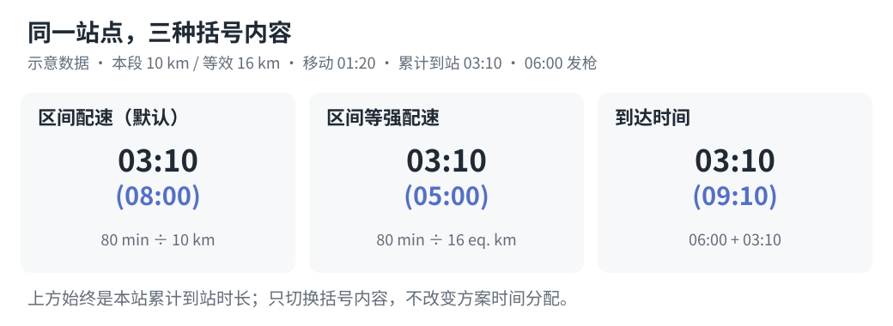

# 配置与命令行

[简体中文](configuration.md) | [English](configuration.en.md)

需要 Python 3.10+。GPX/KML 配速表仅使用标准库；FIT 输入需安装可选依赖。默认生成离线运行；选择按耗时规划携水时，可联网获取天气或使用用户确认的手动天气。下列命令以仓库根目录为工作目录；独立安装 Skills 后，脚本路径应相对于安装包目录解析。

## 默认值与覆盖规则

目标时间必填。省略可选字段时使用脚本默认值；修改已有配置时，其余字段沿用该配置。完整默认值见[参数表](#参数)。

合法的 `0` 或 `false` 按配置生效；例如 `fatigue_rate: 0` 关闭疲劳递增，`smoothing_m: 0` 关闭对应平滑。`null`、空字符串或空列表不能通用地表示“使用默认值”，无效类型或值会报错；`track_index: null` 表示自动选择唯一轨迹，站点 `cutoff: null` 表示未提供关门时间。

`targets` 优先于 `target`；将目标列表改为单个中心目标时，需要删除原 `targets`。`secondary_display` 未设置时沿用旧字段 `pace_basis` 的显式配置。缺少目标时间、存在多条路线未选定、CP 缺失或有歧义时，会停止并提示所需信息。自动展开的五组目标必须全部为正，否则需调整目标列表或间隔。

## 检查轨迹

```bash
python3 skills/even-effort-pace-chart/scripts/pace_chart.py inspect race.gpx
```

可选参数：`--track-index 1`、`--sample-m 5`、`--smoothing-m 20`、`--ascent-method hysteresis`、`--ascent-threshold-m 10`、`--ascent-smoothing-m 0`、`--elevation-spike-m 30`、`--distance-tolerance-m 0`。20 米窗口用于细节图示和坡度分布；爬升默认不做窗口平均，直接在清理后的原始海拔顶点上使用 10 米峰谷反转阈值。输出包括路线距离、爬升下降、处理参数、`diagnostics`、告警和 `cp_candidates`；候选点包含 ID、名称、识别标记及可能的轨迹投影位置，距离单位为米。GPX/KML 使用坐标计算的水平距离，FIT 使用设备记录距离。存在多条轨迹时，错误信息会列出序号，请选择后重新执行。

检查与生成必须使用同一组处理参数。`diagnostics` 包含原始及处理后距离、原始与清理后直接累计爬升、点距最小/中位/最大值、质量标记数量、尖峰修正数量与索引，以及距离简化试算结果。最终过滤后的爬升在顶层 `ascent_m`。距离试算仅诊断，不能证明 GPS 漂移；默认不会修改水平路径。

GPX 优先使用 track 作为路线几何；独立的 route 点和 waypoint 仍可提供 CP。只有 route 时，所选 route 同时提供轨迹和命名候选点。支持 GPX 1.0、1.1 和无命名空间文件。轨迹点必须有有效坐标及海拔；连续重复位置会被去除，不连续的轨迹段会报错，不会通过虚构直线连接。

## KML 输入

根据 XML 根元素自动识别 GPX 或 KML，不依赖扩展名。支持本地 KML 的 LineString 和 gx:Track，包括 Document/Folder、MultiGeometry、gx:MultiTrack 容器。几何未单独声明高度模式时，继承容器的模式。每条线或 track 按文档顺序对应独立的 `track_index`，不同路线不会自动拼接。普通坐标顺序为 `longitude,latitude,altitude`，gx:coord 为以空格分隔的 `longitude latitude altitude`。原始时间戳不参与目标配速分配。

所有轨迹位置必须提供有限的海拔数值。显式声明 `altitudeMode` 为 `absolute` 时直接使用。省略模式在 KML 中表示贴地显示，不能自动把坐标高度认定为海拔；确认这些高度可用于计算后，检查时传入 `--use-kml-altitudes`，生成时配置 `"use_kml_altitudes": true`。显式 `clampToGround` 也需要这一开关。该选择会产生告警，并保存在输出配置中。缺失高度不会填零；相对地面及海底模式即使开启开关也会报错，需要重新导出绝对高度。工具不下载地形数据或修正垂直基准。

```bash
python3 skills/even-effort-pace-chart/scripts/pace_chart.py inspect race.kml --use-kml-altitudes
```

```json
{
  "target": "24:00",
  "use_kml_altitudes": true
}
```

KML 中命名的 Point 地标提供 CP 候选，地标自身可以没有海拔。`placemark:3:point:1` 表示文档中第三个 Placemark 下的第一个 Point 几何。应以 `inspect` 实际返回的 ID 为准，修改源文件可能改变 ID。D1 等站名或任意村名需要通过 `cp_selection` 明确选用。同一文件同时包含独立起终点和共用起终点时，选择其中一种表示，避免端点重复。不支持 KMZ、以多边形充当路线或远程 NetworkLink 获取。各输入格式共用配置和四种导出器。

## FIT 作为路线输入

可直接提供 `.fit` 或只含一个 FIT 的 `.zip`，用于按实际跑过的路线重新规划。先安装依赖，再检查和生成：

```bash
python3 -m pip install -r skills/even-effort-pace-chart/scripts/requirements-comparison.txt
python3 skills/even-effort-pace-chart/scripts/pace_chart.py inspect activity-original.zip
python3 skills/even-effort-pace-chart/scripts/pace_chart.py generate activity-original.zip \
  --config race-fit.json --output-dir output/fit-route
```

使用 record 的设备累计距离，保留 GPS 坐标；不按坐标重新累计距离，也不按 session 或平台总量缩放。海拔优先取 `enhanced_altitude`，缺少时回退 `altitude`，缺失、非有限或非法类型会报错，不填零。同一累计距离保留最后一个点，避免停留时海拔波动形成零距离爬坡；正距离上的重复坐标保留。`diagnostics.distance_source` 为 `fit_recorded`，同时报告合并数和跳过数。

只支持单 session。缺 GPS、时间或距离的 record 会跳过并报告；剩余记录必须从距离 0 开始、距离与时间不倒退，合并后至少有两个不同距离。大于 100 米的距离间隔会告警；最后记录距离与 session 不同会报告且不补造末段。`track_index` 只能省略或为整数 1，`use_kml_altitudes` 不适用；`distance_tolerance_m` 必须为 0，避免水平简化替换设备距离。

此入口不把 FIT 的逐圈或 course point 当作补给站，使用人工 `checkpoints`，包含明确终点距离，单位为 FIT 累计公里。已有路线和核对过的实际经过时刻时，可按时刻插值 FIT 距离来映射原 CP，保留名称、顺序及经过时刻。爬升、下降仍按现有海拔算法重算，不直接采用佳明统计；实际活动侧的指标口径见[活动对比文档](comparison.md#地形指标与输入限制)。

## 仅配置目标时间

轨迹已包含可用 CP 时，最小配置如下：

```json
{
  "name": "Example trail race",
  "target": "24:00"
}
```

生成 23:00、23:30、24:00、24:30、25:00 五组方案。这些值是完赛用时，不是钟表时间。支持 `H:MM`、`H:MM:SS`，允许超过 24 小时。

可用 `"target_step_minutes": 15` 调整五组方案的间隔。也可以精确指定列表：

```json
{
  "targets": ["22:30", "24:00", "27:15"]
}
```

`targets` 优先于 `target`；同时提供时会告警，stdout 的 `summary.target_source` 显示 `"targets"`。时间必须为正且不重复，输出会排序。列表可以只有一组。默认展开五组时也必须全部为正，短距离比赛可直接使用明确的列表。

## CP 选择与覆盖

以下 ID 仅供示意，应使用 `inspect` 返回的真实 ID：

```json
{
  "target": "24:00",
  "cp_selection": ["wpt:1", "wpt:2", "wpt:3"],
  "checkpoint_overrides": {
    "wpt:1": {"name": "CP1 - Village", "rest_minutes": 5, "cutoff": "04:30"},
    "wpt:2": {"distance_km": 37.25},
    "wpt:3": {"allow_off_route": true}
  }
}
```

不设置 `cp_selection` 时，自动选择名称或类型中识别到的 CP/SP、checkpoint、aid station、water station、start/finish 及对应中文站点。最终顺序按轨迹累计距离排列。任意名称的点需要明确选择 ID，普通地标不会自动升级为 CP。轨迹投影存在多解或偏离超过 100 米时，会返回可操作的 JSON 错误。

覆盖字段包括 `name`、`distance_km`、`rest_minutes`、`cutoff`、`allow_off_route`。其中 `distance_km` 明确指定**处理后轨迹的累计公里数**（默认等于原始水平路径口径），同时确认该点在环线或折返中的出现位置，跳过坐标投影；位置必须在轨迹范围内。启用水平简化后应重新检查这些位置。

站点默认保留轨迹内名称，`rest_minutes` 为 `0`，`cutoff` 未提供时不校核，`allow_off_route` 为 `false`。未提供 `distance_km` 覆盖时按坐标与端点规则定位；手工 CP 列表中的名称与累计距离则是必填项。不能根据目标时间、站名或示例推断停留、关门、里程覆盖或偏离许可。

共用起终点在距轨迹首尾均不超过 100 米时，展开成 `<candidate-id>:start` 和 `<candidate-id>:finish`，保留场地名称。配置仍使用原始候选 ID，关门时间只应用于终点，停留必须为零。设置 `distance_km` 则将其作为单个明确定位的站点。

关门时间是从发枪起算的经过时长。到站已超时记为 `arrival_late`；到站未超时、停留后出站超时记为 `departure_late`，不擅自替赛事选择判定规则。恰好等于关门时间视为按时；缺失时记为 `not_checked`。起终点不能设置出站停留。

## 手工 CP 列表

仅在内嵌 CP 缺失或不可用时使用。必须包含带累计距离的终点，零公里起点可省略。GPX/KML 可使用官方累计里程；FIT 路线使用该次记录的设备累计距离。

以下是 GPX/KML 官方里程需要确认后映射的示例：

```json
{
  "target": "24:00",
  "distance_alignment": "scale",
  "checkpoints": [
    {"name": "Start", "distance_km": 0},
    {"name": "CP1", "distance_km": 25, "rest_minutes": 8, "cutoff": "06:00"},
    {"name": "CP2", "distance_km": 60, "rest_minutes": 12, "cutoff": "15:00"},
    {"name": "Finish", "distance_km": 100, "cutoff": "28:00"}
  ]
}
```

距离必须严格递增；`checkpoints` 不能与 GPX/KML 候选点选择或覆盖混用。起终点停留必须为零。

`distance_alignment` 默认为 `"confirm"`：手工终点距离与路线总长的差异超过 `max(100 米, 路线总长的 0.5%)` 时停止。确认后设置 `"scale"`，可将手工各站里程按比例映射到路线总长；路线本身不会缩放。容差内使用 `"confirm"` 时保留中间站公里位置，仅将终点吸附至路线末端。输出记录映射比例；GPX/KML 保留输入的官方里程，FIT 的 `official_distance_km` 为空，应使用该次记录的设备距离。

## 参数

| 参数 | 默认值 | 含义 |
| --- | --- | --- |
| `target` / `targets` | 必须提供其一 | 中心目标或明确的目标列表；`targets` 优先 |
| `name` | 输入文件名，不含扩展名 | 图表名称 |
| `start_time` | `"06:00"` | 本地发枪时间，格式为 `HH:MM`、`YYYY-MM-DD HH:MM` 或 `YYYY-MM-DDTHH:MM`；主行始终为经过时长 |
| `secondary_display` | `"pace"` | 括号内显示：`"pace"` 区间配速、`"equivalent_pace"` 区间等强配速、`"arrival_time"` 到达钟点 |
| `output_formats` | `["svg"]` | 非空且无重复的输出格式列表，可选 `"svg"`、`"html"`、`"csv"`、`"json"` |
| `pace_basis` | `"distance"` | 兼容旧配置，`"equivalent"` 选择等强配速；显式设置 `secondary_display` 优先 |
| `track_index` | 唯一的轨迹 | 从 1 开始的 GPX track/route 或 KML 线/track 序号；FIT 只能省略或设为 1 |
| `checkpoints` | 使用轨迹内 CP | 缺少可用内嵌 CP 时提供手工列表，不能与候选点选择或覆盖混用 |
| `cp_selection` | 自动识别的站点 | 显式选择 `inspect` 返回的候选点 ID |
| `checkpoint_overrides` | `{}` | 覆盖选定站点的名称、停留、关门或定位等字段 |
| `distance_alignment` | `"confirm"` | 手工终点距离不匹配时要求确认；明确设置 `"scale"` 才按比例映射 |
| `use_kml_altitudes` | `false` | 布尔值；显式采用未声明模式或 clampToGround 的 KML 坐标高度，对 GPX 无影响 |
| `sample_m` | 5 | 显示及启用窗口平滑时的沿距离插值间隔，单位米，必须大于零；关闭爬升平滑时保留原始海拔顶点 |
| `smoothing_m` | 20 | 图示与坡度分布的完整居中平均窗口，单位米；0 关闭 |
| `ascent_method` | `"hysteresis"` | 峰谷反转阈值法；`"window"` 选择窗口法，不使用峰谷阈值 |
| `ascent_threshold_m` | 10 | 峰谷反转阈值，单位米，非负；0 关闭峰谷过滤，不是相邻点最小高差 |
| `ascent_smoothing_m` | 0 | 爬升统计前的独立完整居中平均窗口，单位米；默认关闭，正数启用，大窗口仍会削弱短坡 |
| `elevation_spike_m` | 30 | 孤立海拔尖峰的最小预测偏差，单位米；0 关闭，还需满足模型中的距离与坡度条件 |
| `distance_tolerance_m` | 0 | 水平几何简化容差，单位米；0 不简化，正值显式启用并可能缩短真实小弯道 |
| `ascent_km_per_100m` | 1 | 每爬升 100 米增加的等效公里数，非负 |
| `fatigue_rate` | 0.08 | 等效距离翻倍时的平均配速倍率减一，范围 0–1 |
| `water_mode` | `"distance"` | `"distance"` 按等效距离比较水量；`"time"` 按移动耗时和确认的个人速率估算 |
| `water_ml_per_10km` | 700 | 距离模式下每 10 等效公里的比较用水量，非负，单位毫升 |
| `water_target` | 单目标时自动选中 | 耗时模式的水量参考目标；多目标时必填，须与某个展示目标一致 |
| `water_ml_per_hour` | 耗时模式生成时必填 | 用户确认的默认饮水速率，有限正数，单位毫升/小时 |
| `water_buffer_minutes` | 0 | 耗时模式每段额外预留分钟数，非负 |
| `water_rate_overrides` | `{}` | 耗时模式按出发站 ID 覆盖饮水速率，值为有限正数，单位毫升/小时 |
| `water_timezone` | 无 | 自动天气必填的 IANA 时区，例如 `"Asia/Shanghai"` |
| `water_weather` | 无 | 耗时模式使用的已确认自动预报快照或手动天气；未提供时先获取预览 |
| `target_step_minutes` | 30 | 自动展开五组时的相邻间隔，必须大于零，单位分钟 |

未知的配置或站点字段会报错，数值必须有限。不会获取或编造实测海拔；源数据缺失时应先补全。采样最多允许 2,000,000 个区间，另含精确终点；过小的 `sample_m` 会返回输入错误。小到不足以可靠计算窗口边界的正平滑窗口也会报错，请增大对应窗口或设为 `0` 关闭平滑。

海拔处理和时间分配公式见[模型与限制](model.md)。

## 按耗时规划携水

默认 `"water_mode": "distance"` 按等效距离计算比较用水量，无需联网。切换为 `"time"` 后，下一段携水量为 `(下一段移动秒数 / 3600 + 每段余量分钟 / 60) * 本站出发饮水速率`；不包含站内停留。饮水速率由用户结合个人经验、天气和补给条件确认，程序不会根据天气自动套用倍率。

旧配置中的 `"water_mode": "manual"` 已不再支持：删除该项可使用默认距离模式，或改为 `"time"` 并按以下步骤补全速率和天气。手动天气来源仍可使用。

自动天气的示例配置如下，将日期、时间、时区和目标替换为实际比赛信息：

```json
{
  "targets": ["14:00"],
  "start_time": "2026-11-06 06:00",
  "water_mode": "time",
  "water_timezone": "Asia/Shanghai",
  "output_formats": ["svg", "json"]
}
```

1. 先按[检查轨迹](#检查轨迹)确认路线和站点，再执行：

   ```bash
   python3 skills/even-effort-pace-chart/scripts/pace_chart.py generate race.gpx \
     --config race.json --output-dir output/race > water-preview.json
   ```

   首次自动查询的 stdout JSON 中，`status` 为 `"needs_water_confirmation"`，`outputs` 为空，尚未写入配速表。`water_weather` 包含获取时间 `retrieved_at` 和各段 `segments`，每段有起终站、路线中点坐标、时间及逐小时的气温（°C）、相对湿度（%）、风速（km/h）和降水概率（%）；时间戳采用 UTC。参考目标不影响配速分配。
2. 查看预报并确认个人饮水速率后，将 `water-preview.json` 的**完整 `water_weather` 对象**复制到 `race.json`，把其中 `confirmed` 改为 `true`，并加入用户确认的 `water_ml_per_hour`。如需额外余量或分段速率，可加入下列字段；数值仅为格式示例，应替换为用户确认的值：

   ```json
   {
     "water_ml_per_hour": 600,
     "water_buffer_minutes": 15,
     "water_rate_overrides": {"wpt:1": 750}
   }
   ```

   覆盖键是**出发站 ID**，应以检查或生成摘要的实际 ID 为准，不能使用终点 ID；起点可能为 `start`，人工站点 ID 以 `manual:` 开头。没有覆盖的赛段使用默认速率。余量对每一段分别生效。
3. 重新执行上面的 `generate` 命令即可输出配速表；如果希望直接查看生成结果，可去掉 `> water-preview.json`。匹配的已确认快照不会重复联网。需要更新预报时从配置删除 `water_weather`，重新执行预览并再次确认。路线、参考目标、发枪时间、时区或站点时程变化时，旧快照会失效并返回新预览。

若使用 `target` 自动展开五个目标，或在 `targets` 中列出多个目标，必须额外指定匹配表中某列的 `"water_target": "14:00"`；单个 `targets` 则自动选中。整张多目标表共用这一个参考目标的水量。

自动预报需要带日期的当地 `start_time` 和有效的 IANA `water_timezone`，跨日按时区转换后查询；夏令时造成的歧义或不存在的当地时间会报错。Python 需要可用的 IANA 时区数据库；系统未提供时可安装 `tzdata`，或使用手动天气。请求会将每个赛段中点的经纬度发送给 [Open-Meteo](https://open-meteo.com/)，其免费 API 限非商业用途。预报最多覆盖未来 16 天，实际可用范围和数据完整性取决于接口；赛前应更新预报，山地微气候和整段条件可能与中点不同。

无法联网、比赛日期超出预报范围或预报不完整时，可用用户确认的手动天气直接生成，不需要比赛日期、时区或网络。在目标和耗时模式配置中加入：

```json
{
  "water_ml_per_hour": 600,
  "water_weather": {
    "source": "manual",
    "confirmed": true,
    "description": "用户确认的天气情况和个人饮水经验"
  }
}
```

示例速率不是推荐值。无论哪种模式，都应核实下一站是否供水及容器容量；若某站不能补水，需要结合实际补给安排另行规划。

## 旧窗口口径与显式过滤

要选择原先的 100 米窗口统计思路，在已有目标配置中加入：

```json
{
  "ascent_method": "window",
  "ascent_smoothing_m": 100
}
```

对应检查参数为 `--ascent-method window --ascent-smoothing-m 100`。边界和积分问题也已修复，数值不保证与旧版完全相同。只有 `ascent_smoothing_m: 100` 的旧配置会在窗口后继续应用新的默认峰谷阈值；明确选择 `window` 才是不加峰谷阈值的窗口法。

水平简化需明确配置，例如 `"distance_tolerance_m": 2`，检查时使用 `--distance-tolerance-m 2`；不能因试算出现距离下降就自动开启。海拔尖峰修正默认开启并报告改动，明确要求保留所有源海拔时用 `"elevation_spike_m": 0`。同时将 `ascent_threshold_m` 和 `ascent_smoothing_m` 设为 0，可直接在原始顶点上累计升降。原始轨迹文件始终不改写。

## 括号内显示内容

`secondary_display` 同时控制 HTML 和 SVG 的括号内容及表头标注：

`start_time` 与括号显示内容独立。只提供“出发时间早上六点”时，括号仍默认显示配速；只有明确要求或提供配置选择到达时间时，才设置 `"arrival_time"`。

| 值 | 标注 | 计算方式 |
| --- | --- | --- |
| `"pace"` | 区间配速 | 本段移动秒数 / 本段路线公里数，默认值 |
| `"equivalent_pace"` | 区间等强配速 | 本段移动秒数 / 本段等效公里数 |
| `"arrival_time"` | 到达时间 | `start_time` + 本站累计到站时长，使用本站停留前的时间 |



两种配速均显示 `MM:SS`，按秒取整；起点无上一段，因此没有配速括号。到达钟点显示 `HH:MM`，秒数向下截断，起点显示发枪钟点。跨过发枪日的午夜后标注“次日”，两天及以上标注“+N天”，例如 `(次日 01:20)`、`(+2天 00:30)`。时间采用赛事当地时间，不进行时区或夏令时转换。未提供 `start_time` 时按早上 `06:00` 发枪，不假定比赛日期；显式时间优先。JSON 的 `parameters.start_time` 记录实际使用的值。

例如，将以下字段加入含目标时间的配置：

```json
{
  "start_time": "2026-10-31 23:30",
  "secondary_display": "arrival_time"
}
```

未设置 `secondary_display` 时，旧配置 `pace_basis: "equivalent"` 仍显示等强配速，其余默认显示配速。显式选择 `"pace"` 或 `"equivalent_pace"` 时，也会将输出参数 `pace_basis` 和 JSON/CSV 的 `pace_seconds_per_km` 同步到所选口径；选择 `"arrival_time"` 时保留原 `pace_basis` 的数值口径。两种原始配速字段始终保留，三种模式都不改变时间分配。

## 生成与输出

```bash
python3 skills/even-effort-pace-chart/scripts/pace_chart.py generate race.gpx \
  --config race.json --output-dir output/race
```

默认只写入 `pace-chart.svg`。如需其他格式，在比赛配置中设置 `output_formats`；以下配置选择全部四种格式，也可以只选择其中一种或几种，文件路径按数组顺序返回：

```json
{
  "output_formats": ["svg", "html", "csv", "json"]
}
```

空列表、不支持的格式和重复格式会报错。仅在确实需要替换已有结果时使用 `--overwrite`，否则任一**已选择格式**的目标文件存在都会阻止写入；未选择的已有文件不影响生成，也不会被修改或删除。目标文件不能是目录或符号链接。所有选定内容先写到输出目录内的临时目录并备份原文件，再逐个替换；替换发生文件错误时恢复已替换文件、删除本次新建文件。恢复本身失败时保留临时目录，并在错误的 `details.recovery_directory` 中返回位置供人工恢复。此机制处理可捕获的文件错误，不保证断电、进程被强制结束或并发写入时的多文件原子性；同一输出目录应避免并发生成。

成功时 stdout 返回 JSON，包含以下字段，无需额外选择 JSON 文件导出：

| 字段 | 内容 |
| --- | --- |
| `outputs` | 本次生成的文件路径，按 `output_formats` 顺序 |
| `warnings` | 模型限制、未提供关门时间、配置冲突等告警 |
| `summary.parameters` | 实际生效的数值参数、输出格式、括号内容、发枪时间、总停留秒数 |
| `summary.target_source` / `summary.targets_seconds` | 生效目标来自 `target` 还是 `targets`，以及排序后的目标秒数 |
| `summary.route` / `summary.checkpoints` | 路线统计及 `diagnostics` 输入质量/处理前后对比，以及按路线排序的 CP ID、名称、累计米数、停留和关门秒数 |
| `summary.verification` | `finish_targets_match` 检查终点是否等于目标；`rests_match` 检查各站出入时间差是否等于停留；`cutoff_checked_stations` / `cutoff_unchecked_stations` 统计除起点外的站点；`cutoff_failures` 列出目标秒数、站点 ID 和超时状态 |

摘要不包含完整剖面或逐站逐目标时间表；需要这些数据时显式导出 JSON。摘要核对的是计算一致性，不代表已核实赛事规程。预期的输入或文件错误通过 stderr 输出 JSON，退出状态为 2。

可选输出如下，默认只生成 SVG，其余文件需显式选择：

- `pace-chart.html`：白底灰线、黑色图示及黄/红/绿/蓝色地形补给列，打印重复表头，小屏可横向滚动。
- `pace-chart.svg`：包含文字及分段矢量图的独立 SVG，不使用 HTML foreignObject 或外部资源。
- `pace-chart.csv`：UTF-8 BOM，按 CP 和目标展开为长表，包含原始秒数、累计时长、上一段的 `segment_water_ml` 和下一段的 `water_ml`；耗时模式另含参考目标、每站速率、余量和天气来源；可能被表格软件识别为公式的站名会转义。
- `pace-chart.json`：完整精度数据，包括参数、配置、输入 SHA-256、站点统计、配速计划、坡度比例、肖像、告警和文章来源；耗时模式还保留确认的天气和逐站速率。结构版本为 2，几何单位为米，时间为秒，等效距离为公里；版本 2 的 `water_ml` 对应下一段，`segment_water_ml` 对应上一段。

累计主时间为出站时长，显示 `HH:MM`，秒数向下截断，可超过 24 小时；配速模式下，有停留的站点额外显示到站时长。到达钟点模式将本站到达信息直接放入括号，不再增加该行。JSON/CSV 同时保留 `distance_pace_seconds_per_km`、`eq_pace_seconds_per_km` 和所选的 `pace_seconds_per_km`，到站、出站仍为发枪后的累计秒数，钟点仅用于图表展示。HTML/SVG 使用 Target 与小时数作列标题；CSV 格式化累计时间保留秒，原始 JSON/CSV 保留计算精度。位置列仅展示实际提供的关门时间；缺失时仍在 CLI 和 JSON 告警，实际超时在目标单元格标示。JSON/CSV 保留每个站点的校核状态。

HTML/SVG 的可见内容到表格结束，不附加说明页脚；计算参数和告警保留在 JSON 与 CLI，来源保留在 HTML/SVG 元数据及 JSON 中。

水量列是从本站出发去**下一站**的参考量：起点显示首段、中间站显示下一段、终点为零。距离模式的图表注明等效距离换算比例，提示仅供赛段比较、并非个人饮水建议。耗时模式在图表水量格内显示各段速率，表头注明参考目标、默认速率、余量和天气来源。地形统计和括号内配速描述刚完成的上一段；等效距离保留在 CSV/JSON，不额外占用可见表格列。

历史 CSV 字段 `gpx_distance_km` 表示所选路线的累计距离：GPX/KML 为坐标计算的水平距离，FIT 为设备记录距离。里程不匹配错误中的历史字段 `gpx_m` 同样表示所选路线总长，单位米。这些名称保留以兼容现有使用者。图表标签仍为中文，文档双语不改变输出文字。
