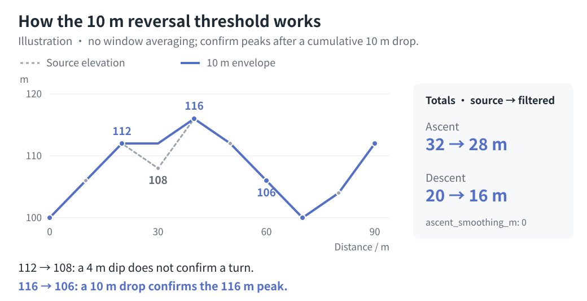

# Model, provenance, and limitations

[简体中文](model.md) | [English](model.en.md)

## Source

Conceptual reference: "耐力科学|体感一致配速表全面指南", 耐力学社 / Pili (表哥), published by 耐力學社 on 2025-08-26; the article credits 隆景体育.

Original: https://mp.weixin.qq.com/s/spYCP-upbqAZN0kzUm-0ng

The repository archive is `docs/reference/耐力科学_体感一致配速表全面指南.md`, with its illustrations under `docs/reference/assets/pace-chart/`. These paths are relative to the repository root. The Skills package remains usable when copied independently; it does not require the archive at runtime.

The equations below describe this project's equivalent-distance and fatigue-curve implementation. The reference article does not expose RunArt.Net's full algorithm; charts generated here are not official output. The article's copyright notice remains in the archive.

## Input normalization

GPX, KML, and FIT become the same ordered `(latitude, longitude, elevation)` profile and distance axis before smoothing, CP projection, and schedule calculation. Original timestamps do not determine the target schedule; distinct line geometries remain separate route selections rather than automatically concatenated segments. Supported formats, altitude modes, and explicit overrides are defined in the [configuration reference](configuration.en.md). Permission to use coordinate heights does not establish that they are surveyed sea-level elevations.

## Distance and elevation

GPX/KML use horizontal cumulative distance from the haversine formula on a sphere of radius 6,371,008.8 m. Elevation does not lengthen geometric distance. FIT routes use recorded device distance directly and prefer `enhanced_altitude`, falling back to `altitude`; repeated distances retain the last point and horizontal simplification is disabled. All distance weighting, grades, and equivalent distances below use the selected route's distance axis. FIT device distance need not equal horizontal distance recomputed from coordinates. Processing order: validate and deduplicate source points, handle isolated elevation spikes, optionally simplify GPX/KML horizontal geometry, build separate display and ascent curves, then split at CPs.

FIT route ascent/descent are also recomputed from per-record elevations with the filters below. Lap, session, and platform totals do not replace them, and no rescaling forces agreement with Garmin. Using the same FIT as route and activity supports retrospective pacing-model review; terrain comparisons show differences between the point-based algorithm and platform statistics.

### Input quality and horizontal distance

The original horizontal path is retained by default. Only `distance_tolerance_m > 0` enables RDP simplification bounded by lateral deviation. Block anchors are retained approximately every 250 m, together with endpoints, closed loops, and points that reverse progress along a chord. Real turns smaller than the tolerance can still be simplified; removed distance is not proof of GPS drift.

Simplification changes horizontal geometry without discarding intermediate elevation observations. Each observation is located by its spatial projection onto the retained chord. Backward or coincident projections introduce extra anchors, keeping distances strictly increasing and preventing elevation from being moved across a CP. Elevation order is retained, and CPs are projected onto the processed geometry. Explicit cumulative distances use this processed distance basis too; recheck CPs after enabling simplification instead of reusing old projections.

With simplification disabled, a 5 m tolerance trial still diagnoses sensitivity. A reduction exceeding `max(10 m, 1% of original distance)` produces a warning without changing distance. GPX `hdop > 10`, `vdop > 20`, `fix=none/unknown`, and invalid quality values are diagnostic only; they do not automatically delete points. Missing quality fields do not establish accuracy. Timestamps may come from route-planning software, so they do not trigger automatic speed filtering.

### Elevation spikes

`elevation_spike_m` defaults to 30 m; 0 disables correction. An isolated interior point is corrected only when all of these conditions hold:

- Its residual from linear prediction between its neighbors reaches the configured threshold.
- The neighbors are at most 50 m apart on the route distance axis, and both absolute adjacent grades exceed 200%.
- It is above both or below both neighbors, whose elevations differ by less than half the threshold.
- Neither adjacent point is also flagged as a potential spike.

Replace that elevation with the neighbors' linear prediction, recording indices, count, and a warning. This is conservative anomaly detection, not surveyed correction: endpoints, sustained steps, multi-point corruption, and low-amplitude noise are not automatically corrected. Very narrow real terrain may also satisfy the rule. Indices are zero-based after input deduplication: consecutive duplicate coordinates are removed for GPX/KML, and consecutive duplicate distances are merged for FIT. Source files remain unchanged and their SHA is retained.

### Display curve and boundaries

Emit samples every **5 m** plus the exact endpoint. The default **20 m full-width centered window** computes a distance-weighted elevation average. Integration uses all vertices of the input polyline directly, avoiding the loss of between-grid peaks before averaging. Near either endpoint, shrink the window symmetrically and retain the endpoint height itself. Noise-free linear slopes consequently retain their full elevation change. A zero window performs linear interpolation only.

### Ascent and descent

Defaults are `ascent_method: "hysteresis"`, `ascent_threshold_m: 10`, and `ascent_smoothing_m: 0`:

1. Track running peaks and valleys directly on cleaned source elevation vertices, without window averaging. Do not substitute the display curve's 5 m sampling grid for source vertices, so short hills between grid points are retained.
2. Confirm a reversal only after a cumulative opposite change of at least 10 m. This is not a minimum adjacent-point difference, so gradual continuous climbs accumulate correctly.
3. Between confirmed extrema, build a monotone envelope at the same along-route distances. This suppresses minor reversals while retaining the source curve's plateaus and the location of major climbs.
4. Retain both endpoint heights and the initial/terminal extrema participating in a confirmed threshold span. Boundary fragments may therefore include subthreshold ascent/descent, but confirmed terrain is not erased and net elevation change is preserved. If the whole profile varies by less than the threshold, only its net start-to-end change remains.
5. Insert CP boundary heights into this curve and accumulate positive/negative changes. Filter globally before splitting; adding CPs does not reset the algorithm or change total ascent/descent.



No averaging and a 10 m threshold are an engineering tradeoff that retains source extrema while suppressing small reversals, not an accuracy guarantee or a community standard. Subthreshold round-trip undulations may be ignored, while elevation noise exceeding the threshold may still count as ascent. Do not infer elevation provenance or adjust filters automatically from file format, point density, or exporting software.

An explicit positive `ascent_smoothing_m` enables an independent full-width centered average; for example, 40 m means 20 m on each side. Average by distance and emit samples every 5 m before applying the reversal threshold, using the same integration and endpoint rules as the display curve. Averaging can suppress real short hills. An explicit `ascent_threshold_m: 0` disables only peak/valley filtering: with the default `ascent_smoothing_m: 0`, changes are summed directly at cleaned source vertices; explicitly enabled averaging remains active. Positive changes in the display curve need not sum to reported ascent.

The window method sums changes on the ascent curve without applying the peak/valley reversal threshold. See [configuration](configuration.en.md#previous-window-method-and-explicit-filtering) for settings and legacy compatibility.

### Examples and limitations

See [ascent methods and selection rationale](ascent-options.en.md) for the default choice and activity/route comparisons. Results depend on filtering scale; agreement with a reference is neither ground truth nor general calibration, and parameters must not be tuned solely to match a platform total.

For methodological comparisons, see [GPS Visualizer's elevation thresholds](https://www.gpsvisualizer.com/tutorials/elevation_gain.php), [GPSBabel's quality filters](https://www.gpsbabel.org/htmldoc-1.10.0/filter_discard.html), and [Strava's elevation FAQ](https://support.strava.com/en-us/articles/15402093-elevation-on-strava-faqs). This implementation's peak/valley envelope and defaults are independent choices, not reproductions of those tools.

Interpolation cannot recover missing terrain detail; original point gaps over 100 m produce a warning. No external DEM, road matching, or surveyed elevation correction is used. Filtering cannot establish true distance or ascent from the track alone; retain input provenance and parameters with the results.

Each segment's seven slope bins are weighted by the selected route distance. Boundaries, in percent, are `(-inf, -15]`, `(-15, -10]`, `(-10, -5]`, `(-5, 5)`, `[5, 10)`, `[10, 15)`, `[15, inf)`. The center bar is white; descent is on the left and ascent on the right. Segment profile thumbnails use independent horizontal and vertical scales and must not be compared as equal-scale maps.

## Equivalent distance

For a segment:

```text
E = route_distance_km + ascent_m / 100 * ascent_km_per_100m
```

The coefficient defaults to 1 km per 100 m of ascent, following the article's common baseline. Downhill does not subtract equivalent distance. Steep descents and technical terrain can demand extra effort that this scalar model does not capture.

## Fatigue and finish targets

Let `r` be `fatigue_rate` (default 0.08), `E_total` the total equivalent distance, and `E_i` the cumulative equivalent distance through station i.

```text
b = 1 + log2(1 + r)
T_move = T_finish - sum(station_rest_seconds)
M_i = T_move * (E_i / E_total)^b
segment_moving_i = M_i - M_(i-1)
segment_eq_pace_i = segment_moving_i / segment_equivalent_km
segment_distance_pace_i = segment_moving_i / segment_route_km
arrival_i = M_i + sum(rest before station i)
departure_i = arrival_i + rest_i
```

`r = 0` gives constant equivalent pace. With the default, average pace over a doubled equivalent distance changes by the factor `2^(b-1) = 1.08`. The curve is normalized separately for each target, so every final departure is exactly that target before presentation rounding.

Rest is explicit and included once; no automatic extra delay or stop is inferred. Every target must exceed total rest. Time calculations retain floating-point precision; segment totals calculated from rounded display values may differ slightly.

Segment pace is moving time divided by route kilometres; equivalent pace divides that same time by equivalent kilometres. Arrival clock time adds cumulative arrival duration to the race start, giving local time before the current station rest.

Calculations retain full precision; display modes and export formats preserve timing allocation. See [parenthesized display](configuration.en.md#parenthesized-display) for display selection, start time, and legacy compatibility, and [generation and outputs](configuration.en.md#generate-and-outputs) for display precision and output fields.

These columns are pre-race reference schedules. Switching to an adjacent column mid-race does not recompute the remaining schedule from the runner's current time, fatigue, or position.

## Water and uncertainty

The default `water_mode: "distance"` compares segment water as `E / 10 * water_ml_per_10km`, with an article-inspired baseline of 700 mL per 10 equivalent kilometres. It expresses relative demand.

The optional `water_mode: "time"` estimates carry amounts using one selected target's moving times and user-confirmed personal rates:

```text
next-leg water ml = (next-leg moving seconds / 3600 + buffer minutes / 60) * departure rate ml/h
```

Moving time runs from departure at this station to arrival at the next, excluding station rest. The buffer applies to each leg; per-station rate overrides use the departure ID. Every column of a multi-target table shares the selected target's water estimates. Automatic weather forecasts inform the user's choice of rate; they do not automatically change the rate or pacing. See [configuration](configuration.en.md#time-based-water-planning) for manual weather and the workflow.

In both modes, `segment_water_ml` describes the incoming leg, while displayed `water_ml` describes the next leg and is zero at the finish. Time-based estimates depend on personal drinking needs, conditions, pace, and station supplies; they do not guarantee actual needs or replace race safety planning. Check container capacity and water availability at the next station.

The input route alone cannot establish an achievable finish target. The pacing model does not account for terrain surface, steep descent load, weather, congestion, altitude response, runner fitness, nutrition, or recovery. Missing race cutoffs remain unchecked. Route-derived totals can differ from organizer statistics because of geometry, elevation source, smoothing, and distance mapping.
