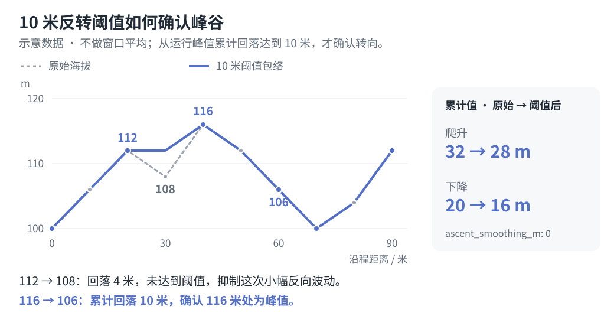

# 模型、来源与限制

[简体中文](model.md) | [English](model.en.md)

## 来源

概念参考：《耐力科学|体感一致配速表全面指南》，耐力学社 / Pili（表哥），由耐力學社于 2025-08-26 发布；原文注明文章来源于隆景体育。

原文：[公众号文章](https://mp.weixin.qq.com/s/spYCP-upbqAZN0kzUm-0ng)。

仓库归档为 `docs/reference/耐力科学_体感一致配速表全面指南.md`，配图位于 `docs/reference/assets/pace-chart/`，均相对于仓库根目录。Skills 可以独立复制使用，运行时不依赖归档资料。

以下公式说明本项目对等效距离与疲劳曲线的实现。参考文章未公开 RunArt.Net 的完整算法，本项目生成结果并非官方输出。原文版权声明保留在归档中。

## 输入归一化

GPX、KML 和 FIT 都转换为统一、有序的 `(latitude, longitude, elevation)` 轨迹与距离轴，再进行平滑、CP 投影和配速计划计算。原始时间戳不决定目标配速；不同线几何是独立路线选项，不会自动拼接。支持的格式、高度模式及显式覆盖规则统一见[配置文档](configuration.md)。允许读取坐标高度并不证明其为实测海平面高程。

## 距离与海拔

GPX/KML 使用半径为 6,371,008.8 米的球体和 haversine 公式计算累计水平距离，海拔不增加几何距离。FIT 路线直接使用设备记录距离，海拔优先 `enhanced_altitude`、回退 `altitude`；重复距离保留最后一点，水平简化禁用。以下距离加权、坡度和等效距离均使用所选路线的距离轴；FIT 设备距离不保证等于坐标重算的水平距离。处理顺序为：原始点校验与去重 → 孤立海拔尖峰处理 → GPX/KML 可选水平简化 → 独立生成显示曲线和爬升曲线 → CP 分段。

FIT 路线的爬升、下降同样由逐点海拔经过下述过滤后计算，不采用逐圈、session 或平台总量替代，不为接近佳明汇总而缩放。以同一 FIT 作为路线和实际活动时，时间对照用于赛后配速模型复盘；地形对照反映逐点算法与平台统计的口径差异。

### 输入质量与水平距离

默认保留原始水平路径。`distance_tolerance_m > 0` 才启用按横向偏差约束的 RDP 简化；每累计约 250 米保留一个分块锚点，同时保留首尾、闭环及沿弦段方向的回退点。块内小于容差的真实弯道仍可能被简化，因此不能把距离减少量直接解释为 GPS 漂移。

简化仅改变水平几何，不删除中间海拔观测：每个原始点按其在保留弦段上的空间投影定位，投影发生回退或重合时增设锚点，保证累计距离严格递增，避免把海拔移动到 CP 的另一侧。海拔序列保留，CP 在处理后的几何上重新定位。显式累计里程也使用处理后的距离口径；启用简化后应重新检查 CP，不能直接沿用旧投影。

不启用简化时仍试算 5 米容差的距离敏感性；减少量超过 `max(10 米, 原距离的 1%)` 时告警，实际距离不变。GPX 的 `hdop > 10`、`vdop > 20`、`fix=none/unknown` 及非法质量值仅作诊断，不自动删点。无质量字段不代表数据可靠；时间戳可能是规划软件生成的，不据此自动套用运动速度限制。

### 海拔尖峰

`elevation_spike_m` 默认 30 米，0 关闭。仅修正同时满足以下条件的孤立内点：

- 相对前后点线性预测的偏差至少达到配置阈值。
- 前后点在路线距离轴上的间隔不超过 50 米，两侧绝对坡度均超过 200%。
- 内点同时高于或低于两个邻点，邻点高差小于阈值的一半。
- 相邻点未同时被标为可疑尖峰。

用两个邻点的线性预测值替换该点，并记录数量、索引和告警。这是保守的异常检测，不是测量纠正：端点、持续台阶、多点错误或低幅噪声不自动修正，极窄的真实地形也可能满足条件。索引从 0 起算，指输入去重后的点序列：GPX/KML 去除连续重复坐标，FIT 合并连续重复距离。原文件不改动，来源 SHA 保留。

### 显示曲线与边界

沿距离每 **5 米**输出一个采样点，加入精确终点；默认取 **20 米完整居中窗口**内的距离加权海拔平均。积分直接使用输入折线上的所有顶点，避免先重采样丢掉网格之间的峰谷。靠近首尾时对称缩短窗口，端点保留输入高度；因此无噪声的线性坡保留完整高差。窗口为 0 时仅线性插值，不做平均。

### 累计爬升与下降

默认 `ascent_method: "hysteresis"`、`ascent_threshold_m: 10`、`ascent_smoothing_m: 0`：

1. 直接在清理后的原始海拔顶点上追踪运行峰谷，不做窗口平均，也不使用显示曲线的 5 米采样网格替代原始顶点，避免丢失网格之间的短坡。
2. 反向变化达到 10 米才确认峰谷转向。阈值针对累计反向变化，不针对相邻点高差，因此连续缓坡不会因单步变化小而丢失。
3. 在确认的峰谷之间构造保留沿程距离位置的单调包络，抑制小幅反向波动，同时保留源曲线中的平台和主要爬坡所在区间。
4. 保留全程首尾高度，以及参与已确认阈值跨度的初始和末端极值。因此边界可能包含小于阈值的升降，但不会抹掉已识别的有效起伏，首尾净高差仍守恒。若整条路线起伏都不足阈值，只保留首尾之间的净变化。
5. 在处理后的曲线上插入 CP 边界高度，再累计正负变化。先处理全程后分段，拆分 CP 不重置算法，各段爬升下降之和等于全程。



不平滑与 10 米阈值是保留源海拔峰谷、抑制小幅反转的工程取舍，不是精度保证或社区统一标准。小于反转阈值的往返起伏可能被忽略，超过阈值的海拔噪声仍可能计入爬升。不按文件格式、点密度或导出软件自动判断海拔来源或调整过滤参数。

显式设置正数 `ascent_smoothing_m` 可启用独立的完整居中窗口平均，例如 40 米表示前后各 20 米。按距离加权平均后每 5 米输出一个点，积分与首尾边界规则同显示曲线，再应用峰谷阈值；窗口平均可能削弱真实短坡。`ascent_threshold_m: 0` 仅关闭峰谷过滤；保持默认的 `ascent_smoothing_m: 0` 时，直接累计清理后的原始顶点升降，已显式开启的窗口平均则仍然生效。显示曲线与爬升统计的正变化总和不必相等。

窗口法直接累计爬升曲线的升降，不使用峰谷反转阈值；设置和旧配置兼容说明见[配置文档](configuration.md#旧窗口口径与显式过滤)。

### 示例与方法边界

默认方案的选择依据、活动与赛道对比见[爬升算法方案](ascent-options.md)。结果依赖过滤尺度，接近参考值不是地面真值或通用校准依据，不应仅为匹配平台总量调参。

方法对照可参阅 [GPS Visualizer 的海拔阈值说明](https://www.gpsvisualizer.com/tutorials/elevation_gain.php)、[GPSBabel 的质量筛点](https://www.gpsbabel.org/htmldoc-1.10.0/filter_discard.html) 和 [Strava 的海拔统计说明](https://support.strava.com/en-us/articles/15402093-elevation-on-strava-faqs)。本实现的峰谷包络与默认参数是独立选择，不声称复现这些工具。

插值不能补回原始缺失的地形细节，原始相邻点超过 100 米时告警。本工具不使用外部 DEM、道路匹配或实测海拔校正。任何过滤都不能仅凭轨迹证明真实距离与爬升；输入来源和参数必须随结果保留。

七档坡度按所选路线距离加权。百分比边界为 `(-inf, -15]`、`(-15, -10]`、`(-10, -5]`、`(-5, 5)`、`[5, 10)`、`[10, 15)`、`[15, inf)`。中间柱留白，左侧下降、右侧爬升。各段肖像独立缩放横纵轴，不能作为同尺度地图比较。

## 等效距离

每段采用：

```text
E = route_distance_km + ascent_m / 100 * ascent_km_per_100m
```

参考文章的常用基准，每爬升 100 米默认增加 1 等效公里。下降不扣减等效距离；陡下坡和技术路段的额外负担未被这个标量模型表达。

## 疲劳与目标时间

设 `r` 为 `fatigue_rate`，默认 0.08；`E_total` 为全程等效距离，`E_i` 为到第 i 站的累计等效距离：

```text
b = 1 + log2(1 + r)
T_move = T_finish - sum(station_rest_seconds)
M_i = T_move * (E_i / E_total)^b
segment_moving_i = M_i - M_(i-1)
segment_eq_pace_i = segment_moving_i / segment_equivalent_km
segment_distance_pace_i = segment_moving_i / segment_route_km
arrival_i = M_i + sum(rest before station i)
departure_i = arrival_i + rest_i
```

`r = 0` 时等效配速恒定；默认参数下，等效距离翻倍的平均配速变化倍率为 `2^(b-1) = 1.08`。每组目标单独归一化，显示取整前最终出站时长精确等于目标。

停留时间明确配置且仅计入一次，不自动推断额外延误或停留。每个目标都必须大于总停留；计算保留浮点精度，从显示值反推分段总和可能有少量取整差异。

区间配速为本段移动耗时除以路线公里数，等强配速为本段移动耗时除以等效公里数。到达钟点由发枪时间加本站累计到站时长得到，表示本站停留前的当地时间。

计算保留完整精度，展示模式与导出格式不改变时间分配。括号内容、发枪时间和旧字段兼容见[配置说明](configuration.md#括号内显示内容)，显示精度与输出字段见[生成与输出](configuration.md#生成与输出)。

每列是赛前参考计划，途中切换到相邻列不会根据选手当前时间、疲劳或位置重新计算剩余计划。

## 水量与不确定性

默认 `water_mode: "distance"` 的比较用水量为 `E / 10 * water_ml_per_10km`，参考文章默认每 10 等效公里 700 毫升，只表达赛段相对需求。

可选 `water_mode: "time"` 按选定目标的站间移动时间和用户确认的个人饮水速率估算：

```text
下一段携水量 ml = (下一段移动秒数 / 3600 + 每段余量分钟 / 60) * 本站出发速率 ml/h
```

移动时间为下一站到站时刻减本站出站时刻，不包含本站停留。余量适用于每一段，分站速率覆盖按出发站 ID 生效；多目标表中所有列共用指定参考目标的水量。自动天气预报仅供用户确认速率时参考，不自动调整速率，也不改变配速分配。手动天气和操作步骤见[配置说明](configuration.md#按耗时规划携水)。

两种模式中，`segment_water_ml` 对应上一段，表格的 `water_ml` 对应下一段，终点为零。耗时估算依赖个人饮水、天气、行进速度及补水站条件，不能保证实际需要或替代赛事安全安排；需检查容器容量和下一站是否提供补水。

仅凭轨迹不能判断目标是否可达。配速模型未计入路面、陡下坡负担、天气、拥堵、海拔反应、体能、营养和恢复差异；缺失的关门时间不作校核。轨迹测量总量也可能因几何、海拔来源、平滑和里程映射而与赛事官方统计不同。
