# 耐力科学|体感一致配速表全面指南

- 发布账号：耐力學社
- 发布时间：2025年8月26日 07:27 中国香港
- 原文链接：https://mp.weixin.qq.com/s/spYCP-upbqAZN0kzUm-0ng
- 整理来源：用户提供的同名 PDF，共 18 页
- 解析工具：OpenDataLoader PDF 2.5.16
- 整理日期：2026-10-28

> 整理说明：以下保留原文正文、图示和版权声明，统一标题层级，修复 PDF 换行、兼容字和解析断词，移除打印页眉、页脚及来源账号头像。图表保留为独立图片；原文表述及参数未作改写。

以下文章来源于隆景体育，作者耐力学社

**隆景体育**

*隆景体育以赛事运营为起点，致力于创造富有生命之力的运动体验。*

请收藏，《体感一致配速表全面指南》，The Complete Book of PaceChart。

体感一致配速表（社区称「跑表」），是由耐力学社创始人 Pili （社区称「表哥」）提出的超长距离越野跑体能分配方案。「跑表」使用一个类 Peter Riegel 的曲线作掉速模型，综合考虑距离、爬升后，给出不同目标时间下的配速建议。

本文分为四个部分：

- 一、使用跑表的方法。建议所有感兴趣的跑者阅读。
- 二、跑表的计算原理。详细解释了模型和参数，为数据爱好者提供研究材料，以及帮助进阶跑者对跑表进行定制化。
- 三、比赛目标设定。通过跑力包线、训练肖像、UTMB/ITRA 积分，进行比赛目标设定。
- 四、加入社区。如何获取未来的跑表，如何获取学习工具的使用。
- 五、关于版权的说明。体感一致配速方案（知识）、RunArt.Net（工具）、耐力学社（社区），理解不同角色。

## 一、如何读表

下面是一张体感一致配速表（社区称「跑表」）的样例。

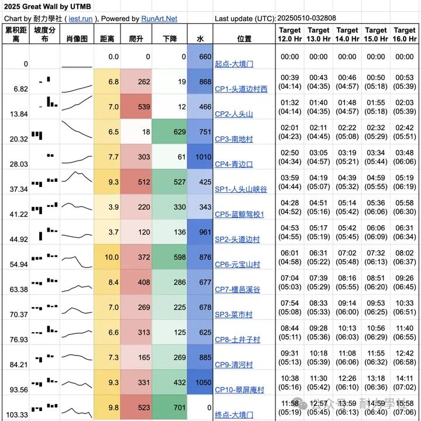

*2025 大境门 100K 样表*

跑表大致分为两部分，以 CP 点的名字列为界：

- 左边为赛道统计数据，包括分段距离、爬升、下降，以及累积距离。同时提供坡度分布和肖像图，让选手对赛道类型有一个直观了解。
- 右边为配速计划。通常包括五列，跑者的预期目标放在中间，左右各加上两列作为超速和失速的参考。配速计划中的指标，根据跑者习惯进行客制化。一般采用较多的是累积时间和分段等效配速。通过累积时间，选手可以在到达 CP 点时，快速比对，了解比赛进度，评估体能状态。

### 基础数据

跑表左边包括累积距离，分段距离、爬升、下降等基础数据，与跑者在常用运动手表、运动软件中见到的一致。

### 肖像图

表格中的分段赛道肖像图，提供了一个对赛道的直观感受。在同样的距离、爬升条件下，赛道的起伏顺序不同，也会影响体能分配。通过查看肖像图，选手可以对未来赛段建立预期。

### 坡度分布

坡度的定义是，垂直位移 / 水平位移。坡度分布一列，是一个直方图（histogram）。

坡度分布一列，可视化了爬升和下降的分布。有 7 个柱子，从左到右分别是 7 个区间所占的比例为：

- (-inf,-15]
- (-15,-10]
- (-10,-5]
- (-5,5)
- [5,10)
- [10,15)
- [15,inf)

在表格中展示的时候，我们将中间的柱子（即坡度 -5% ~ 5% 之间）留白，便于区分下降（左侧）和爬升（右侧）。

通常来说，坡度在 -5% ~ 5% 之间的赛道是可跑的。当爬升 >15% 时，就要使用如 PowerHike 等技巧。另外，要格外注意最左侧柱子较长的，意味着坡度 <-15% 的陡下坡较多。这时候的下降，不但起不到加速的作用，还会因为每一步的刹车，导致更多额外的体能开销。

### 水

耗水量的折算。是根据距离、爬升，假设平路每 10K 消耗 700mL。这个数值提供一个基准参考，让选手可以了解到前后分段耗水量的相对差异，而不是一个绝对的耗水量推荐。在实践中，依据跑者体质、气温、湿度等因素的不同，每 10K 耗水量从 200mL 到 2L 不等。

如需获得相对准确的耗水量，并加入到跑表中，需要选手提前用近似赛道的环境自我测试，并通过做表工具调整基础耗水量（即前面的每 10K 消耗 700mL）。

### 配速参考

现在进入到跑表的右半部分。依据设计师的偏好和版面大小，这里可能包括多列目标时间。常见的是为选手提供五列目标。选手在赛前制定的目标，放置在最中间，然后分别向左和向右，提供两组超速和掉速的选项。

每一列按照 CP 顺序，提供两组数据。主数据是累积时间，括号中的次级数据是本段的等效配速。在后续的制表原理章节，我们会更详细解释等效配速的概念。

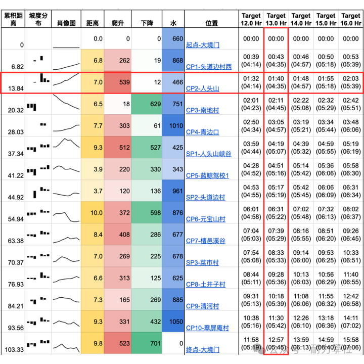

*读表方法：到达 CP 点后，进行时间比对，并调整接下来的比赛计划*

我们对超长距离越野跑的建议是，选手按照「体感一致」的标准，用轻松的配速开局，或者用自己赛前制定的目标列开局。

每个 CP 检查一下累积时间，目前在哪一列，就是按照目前体感坚持下去的预测时间，决定加速或者减速。

在上例中，选手跑到 CP2，累积用时 1:40，于是他可以推知，假设他能维持当前体感到比赛结束，则最终会以 13 小时完成。同时，他可以知道，如果要达到 13 小时的目标，接下来的 CP2-CP3 这一赛段，他可以适当放慢速度到 4:45。

如果到达某个 CP 时，发现累积时间超过了原来的目标，则需要据此将完赛目标右移一列，并对接下来的配速建立新的预期。

如果选手清楚自己的体能可以加速，并且知道上一段额外开销的时间，不是因为体能问题，而是因为一些突发原因，如上厕所、堵车等，则他可以参考左边的一列。即如果要追回到某个目标时间，他需要将等效配速提升到什么水平。

！注意！：请选手自行注意关门时间。配速表使用的掉速模型，只考虑体能分配，与比赛设计的关门时间是不同的。在使用接近关门时间的列时，选手需以关门时间为准。另外需要注意，在分波出发的比赛中，后出发的选手，所能使用的累积时间更少。跑表只做参考，请选手根据比赛规程安排计划。

## 二、制表原理

### 等效距离

在制作配速表的过程中，每 100m 爬升，通常折算成 1KM 的水平距离。这个距离叫做等效距离 （Eq. Dist.）。

比如，有段赛道，水平 1KM，爬升 50m，相当于 1.5KM 的等效距离。如果配速策略是 6 分配的等效配速，就意味着跑者通过这段的总时间是 1.5 x 6 = 9 分钟。

那么一段爬升折算成多少水平距离合适呢？

最佳情况，是假设跑者训练有素，坡度小于 5%，全程使用跑姿，没有任何肌力方面的短板。这个时候的 100m 爬升，折算成大约 450m 水平距离。450m 这个参数，可以从 VO2max 的归回公式中找到（ 🔗 超跑笔记 | 运动科学 101[1]；VO2max）。

对于越野新人来说，爬坡用到的肌群并未训练发达，会导致额外的体能开销，合理的折算可能是 100m 爬升折算成 1200m-1500m 水平距离。

在 RunArt.Net 提供的制表工具中，进阶选手可以根据自身能力，调整爬升的折算比例。

### 等效配速

通过等效距离（Eq. Dist.）和历经时间（Elapsed Time）折算出来的速度/配速，就是等效速度/ 配速。

目前主流的运动手表，都会给出等效配速（有时称等强配速）。需要注意的是，大多数手表并未公布等效配速的模型和参数，所以和配速表上的显示未必一致。由于越野赛道的起伏，山地 GPS 信号的不稳定性等，我们并不推荐选手时刻关注等效配速。

一般来说，选手可以在经历了几百米的平路后，看一下手表记录的配速。如果这个平路的配速和配速表推荐的区间配速一致，则只需要保持同样的体感，上坡自然减速、下坡自然加速，则可以按照计划的时间到达下一个 CP。

### 爬升误差

经常参与越野跑的朋友会发现，不同软件给出的距离大同小异，但在爬升上却容易出现很大的差异。核心原因，因为不同软件使用的平滑距离不同导致。

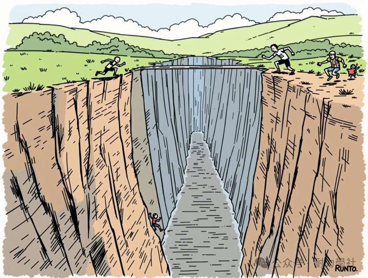

*AI 图，一个深坑*

我们举个例子，试想前面有一个坑：

- 我们先下到坑的底部，录得海拔 -100，再爬上来，录得海拔 0。这样的累积爬升就是 100m。
- 如果现在来了个巨人，根本不下坑，直接跨过去了，他前后脚录得的海拔都是 0，这样的累积爬升就是 0。

普通人走一步的距离，和巨人走一步的距离，两者不一样。这就相当于我们制表过程中调整的平滑距离。配速表的制作，默认使用 100m 的平滑距离，这也是一个可以客制化的参数。

### 爬升类型

配速表的制作中，只考虑了距离和爬升，因为这两个变量对能量消耗的影响最大。需要注意的是，除了每 100m 爬升折算的等效距离、爬升计算中因不同平滑距离带来误差外，不同的爬升类型，也对每个赛段的表现有影响。

以下图为例，三种颜色的线路，从运动手表录得的距离和爬升，都是相同的。但依据选手的水平和训练风格不同，他们会有不同的表现。

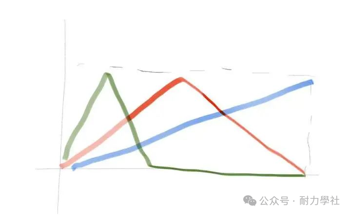

*相同的距离和爬升数据，不同类型的赛道*

在配速推算的过程中，我们未使用这部分信息，避免对赛道过度拟合。配速表左侧的坡度分布和赛道肖像，通过可视化的方式提供这部分信息，供选手综合评判。

### 掉速曲线

Peter Riegel 公式的核心思想是，在耐力运动中，随着距离增长，运动员的平均速度的会降低，但降低的幅度会随着距离增长而变小。

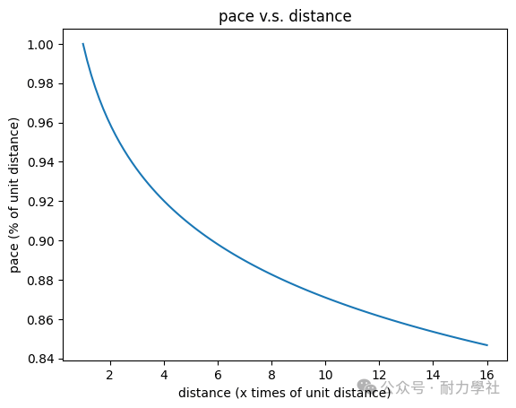

Peter Riegel formula 图示（以 8% 为例）

例如，在较优的体能分配下，运动员的前 10K，按照 6:00 的等效配速推进；那么他在 20K-40K 的区间，等效配速降低 8%，即 6:28；在 40K-80K 的区间，等效配速再次降低 8%，即 6:57。

注意，这里的 8% 是一个经典参数，在长距离越野跑中颇为有效。实践中，根据运动员自身的水平和赛道特征，一般可在 1%-15% 调整。如在相对平坦的「美式越野」中，WSER 的头部完成者，掉速参数小于 1%。而在经典的香港 100 中，头部完成者的掉速参数在 6%-8%。

运动员可以根据自身情况，对此进行客制化。如 RunArt.Net 网站，可提供全面客制化的工具。

### 休息时间

在普通版的配速表中，我们并 *没有* 加入休息时间，即选手需要按照出站时间去解读表格中的累积时间一列。

在超长距离比赛中，可能涉及大休、换装等，休息时间较长的检查站。进阶的选手可以通过 RunArt.Net 提供的工具，加入不同的休息时间。

对于超过百英里的比赛，选手可能需要制作”多段表“，这也超过本文的讨论范围。感兴趣的跑者，都可以到耐力学社的开放群组中进行讨论。

## 三、目标设定

掌握了体感一致配速表后，相信各位选手都可以胸有成竹地完成比赛。

注意到配速表的大前提：选手已经对自己体能和目标成绩有清晰的认知。在这个大前提下，配速表通过一个简单模型，推荐出一份分段计划。

实践过程中，比较常见的问题是，选手并不了解自己的体能状况。又或者是第一次尝试某种新的距离，设定了过于激进的目标。最后结果是，在前面几个 CP，按照某一列的配速完成，但突然出现断崖似的掉速，目标列只能一降再降。

我们推荐三种方法，来制定完赛目标。

### 跑力包线

根据跑力包线，从能量的角度，为自己找到目标的上界和下界。

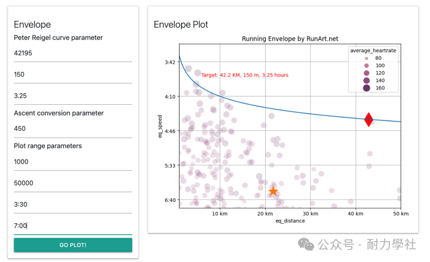

*跑力包线 (Envelope）图，用于跟踪训练进度和制定合理比赛目标*

跑力包线，是一组散点图加上按 Peter Riegel 公式绘制的边界。如果选手要在某个赛道上达到某个成绩，可以通过 PR 公式推算出他在不同等效距离下，所应该达到的平均速度。通过比对过往训练记录，即紫色的散点是否围绕蓝色的 PR 曲线，则可以知道该目标是否是合理的。

### 训练肖像

从跑力包线得到了能量角度的指导后，选手可以根据训练肖像，进一步微调比赛目标。

选手也可以根据未来目标比赛的赛道类型，提前进行适应训练。

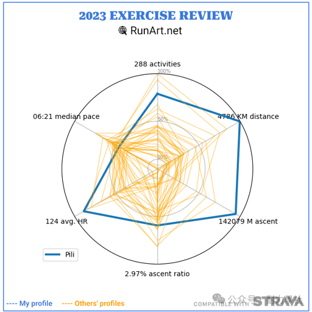

我的 2023 训练肖像 / 橙色为其他人的训练肖像 / 来看看你在跑团中的位置吧

### UTMB/ITRA 积分

最后，选手可以使用 UTMB/ ITRA Index，来指导自己制定目标。这些 Index 提供了一个统一的参考标准。选手可以找到和自己 UTMB index 接近的跑者，并查看他们过去在本比赛的成绩，以此为自己选定合适的完赛时间目标。

### 比赛参考

以百公里为例，如果选手已经跑过香港 100，则可以通过回归公式得到宁海 100 的目标。注意历史数据中吸纳了很多变量，包括地形、天气等不同的因素。受到过去几年疫情的影响，有一些经典比赛的时间进行过更改，如秋季赛改春季赛，所以横向对比的时候，并非一致的比较。如果选手有更具体的信息，可以查找路况、天气的类似比赛，统计出难度系数，这样就可以用自己跑过的比赛，去推演未跑的比赛的目标成绩。

DUV 是一个丰富的超跑数据库，通过它的数据，可以统计出比赛间的难度系数。

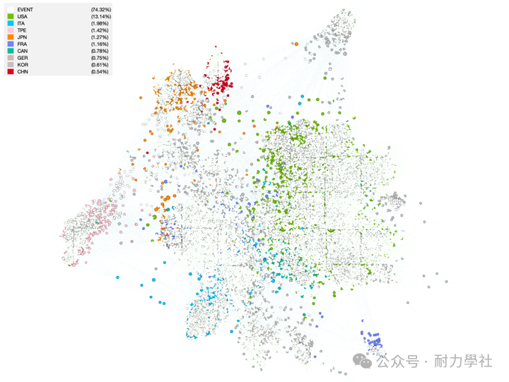

世界超跑地图 / 数据来自 DUV: 🔗 https://statistik.d-u-v.org/ [2] / 图源：pwords《港百目标设定的两种方法》

通过比赛历史数据，我们可以统计出难度系数，生成如下的对照表。比如一位跑者 16 小时完成港百，那么他完成宁海 100 的平均时间是 15.3 小时。

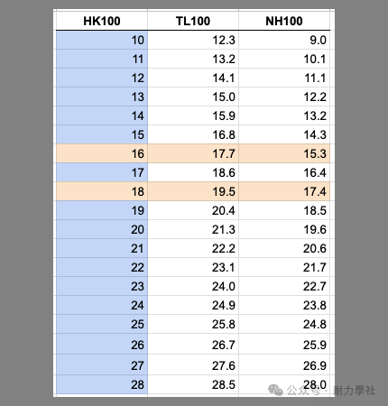

*比赛完成时间对照表*

## 四、加入社区

### 普通用户

主要使用配速表的朋友，欢迎加入耐力学社各地的群组，参与耐力科学的讨论，分享比赛资讯，找到训练伙伴。可以在各个耐力学社群组，询问配速表的制作情况。

群组公约：

https://hupili.net/article/deed-of-chat-groups/

### 进阶用户/ 布道者

喜欢数据驱动的朋友，可以进入配速表的专项交流群。在这里分享有关配速表的反馈，帮助我们改进。欢迎有关配速表功能的讨论，使用配速表进行比赛覆盘，共同定义出配速表的下一个版本。表哥会在这个群组亲自回答关于配速表的问题。

如果你认识的朋友，可能是 Power User、设计师、工程师、布道者，请向我们推荐。

配速表专项讨论群

### 做表师

登记入口：

https://runart.net/ocean/runart-pace-chart

登记后，我们不定期会处理该表单，进行以下操作：

- 加入到 gpx-plan@ 邮件组，可以找到有关做表资料的历史记录
- 开放 RunArt.Net 做表工具的使用权限
- 发送有关做表、读表工作坊的信息
- 成功做表并向社区发布的做表师，可以获得「社区贡献者」资质，获得每月 Carbon 的额度，用于解锁 RunArt.Net 平台上的各项功能

做表师会面临非常多的困难！！

越野赛事的路线径文件和路线数据，有你想象不到的麻烦。

随着做表师的升级，可以解锁神秘功能！！解锁过的做表师，都懂的。

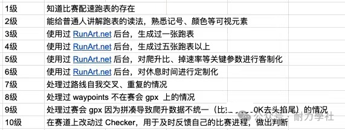

做表师打级之路

## 五、版权声明

### 免费和开放的知识传播

体感一致配速方案，由表哥提出，最初在公众号 pwords 发布，使用 CC4.0 协议，这意味着你可以使用该思想，制作自己的配速表，或编写相应的软件，生成配速表。这些衍生操作，都无需支付费用，也不会有人为使用配速表的结果负责。唯一条件是 CC4.0 中有关 attribution 的事项。指明来源，不仅是对作者的尊重，也是对下游的读者的负责，为有好奇心的读者，提供一个溯源的机会，避免断章取义，让社区更充分地了解配速表的优势和劣势，明白这套方法的适用场景，以便用户做出合理的判断。

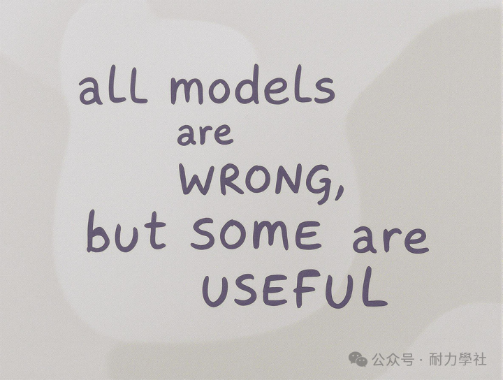

Motto，by 统计学家 George Box

### 有限度的工具使用

RunArt.Net 汇集了表哥的超跑艺术作品和数据工具，为跑者提供一站式数据集成、可视化、分析的服务。RunArt.Net 的部分功能，如 Firefly，通过 GitHub 的代码仓库 irunart 进行开源。已经开源的部分，任何人可遵循开源协议进行使用。未开源的部分，不提供 SLA，并保留所有权利，All Rights Reserved。这意味着，通过 RunArt.Net 的制表工具（gpx_plan），生成的配速表格 / 图像/ 中间数据，如无特别声明或约定，RunArt.Net 保留了所有权利。

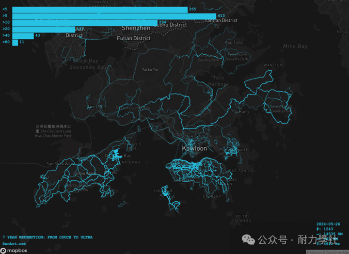

7 Years Redemption - 超跑可视化，ChinaVis 2024 艺术项目展出作品

### 免费赋能中文社区

「跑表」的开源协议：耐力学社作为 RunArt.Net 在中文社区的合作伙伴，对 gpx_plan 工具生成的配速表，拥有复制、传播、衍生的权利。由耐力学社组织和培训的做表师，默认遵循类 GPL 的强开源协议，即

使用 gpx_plan 工具生成的配速表，需要以开源的方式在社区流转，并且后续的衍生作品，也需要以 GPL 的协议进行开源。

除外：由 RunArt.Net 用户在 WTFPL 协议下生成的配速表，或 RunArt.Net 合作伙伴通过特别协议约定的，可免除类GPL 条款。

## 作者

### About Pili（表哥）：

来自 Google 的 GenAI 工程师。疫情后开始跑步，减重 20KG，通过研究和调整跑姿，从跑 3K 膝盖痛，到无伤完成多项百英里越野跑。香港首位完成港百大满贯+渣打马拉松（234K） 四天连跑的跑者。耐力学社社长，《超跑笔记》作者，RunArt.Net 开发者，在香港中文大学、香港科技大学、香港城市大学、香港浸会大学、香港岭南大学，通过高桌晚宴、专题报告等形式，推广耐力科学和超跑文化。

### About 耐力学社（ iest.run）：

一个以数据和科技赋能的耐力运动社群。

愿景：通过科学的耐力训练，让每个人在事业和运动上都充满生命力。

耐力学社专注三大板块：社区、科技、赋能。

倡议：科学训练、理性比赛、终生运动。

2026 使命：共同构建耐力运动的公共数字空间

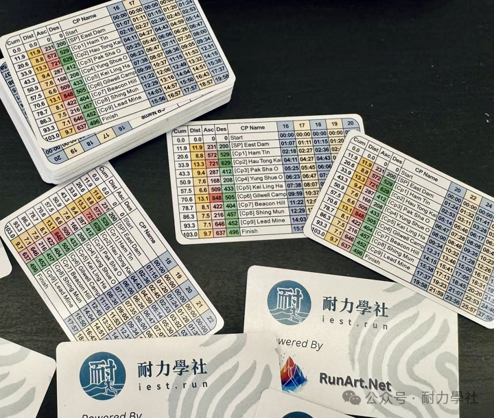

2025港百体感一致配速表免费发放

### MADE IN

科学训练 ⬤ 理性比赛 ⬤ 终生运动

耐力科技 ⬤ 超跑文化 ⬤ 开源社群

作者提示: 个人观点，仅供参考

## 参考链接

- [超跑笔记 | 运动科学 101][1]
- [DUV 超跑数据库][2]

[1]: https://mp.weixin.qq.com/s?__biz=MzA3Nzk3MTcwNw==&mid=2649389462&idx=1&sn=58a3c18d7d1a2a9ed7017e8431388cb9&scene=21#wechat_redirect
[2]: https://statistik.d-u-v.org/
